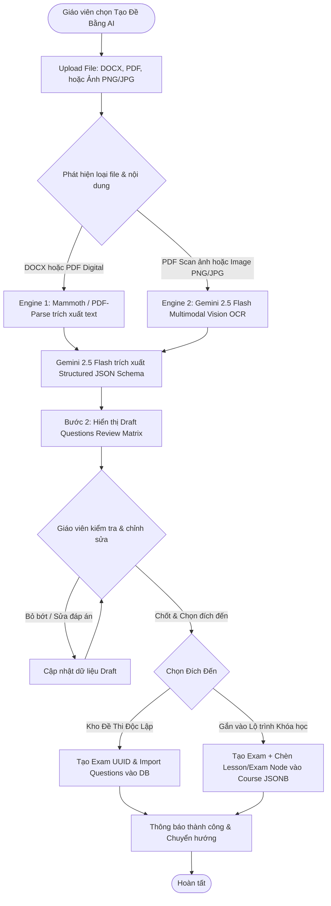
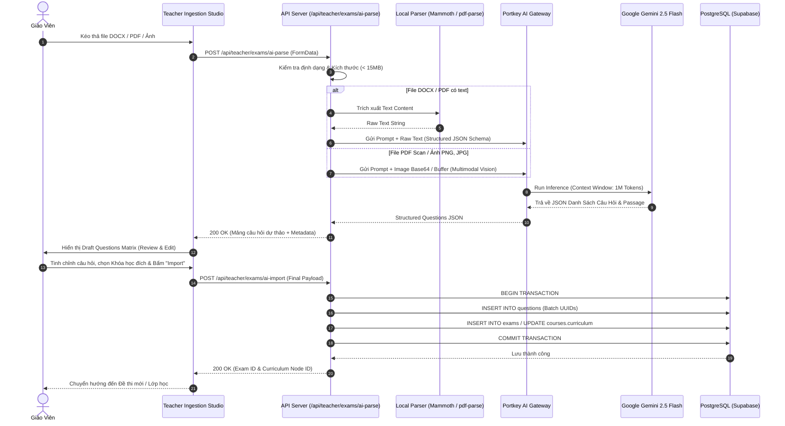
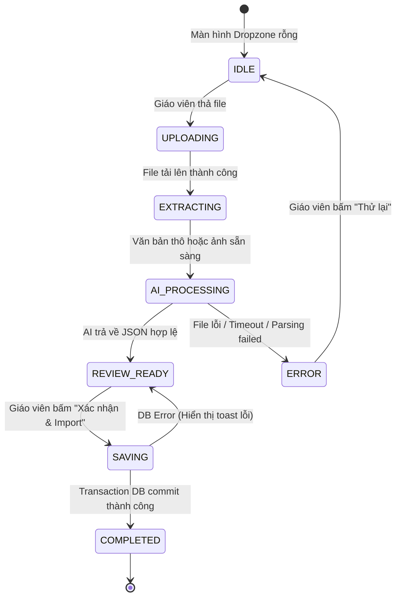

# Đặc tả Tính năng: AI Exam & Curriculum Ingestion Engine (FEAT-009)

> **Mã tính năng**: `FEAT-009`  
> **Trạng thái**: SPEC_APPROVED  
> **Phân hệ**: Teacher Portal & Admin Settings  
> **Tác giả**: Principal Solutions Architect & Lead Product Owner  
> **Phiên bản**: 1.0 (2026-10-05)

---

## 1. Tổng quan & Mục tiêu Nghiệp vụ

### 1.1. Bối cảnh & Bài toán Cốt lõi
Hiện nay, giáo viên muốn tạo đề thi 4 kỹ năng (Reading, Listening, Writing, Speaking) hoặc bài tập theo lộ trình khóa học phải tự nhập tay từng câu hỏi, từng đáp án và từng bài đọc vào form soạn thảo rất mất thời gian (trung bình 45–60 phút cho một đề IELTS 40 câu). Hầu hết giáo viên đều đã có sẵn đề thi dưới dạng file **Microsoft Word (`.docx`)**, **file PDF kỹ thuật số**, hoặc **tài liệu scan/ảnh chụp (`.png`, `.jpg`)**.

### 1.2. Mục tiêu Nghiệp vụ
* Cung cấp công cụ **AI Exam & Curriculum Ingestion Engine** cho phép giáo viên kéo thả file tài liệu lên hệ thống.
* Ứng dụng **kiến trúc động cơ kép (Dual-Engine Pipeline)**:
  * **Engine 1 (Fast Digital Parser)**: Trích xuất trực tiếp từ file `.docx` (qua thư viện `mammoth`) và file `.pdf` có text layer (qua `pdf-parse`).
  * **Engine 2 (Gemini Multimodal Vision OCR)**: Kích hoạt khi phát hiện file PDF scan ảnh hoặc ảnh chụp bài thi, truyền ảnh trực tiếp vào **Google Gemini 2.5 Flash Multimodal Vision** để đọc ngữ cảnh và bóc tách chữ.
* **Two-step Review Studio**: Giáo viên xem trước ma trận câu hỏi dự thảo (**Draft Questions Matrix**), chỉnh sửa hoặc bỏ bớt câu trước khi lưu.
* **Linh hoạt điểm đến**: Cho phép tạo đề thi độc lập trong Kho Đề Thi HOẶC bắn thẳng thành 1 nút Bài học/Đề thi mới trong cây Lộ trình khóa học (`curriculum` tree).
* **Dynamic AI Model Switcher**: Lưu cấu hình model vào hệ thống, cho phép Admin chuyển đổi sang các model thế hệ mới trong tương lai mà không cần sửa code.

---

## 2. Sơ đồ Luồng Tương tác (Flowchart & Sequence Diagram)

### 2.1. Sơ đồ Luồng Nghiệp vụ (Business Flowchart)



### 2.2. Sơ đồ Tuần tự Kỹ thuật (Sequence Diagram)



---

## 3. Đặc tả Giao diện & Ma trận 4 Trạng thái (UI Specs & Stitch Prompts)

### 3.1. Vị trí Giao diện
* **Vị trí**: Nằm trong trang **Soạn & Tạo Đề Thi** ([`app/teacher/tests/create/page.tsx`](file:///Users/namtran/Local%20Apps/learningsystem/app/teacher/tests/create/page.tsx)) dưới dạng Tab phương thức:
  * `Tab 1: Nhập tay thủ công (Manual Creator)`
  * `Tab 2: AI Ingestion Studio - Bóc tách từ File (DOCX/PDF/Ảnh) [Active New]`
* **Định danh màn hình**: `SCR-16: Teacher AI Exam & Curriculum Ingestion Studio`
* **Phong cách**: Tuân thủ chuẩn **Academic Precision** (Nền mềm `#f8f7f6`, thẻ trắng viền be `#d8c2b6`, điểm nhấn Burnished Sienna `#6d3807` và Ocean Blue `#004d5e`).

### 3.2. Ma trận 4 Trạng thái Giao diện (UI 4-States)
| Trạng thái | Biểu hiện Giao diện | Hành vi & Tương tác |
| :--- | :--- | :--- |
| **Loading State** | Hiển thị Stepper 4 bước thời gian thực kèm thanh đo tiến trình (0–100%) và animated waveform loader: <br>1. *Đang tải tệp lên server...*<br>2. *Đang trích xuất văn bản...*<br>3. *AI Gemini đang cấu trúc hóa câu hỏi...*<br>4. *Đang chuẩn bị bảng phê duyệt...* | Khóa nút Upload, hiển thị thời gian ước lượng (2–4 giây). |
| **Empty State** | Vùng kéo thả file Dropzone lớn viền nét đứt (`border-dashed border-[#d8c2b6]`), icon tài liệu sinh động, hỗ trợ click chọn file hoặc kéo thả file `.docx`, `.pdf`, `.png`, `.jpg`. | Hướng dẫn rõ ràng định dạng tệp và dung lượng tối đa 15MB. |
| **Error State** | Banner cảnh báo đỏ mềm (`bg-[#ffdad6] border-[#ba1a1a] text-[#ba1a1a]`): <br>• File bị mã hóa mật khẩu.<br>• File rỗng hoặc không tìm thấy câu hỏi.<br>• Quá giới hạn dung lượng (>15MB). | Có nút "Thử lại với tệp khác" hoặc "Chuyển sang nhập tay". |
| **Success State** | Bảng **Draft Questions Review Matrix**:<br>• Tổng số câu hỏi bóc tách thành công (badge xanh).<br>• Accordion phân tách theo từng Passage bài đọc dùng chung.<br>• Mỗi câu hỏi hiển thị dạng Card có nút Sửa/Xóa, pill loại câu hỏi, và badge đáp án đúng.<br>• Thanh công cụ chốt đích đến: Chọn Khóa học $\rightarrow$ Chọn Unit. | Nút CTA nổi bật: **"Xác Nhận & Tạo Đề Thi"** (`bg-[#6d3807]`). |

### 3.3. Prompt Chuẩn cho Google Stitch (Canvas Generation)
```text
Design a comprehensive, high-fidelity AI Exam Ingestion Studio for teachers titled 'AI Exam & Curriculum Ingestion Studio' adhering strictly to the Academic Precision design system (Deep Indigo #00236f / Burnished Sienna #6d3807, soft stone-tinted background #f8f7f6, crisp white cards, light neutral surfaces, Inter and Be Vietnam Pro typography, JetBrains Mono for question numbers).

Layout & Components:
1. Header Bar: Title 'AI Exam Ingestion Studio', subtitle 'Tự động tạo câu hỏi & lộ trình từ tài liệu Word, PDF hoặc Ảnh chụp', breadcrumb 'Tests / AI Ingestion'.
2. Left Pane (or Step 1 Container): Interactive Dropzone area with dashed borders, file upload pills for (.docx, .pdf, .png, .jpg), max 15MB badge, and an animated 4-stage processing stepper indicator.
3. Right Pane (Step 2 Review Matrix):
   - Summary stat bar: '40 Questions Extracted (100% Parsed)', '3 Reading Passages', 'Skill: Reading & Writing Academic'.
   - Grouped Card list: Reading Passage Stimulus container on top (previewing stimulus text with toggle expand/collapse), followed by numbered question items (Q1 to Q5) showing question prompt, 4 choices A/B/C/D with correct answer highlighted in emerald pill, and explanation text.
   - Quick action bar: Checkbox select all, 'Delete Selected', '+ Add Manual Question'.
4. Finalize & Destination Selector Footer Panel:
   - Radio option 1: 'Save to Standalone Exam Bank'
   - Radio option 2: 'Bind directly into Course Curriculum' (with dropdowns for Course: 'IELTS Master 7.5' and Unit: 'Unit 2: High-Scoring Argumentation').
   - Primary action button: 'Confirm & Import to System' (solid #6d3807, rounded-xl).
```

---

## 4. Tác động Cơ sở Dữ liệu (Database Schema Diff)

Tính năng không làm đảo lộn cấu trúc 11 bảng PostgreSQL UUID hiện có mà bổ sung 1 bảng cấu hình hệ thống và tái sử dụng các bảng chuẩn:

### 4.1. Bảng Mới: `system_settings` (Quản lý Cấu hình AI Model Động)
```sql
CREATE TABLE IF NOT EXISTS system_settings (
  key VARCHAR(100) PRIMARY KEY,
  value JSONB NOT NULL,
  description TEXT,
  updated_by UUID REFERENCES users(id) ON DELETE SET NULL,
  updated_at TIMESTAMPTZ DEFAULT CURRENT_TIMESTAMP
);

-- Seed giá trị mặc định cho Model AI bóc tách
INSERT INTO system_settings (key, value, description)
VALUES (
  'ai_exam_ingestion_model',
  '{"provider": "portkey", "model": "gemini-2.5-flash", "temperature": 0.1, "max_tokens": 8192}'::jsonb,
  'Mô hình AI sử dụng để bóc tách câu hỏi từ file DOCX/PDF/Ảnh'
) ON CONFLICT (key) DO NOTHING;
```

### 4.2. Tác động đến các Bảng Hiện Có
* **`questions`**: Tiếp nhận các bản ghi câu hỏi mới với đầy đủ `skill`, `category`, `prompt`, `stimulus_text`, `options`, `content` (gồm `correct_answer`, `explanation`).
* **`courses`**: Cột `curriculum` (JSONB) được cập nhật thêm nút bài học/đề thi mới nếu giáo viên chọn gắn vào Unit.
* **`ai_usage_logs`**: Ghi nhận số tokens và chi phí trích xuất tài liệu theo `teacher_id`.

---

## 5. Hợp đồng Dữ liệu API (API Contracts)

### 5.1. Endpoint 1: Bóc tách Tài liệu (Parse Document)
* **Method**: `POST`
* **Route**: `/api/teacher/exams/ai-parse`
* **Content-Type**: `multipart/form-data`
* **Request**:
  * `file`: Binary file (`.docx`, `.pdf`, `.png`, `.jpg`, `.jpeg`), tối đa 15MB.
  * `targetSkill`: Optional string (`"Auto" | "Reading" | "Listening" | "Writing" | "Speaking"`).
* **Response (200 OK)**:
```json
{
  "success": true,
  "fileName": "IELTS_Reading_Test_01.docx",
  "fileType": "docx",
  "engineUsed": "DIGITAL_PARSER_GEMINI",
  "questionsCount": 40,
  "passagesCount": 3,
  "extractedData": {
    "examTitle": "IELTS Academic Reading Practice Test 1",
    "suggestedDurationMinutes": 60,
    "questions": [
      {
        "tempId": "temp_q_1",
        "number": 1,
        "skill": "Reading",
        "category": "READING_MULTIPLE_CHOICE",
        "prompt": "What is the main topic discussed in paragraph A?",
        "stimulus_text": "The secret life of the subterranean rainforest...",
        "options": [
          { "key": "A", "text": "Biodiversity in underground ecosystems" },
          { "key": "B", "text": "Deforestation in Amazon basin" },
          { "key": "C", "text": "Soil acidification" },
          { "key": "D", "text": "Urban infrastructure" }
        ],
        "content": {
          "correct_answer": "A",
          "explanation": "Paragraph A explicitly discusses biodiversity beneath the canopy."
        }
      }
    ]
  }
}
```

### 5.2. Endpoint 2: Import & Lưu vào Hệ thống (Finalize Import)
* **Method**: `POST`
* **Route**: `/api/teacher/exams/ai-import`
* **Content-Type**: `application/json`
* **Request Payload**:
```json
{
  "examTitle": "IELTS Academic Reading Test 1",
  "durationMinutes": 60,
  "destination": {
    "type": "COURSE_CURRICULUM",
    "courseId": "c001a1b2-...",
    "unitId": "unit_2"
  },
  "questions": [
    {
      "skill": "Reading",
      "category": "READING_MULTIPLE_CHOICE",
      "prompt": "What is the main topic discussed in paragraph A?",
      "stimulus_text": "The secret life of the subterranean rainforest...",
      "options": [...],
      "content": {
        "correct_answer": "A",
        "explanation": "..."
      }
    }
  ]
}
```
* **Response (201 Created)**:
```json
{
  "success": true,
  "examId": "e1122334-...",
  "courseId": "c001a1b2-...",
  "curriculumItemId": "cur_exam_9921",
  "importedQuestionsCount": 40,
  "message": "Đã tạo đề thi và liên kết thành công vào lộ trình khóa học!"
}
```

### 5.3. Endpoint 3: Quản trị Cấu hình Model AI (Admin Settings)
* **Method**: `GET` / `PUT`
* **Route**: `/api/admin/settings/ai-model`
* **RBAC**: Yêu cầu `role === 'ADMIN'`.

---

## 6. Quy tắc Nghiệp vụ & Máy Trạng thái (Business Rules & State Machine)

### 6.1. Quy tắc Nghiệp vụ (Business Rules)
* **`BR-INGEST-01` (Kích thước & Định dạng File)**: Hệ thống từ chối các file không thuộc `.docx`, `.pdf`, `.png`, `.jpg`, `.jpeg` hoặc dung lượng vượt quá **15 MB**.
* **`BR-INGEST-02` (Dual-Engine Fallback)**: Nếu file PDF có độ dài văn bản trích xuất được $< 50$ ký tự $\rightarrow$ Tự động coi là PDF scan ảnh và chuyển sang **Engine 2 (Gemini Multimodal Vision OCR)**.
* **`BR-INGEST-03` (Giới hạn Câu hỏi)**: Mỗi lần bóc tách tối đa **50 câu hỏi** để đảm bảo thời gian xử lý dưới 10 giây và ngăn ngừa nghẽn RAM máy chủ.
* **`BR-INGEST-04` (Liên kết Đoạn văn Chung)**: Các câu hỏi thuộc cùng một bài đọc bắt buộc phải kế thừa cùng một chuỗi `stimulus_text` để đảm bảo hiển thị đồng bộ ở màn hình làm bài Split-screen của học sinh.
* **`BR-INGEST-05` (Tính Toàn vẹn Transaction)**: Thao tác tạo câu hỏi + tạo đề thi + chèn vào lộ trình khóa học phải thực hiện trong **1 PostgreSQL Transaction**. Nếu xảy ra lỗi giữa chừng, toàn bộ thay đổi bị rollback.
* **`BR-INGEST-06` (Dynamic Model Precedence)**: Model xử lý luôn ưu tiên đọc từ bảng `system_settings.ai_exam_ingestion_model`; nếu cấu hình bị lỗi, tự động fallback về biến môi trường `DEFAULT_AI_MODEL`.

### 6.2. Máy Trạng thái Bóc tách (Ingestion State Machine)


---

## 7. Ma trận Ca Kiểm thử (Test Cases Matrix)

| Test ID | Tên Ca Kiểm Thử | Điều Kiện Đầu Vào | Kết Quả Kỳ Vọng | Mức Độ |
| :--- | :--- | :--- | :--- | :--- |
| `TC-INGEST-01` | Bóc tách file DOCX chuẩn 40 câu IELTS | File `.docx` 40 câu trắc nghiệm + 3 bài đọc | Trích xuất thành công 40 câu, tách đúng 3 đoạn văn `stimulus_text`, hiển thị bảng Review. | **Blocker** |
| `TC-INGEST-02` | Bóc tách file PDF kỹ thuật số (Text Layer) | File `.pdf` Cambridge IELTS có văn bản | Engine 1 trích xuất thành công nội dung chữ trong vòng dưới 3 giây. | **Critical** |
| `TC-INGEST-03` | Xử lý file PDF scan ảnh hoặc ảnh chụp bài thi | File `.pdf` scan không có text layer hoặc ảnh chụp `.png` | Tự động kích hoạt Engine 2 (Gemini Multimodal Vision OCR) và trả về câu hỏi chính xác. | **Critical** |
| `TC-INGEST-04` | Import đề thi gắn vào Khóa học cụ thể | Chọn Khóa học `IELTS Master 7.5` và `Unit 2` | DB tạo mới bản ghi `exams`, cập nhật cột `curriculum` của `courses` có thêm nút Exam mới. | **Blocker** |
| `TC-INGEST-05` | Thay đổi AI Model từ tài khoản Admin | Admin đổi model sang `gemini-2.5-pro` qua API settings | Lần bóc tách tiếp theo sử dụng đúng model `gemini-2.5-pro` mà không cần khởi động lại server. | **Normal** |
| `TC-INGEST-06` | Bảo vệ Dung lượng & File độc hại | File `.exe` đổi tên thành `.docx` hoặc file > 15MB | Bị chặn ngay tại tầng Validate API, trả về HTTP 400 kèm thông báo thân thiện. | **Critical** |

---

## 8. Kế hoạch Triển khai & Tiêu chuẩn Nghiệm thu (Tasks & DoD)

### 8.1. Danh mục Task Triển khai
1. **Task 1 (Database)**: Tạo bảng `system_settings` trong PostgreSQL và seed cấu hình model AI mặc định.
2. **Task 2 (Backend Parser Engine)**: Cài đặt `mammoth` và `pdf-parse`, xây dựng service bóc tách văn bản kép (Digital + Vision OCR).
3. **Task 3 (API Endpoints)**:
   - Xây dựng API `/api/teacher/exams/ai-parse`.
   - Xây dựng API `/api/teacher/exams/ai-import`.
   - Xây dựng API `/api/admin/settings/ai-model`.
4. **Task 4 (Frontend UI Studio)**:
   - Thêm Tab `AI Ingestion Studio` vào [`app/teacher/tests/create/page.tsx`](file:///Users/namtran/Local%20Apps/learningsystem/app/teacher/tests/create/page.tsx).
   - Thiết kế Dropzone kéo thả file chuẩn Academic Precision.
   - Xây dựng bảng **Draft Questions Review Matrix** (Accordion, edit, delete, preview split-screen).
5. **Task 5 (Admin UI)**: Thêm trường cấu hình Model AI trong trang Quản trị.

### 8.2. Tiêu chuẩn Nghiệm thu Đo lường được (Definition of Done - DoD)
* [ ] Lệnh cURL tải lên file `.docx` mẫu trả về mã `HTTP 200` với đầy đủ mảng `questions` có `stimulus_text` và `options`.
* [ ] Kiểm tra cơ chế tự động chuyển sang Multimodal Vision OCR khi tải lên file ảnh chụp `.png`.
* [ ] Giáo viên có thể bấm chỉnh sửa đáp án của câu hỏi bất kỳ trên giao diện Review Studio.
* [ ] Kiểm tra trong cơ sở dữ liệu: Sau khi bấm Import, bảng `questions` có thêm các bản ghi UUID mới và bảng `courses.curriculum` chứa đúng `exam_id` vừa tạo.
* [ ] TypeScript check `npx tsc --noEmit` đạt 0 lỗi.
