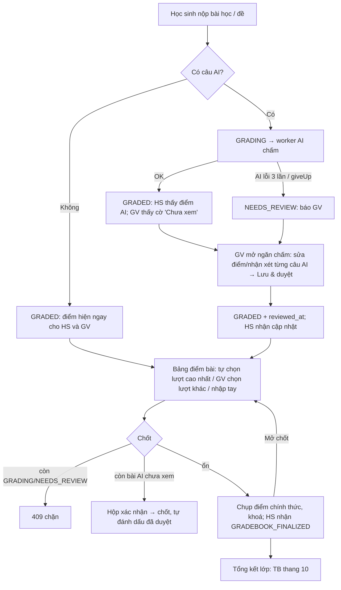

> Trạng thái: DONE (2026-11-06) · DEC-037 → DEC-041 · TASK-044 → TASK-047

# FEAT-014: Chấm & Bảng điểm theo lớp

## 1. Tổng quan & mục tiêu nghiệp vụ
Thay màn "Duyệt Điểm AI" (danh sách phẳng chỉ có bài nộp đề thi) bằng một hub chấm điểm **theo lớp → theo bài**:

- Mỗi lớp liệt kê các bài (bài học và đề thi) của lớp. Mỗi bài có **bảng điểm riêng** (học sinh × điểm).
- Bài chỉ có câu khách quan: điểm hiện ngay, không cần giáo viên làm gì.
- Bài có câu AI: AI chấm trước. Học sinh thấy điểm AI ngay, giữ nguyên DEC-021. Sau đó giáo viên xem bài làm, **sửa điểm và nhận xét từng câu AI**, thêm nhận xét chung.
- Giáo viên **chốt bảng điểm** từng bài. Điểm thành chính thức, được khoá lại và hiện trong tab "Bảng điểm" của học sinh.
- Giáo viên xem **bảng tổng kết lớp**: học sinh × các bài đã chốt, kèm cột trung bình quy về thang 10.

Hiện trạng trước FEAT-014 (khảo sát 05/11):
- Bài học không có màn cho giáo viên.
- AI chấm bài học lỗi thì cho 0 điểm âm thầm.
- Tab "Sổ điểm" ở trang lớp gọi `grade-override` thiếu `section_scores`, nên luôn trả 400.
- API `members` tính điểm từ bài nộp của mọi lớp.
- Người tạo đề thấy bài nộp của lớp giáo viên khác.

FEAT-014 sửa toàn bộ các điểm này.

## 2. Phân quyền
| Hành động | TEACHER | ADMIN | STUDENT |
| :--- | :--- | :--- | :--- |
| Xem hub, bảng điểm, bài làm; sửa điểm; chốt / mở chốt; tổng kết | Chỉ lớp có `classes.teacher_id = mình` | Mọi lớp | — |
| Xem bảng điểm chính thức | — | — | Chỉ dòng của mình, ở lớp đã ghi danh, chỉ các bài đã chốt |

- Người tạo đề **không** còn quyền với bài nộp của lớp giáo viên khác (DEC-038).
- Bài luyện tự do (`submissions.class_ref` rỗng) không hiện trong hub. AI vẫn chấm, học sinh vẫn xem lại được.
- Trang giáo viên không có link sang `/student/*` hay `/admin/*`. Thông báo cho học sinh trỏ tới trang học sinh; thông báo cho giáo viên trỏ tới trang giáo viên.

## 3. Luồng tương tác


## 4. Giao diện & 4 trạng thái UI
Menu giáo viên đổi "Duyệt Điểm AI" thành **"Chấm & Bảng điểm"**, vẫn trỏ `/teacher/grading`.

### SCR-31 `/teacher/grading` — Hub (viết lại)
- Thanh trên: chọn lớp (`?class=<id>`, mặc định là lớp đầu tiên), tab **Bài** | **Tổng kết lớp** (`?tab=summary`).
- Tab **Bài**:
  - Bộ lọc loại: Tất cả / Bài học / Đề thi. Ô "Chỉ bài còn việc" lọc bài có chờ duyệt, lỗi chấm hoặc chưa chốt.
  - Bảng các bài theo thứ tự lộ trình, đề giao riêng xếp cuối. Cột:
    - tên;
    - loại;
    - nhãn `KQ` (chỉ khách quan) hoặc `AI`;
    - đã nộp / sĩ số;
    - chờ duyệt (AI đã chấm, chưa xem);
    - cần chấm tay (`NEEDS_REVIEW`);
    - đang chấm;
    - trạng thái `Mở` / `Đã chốt dd/mm`.
  - Bấm một dòng thì sang SCR-51.
- Tab **Tổng kết lớp**:
  - Bảng học sinh × các bài **đã chốt**. Mỗi ô ghi điểm gốc (vd `6.5/9`, `82%`) và điểm thang 10.
  - Cột cuối là trung bình thang 10. Ô trống ghi "Chưa nộp".
  - Có hàng trung bình của từng bài.
- 4 trạng thái:
  - Đang tải: skeleton bảng.
  - Rỗng: chưa có lớp thì ghi "Bạn chưa có lớp nào", **không** link sang trang khác ngoài `/teacher/classes`. Lớp chưa có bài thì ghi "Lớp chưa có bài học/đề nào trong lộ trình hoặc được giao".
  - Lỗi: hộp đỏ kèm nút "Thử lại".
  - Thành công.

### SCR-51 `/teacher/grading/[classId]/[kind]/[itemId]` — Bảng điểm một bài (mới)
`kind` là `lesson` hoặc `exam`.
- Đầu trang:
  - tên bài, loại, lớp, chuẩn chấm (với đề);
  - trạng thái chốt;
  - nút **Chốt bảng điểm** hoặc **Mở chốt**;
  - link quay lại hub (`/teacher/grading?class=…`).
- Bảng: mỗi học sinh ghi danh một dòng.
  - Đề thi: cột từng phần kỹ năng theo `standard_snapshot.sections`, cột Tổng và Đạt/Chưa.
  - Bài học: cột Khách quan %, AI %, Tổng %.
  - Cột chung:
    - Thang 10;
    - số lượt;
    - trạng thái lượt được tính (`Đang chấm` / `Cần chấm tay` / `Chưa xem` / `Đã duyệt` / `Khách quan`);
    - nhãn "nộp sau chốt" nếu có lượt mới hơn mốc chốt.
  - Học sinh chưa nộp: ô "Chưa nộp". Giáo viên nhập tay được điểm thang 10 (vd 0) và ghi chú.
- Bấm một dòng thì mở **ngăn chấm** (drawer bên phải):
  - Danh sách lượt của học sinh. Lượt đang tính có dấu ★, nút "Tính lượt này" (đổi `chosen_attempt_id`) và "Bỏ chọn" (trở về tự lấy cao nhất).
  - Bài làm của lượt đang mở, theo từng câu:
    - Câu khách quan: chỉ xem, ghi đáp án học sinh, đáp án đúng và đúng/sai.
    - Câu AI: bài viết hoặc ghi âm của học sinh, điểm AI và nhận xét AI (chỉ đọc). Ô **Điểm giáo viên** có min/max/step theo phần (đề) hoặc band 0–9 bước 0.5 (bài học). Ô **Nhận xét giáo viên**.
  - Ô nhận xét chung cho cả bài.
  - Nút **Lưu & đánh dấu đã duyệt**.
- Validate:
  - điểm phải là số, nằm trong [min, max] và đúng bước. Sai thì báo lỗi ngay dưới ô, không gửi;
  - nhận xét tối đa 2000 ký tự.
- Bài đã chốt:
  - Mọi ô và nút sửa của các lượt nộp trước mốc chốt bị khoá. Có băng "Đã chốt — mở chốt để sửa".
  - Lượt nộp sau chốt vẫn chấm được nhưng không đổi điểm chính thức.
- Hộp xác nhận khi chốt: "Còn N bài AI chưa xem. Vẫn chốt theo điểm hiện tại?"
- 4 trạng thái:
  - Đang tải: skeleton.
  - Rỗng: "Lớp chưa có học sinh".
  - Lỗi: 403/404 thì ghi "Không tìm thấy bài trong lớp của bạn". 409 khi chốt thì hiện danh sách học sinh còn đang chấm hoặc cần chấm tay.
  - Thành công: toast.

### SCR-21 `/teacher/classes/[classId]` (sửa)
Bỏ tab "Sổ điểm" (ma trận đề giao dùng trường cũ). Thay bằng:
- tab **Đề giao**, giữ chức năng giao/gỡ đề và xem đề;
- nút **Mở bảng điểm** trỏ `/teacher/grading?class=<classId>`.

### SCR-11 `/student/class/[classId]` (sửa)
- Thêm tab **Bảng điểm** (`?tab=gradebook`): mỗi bài đã chốt một dòng, gồm tên, loại, điểm gốc, thang 10, nhận xét chung và ngày chốt. Dòng cuối là trung bình.
- Rỗng: "Giáo viên chưa chốt bài nào".
- Có 4 trạng thái như trên.

### SCR-14 / `/student/lesson/[lessonId]` (sửa)
- Xem lại đề và kết quả bài học hiển thị **điểm hiệu lực** (`score`). Câu nào giáo viên đã sửa thì có nhãn "Giáo viên chấm" và nhận xét giáo viên, kèm nhận xét chung.
- Bài học `NEEDS_REVIEW` ghi "Đang chờ giáo viên chấm phần tự luận".

## 5. Tác động dữ liệu (migration 017, `docs/db-migration-017-gradebook.sql`)
```sql
ALTER TABLE submissions     ADD COLUMN IF NOT EXISTS reviewed_at TIMESTAMPTZ,
                            ADD COLUMN IF NOT EXISTS reviewed_by VARCHAR(50);
ALTER TABLE lesson_attempts ADD COLUMN IF NOT EXISTS reviewed_at TIMESTAMPTZ,
                            ADD COLUMN IF NOT EXISTS reviewed_by VARCHAR(50),
                            ADD COLUMN IF NOT EXISTS teacher_feedback TEXT,
                            ADD COLUMN IF NOT EXISTS last_grading_error TEXT;
-- lesson_attempts.status thêm giá trị NEEDS_REVIEW (VARCHAR, không có CHECK)

CREATE TABLE IF NOT EXISTS class_grade_items (
  id VARCHAR(50) PRIMARY KEY,            -- "cgi_" + uuid
  class_id VARCHAR(50) NOT NULL,
  item_kind VARCHAR(10) NOT NULL,        -- LESSON | EXAM
  item_id VARCHAR(50) NOT NULL,          -- lessons.id | exams.id
  finalized_at TIMESTAMPTZ,              -- NULL = đang mở
  finalized_by VARCHAR(50),
  reopened_at TIMESTAMPTZ,
  created_at TIMESTAMPTZ DEFAULT NOW(),
  UNIQUE (class_id, item_kind, item_id)
);
CREATE TABLE IF NOT EXISTS class_grades (
  id VARCHAR(50) PRIMARY KEY,            -- "cgr_" + uuid
  class_id VARCHAR(50) NOT NULL,
  item_kind VARCHAR(10) NOT NULL,
  item_id VARCHAR(50) NOT NULL,
  student_id VARCHAR(50) NOT NULL,
  chosen_attempt_id VARCHAR(50),         -- NULL = tự lấy lượt cao nhất
  manual_score10 NUMERIC,                -- GV nhập tay (ưu tiên hơn lượt)
  note TEXT,
  -- ảnh chụp lúc chốt (NULL khi chưa chốt / chưa nộp):
  attempt_id VARCHAR(50), raw_score NUMERIC, raw_max NUMERIC, score10 NUMERIC, passed BOOLEAN,
  finalized_at TIMESTAMPTZ,
  updated_at TIMESTAMPTZ DEFAULT NOW(),
  UNIQUE (class_id, item_kind, item_id, student_id)
);
CREATE INDEX IF NOT EXISTS idx_class_grades_student ON class_grades (student_id, class_id);
```

Mục AI trong `results[]` (cả `submissions` lẫn `lesson_attempts`) thêm các khoá JSON sau. Không cần migration.

| Khoá | Ý nghĩa |
| :--- | :--- |
| `ai_score`, `ai_feedback` | Bản gốc AI, không bao giờ bị ghi đè sau khi giáo viên sửa |
| `teacher_score`, `teacher_feedback`, `teacher_by`, `teacher_at` | Giáo viên sửa |
| `score` | Điểm hiệu lực = `teacher_score ?? ai_score` |

- Với đề, cấp mục là cả câu. Với bài học, cấp mục là `items[]` (band từng mục con), các khoá trên nằm ở từng phần tử `items[]`.
- Dữ liệu cũ thiếu `ai_score` thì coi `score` (đề) hoặc `band` (bài học) là `ai_score`. Không cần backfill.
- Bỏ đọc cột `teacher_review`, `final_score`, `ai_score`, `ai_feedback` ở SCR-21 (đều là cột di sản).

## 6. Hợp đồng API
Mọi route giáo viên dùng `requireRole(["ADMIN","TEACHER"])`. TEACHER không phải chủ lớp nhận 403. `kind` ngoài `lesson|exam` trả 400. Bài không thuộc lớp trả 404.

| Method | Route | Vào | Ra / lỗi |
| :--- | :--- | :--- | :--- |
| GET | `/api/teacher/grading/classes` | — | `{ classes: [{ id, name, student_count, pending_review, needs_review }] }` |
| GET | `/api/teacher/grading/classes/[classId]` | — | `{ class, items: [{ kind, id, title, source: ROADMAP\|ASSIGNMENT, has_ai, submitted, student_count, pending_review, needs_review, grading, finalized_at }] }` |
| GET | `/api/teacher/grading/classes/[classId]/summary` | — | `{ items: [{ kind, id, title, finalized_at }], students: [{ id, name, cells: { "<kind>:<id>": { raw_score, raw_max, score10, label } }, average10 }], item_averages }` |
| GET | `/api/teacher/grading/classes/[classId]/items/[kind]/[itemId]` | — | `{ item, columns, finalized_at, rows: [{ student, attempts: [{ id, status, score…, submitted_at, has_ai, reviewed_at, after_finalize }], counted_attempt_id, chosen_attempt_id, manual_score10, note, cell: { sections?, raw_score, raw_max, score10, state } }] }` |
| PUT | `/api/teacher/grading/classes/[classId]/items/[kind]/[itemId]/students/[studentId]` | `{ chosen_attempt_id?: string\|null, manual_score10?: number\|null, note?: string }` | 200 `{ row }` · 400 điểm ngoài [0,10] / lượt không thuộc học sinh-bài-lớp · 409 `GRADEBOOK_FINALIZED` |
| POST | `/api/teacher/grading/classes/[classId]/items/[kind]/[itemId]/finalize` | `{ confirmUnreviewed?: boolean }` | 200 `{ finalized_at, notified }` · 409 `{ code: "GRADING_PENDING", students }` · 409 `{ code: "UNREVIEWED", count }` khi chưa xác nhận · 409 `ALREADY_FINALIZED` |
| POST | `/api/teacher/grading/classes/[classId]/items/[kind]/[itemId]/reopen` | — | 200 · 409 khi chưa chốt |
| GET | `/api/teacher/grading/attempts/[kind]/[attemptId]` | — | `{ attempt, student, questions: [{ id, category, skill, prompt, stimulus, answer, result }], locked }`. Có đáp án vì người xem là giáo viên |
| PUT | `/api/teacher/grading/attempts/[kind]/[attemptId]` | `{ items: [{ question_id, item_key?, teacher_score: number\|null, teacher_feedback?: string }], feedback?: string }` | 200 `{ attempt }` (tính lại điểm, `reviewed_at`) · 400 điểm sai thang hoặc mục không phải AI · 409 `GRADEBOOK_FINALIZED` / lượt đang `IN_PROGRESS` hoặc `GRADING` |
| GET | `/api/student/classes/[classId]/gradebook` | — | `{ items: [{ kind, id, title, raw_score, raw_max, score10, passed, note, finalized_at }], average10 }`. Chưa ghi danh → 403 |
| POST | `/api/lessons/grade-async` (sửa) | `{ attemptId, giveUp? }` | AI lỗi 3 lần hoặc `giveUp` thì `NEEDS_REVIEW`, không cho 0 |

**Bỏ:** `GET /api/teacher/submissions`, `PUT /api/exam/grade-override`. Thay bằng các route ở trên.

**Sửa:** `GET /api/teacher/classes/[classId]/members` chỉ đếm và lấy điểm bài nộp có `class_ref = classId`.

**Thông báo:**

| Loại | Người nhận | Khi nào | Link | `ref_id` |
| :--- | :--- | :--- | :--- | :--- |
| `GRADEBOOK_FINALIZED` (mới) | Học sinh có ô không rỗng | Chốt; chốt lại thì cập nhật cùng dòng | `/student/class/[classId]?tab=gradebook` | `class_grade_items.id` |
| `LESSON_NEEDS_REVIEW` (mới) | Giáo viên lớp | Bài học chuyển `NEEDS_REVIEW` | `/teacher/grading/[classId]/lesson/[lessonId]` | — |
| `EXAM_NEEDS_REVIEW` (sửa link) | Giáo viên | Như cũ | `/teacher/grading/[classId]/exam/[examId]` | — |
| `EXAM_GRADED` | Học sinh | Như cũ, kèm khi giáo viên lưu sửa điểm (cập nhật cùng dòng) | Như cũ | Như cũ |

## 7. Quy tắc nghiệp vụ & máy trạng thái
- **BR-B01** Bài của lớp gồm:
  - `curriculum_items` loại `LESSON` hoặc `EXAM` thuộc `classes.course_id`;
  - mọi `class_assignments.exam_id` của lớp.

  Trùng nhau thì gộp theo (`kind`, `id`). Thứ tự: theo lộ trình trước, đề giao riêng sau.
- **BR-B02** Lượt thuộc bài trong lớp:
  - đề: `submissions.exam_id = itemId AND class_ref = classId`, trừ `IN_PROGRESS`;
  - bài học: `lesson_attempts.lesson_id = itemId AND class_id = classId`.
- **BR-B03** Lượt được tính của mỗi ô, theo thứ tự ưu tiên:
  1. `manual_score10` nếu có;
  2. `chosen_attempt_id` nếu có;
  3. lượt `GRADED` có điểm cao nhất (đề: `total_score`; bài học: `score_percent`), bằng điểm thì lấy lượt nộp sớm hơn.

  Không có lượt `GRADED` thì ô mang trạng thái của lượt mới nhất (`GRADING` / `NEEDS_REVIEW`), hoặc "Chưa nộp".
- **BR-B04** Điểm thang 10, làm tròn 0.1:
  - bài học: `score_percent / 10`;
  - đề: `percent / 10`, với `percent` lấy từ `submissionScore()` (`lib/score-display.ts`) theo `standard_snapshot`.
- **BR-B05** "Chờ duyệt" là lượt `GRADED` có ít nhất một mục AI và `reviewed_at IS NULL`. Bài chỉ có khách quan không bao giờ ở trạng thái chờ duyệt.
- **BR-B06** Giáo viên chỉ sửa được mục `kind = "AI"`. Thang điểm:
  - đề: [`min`, `max`] và `step` của phần (`standard_snapshot.sections[skill]`);
  - bài học: band 0–9, bước 0.5.

  `teacher_score = null` xoá phần sửa và quay về `ai_score`. Không bao giờ ghi đè `ai_score` hay `ai_feedback`.
- **BR-B07** Lưu sửa điểm thì tính lại điểm:
  - đề: chạy lại `tallyAndScoreSections` rồi `aggregateTotal`;
  - bài học: `earned` của mục = band / 9, tính lại `ai_earned` và `score_percent` (BR-L08).

  Sau đó đặt `reviewed_at = NOW()` và `reviewed_by`.
  - Lượt `NEEDS_REVIEW` chỉ chuyển `GRADED` khi mọi mục AI đều có `score`. Còn thiếu thì giữ `NEEDS_REVIEW` và lưu phần đã nhập.
  - Đề chuyển hoặc vẫn ở `GRADED` thì gọi `notifyExamGraded`.
- **BR-B08** Chốt một bài:
  - Có lượt nào của bài trong lớp đang `GRADING` hoặc `NEEDS_REVIEW` thì 409 `GRADING_PENDING`.
  - Còn ô có lượt được tính đang chờ duyệt mà không gửi `confirmUnreviewed: true` thì 409 `UNREVIEWED`. Có gửi thì đặt `reviewed_at` cho các lượt đó.
  - Qua được hai kiểm tra trên thì chụp `attempt_id`, `raw_score`, `raw_max`, `score10`, `passed`, `finalized_at` vào `class_grades` cho mọi học sinh ghi danh, kể cả ô rỗng (`score10 = NULL`). Đồng thời đặt `class_grade_items.finalized_at`.
  - Cả bước chụp chạy trong một giao dịch.
- **BR-B09** Bài đã chốt:
  - Mọi thay đổi `class_grades` của bài trả 409.
  - Sửa lượt có `submitted_at` (bài học: `created_at`) ≤ `finalized_at` trả 409.
  - Lượt nộp sau chốt vẫn chấm và sửa được, có nhãn "nộp sau chốt", không đổi ảnh chụp.
  - Mở chốt thì `finalized_at = NULL`, `reopened_at = NOW()`, học sinh không thấy bài đó nữa cho tới khi chốt lại.
- **BR-B10** Trung bình thang 10 của học sinh là trung bình cộng `score10` không rỗng trên các bài **đã chốt**, làm tròn 0.1. Không có bài nào thì để `null`. Ô "Chưa nộp" không tính, trừ khi giáo viên nhập tay.
- **BR-B11** Học sinh chỉ thấy bài đã chốt, chỉ dòng của mình, chỉ các trường trong ảnh chụp và `note`.
- **BR-B12** Chấm AI bài học lỗi sau 3 lần, hoặc worker `giveUp` (`MAX_DELIVERIES`), thì lượt chuyển `NEEDS_REVIEW` với `ai_earned = NULL`, `score_percent = NULL`, `last_grading_error`, và báo `LESSON_NEEDS_REVIEW`. Không cho 0 điểm (thay đoạn `return 0` cũ trong `callGradeWithRetry`).
- **BR-B13** Khi AI chấm xong một mục, ghi `ai_score` và `ai_feedback` cùng lúc với `score` (cả đề lẫn bài học).

```text
lesson_attempts.status (nộp) ─▶ GRADED | GRADING ─grade-async OK─▶ GRADED
                                         └─AI lỗi 3 lần / giveUp─▶ NEEDS_REVIEW ─GV chấm đủ mục AI─▶ GRADED
submissions.status      … NEEDS_REVIEW ─PUT /api/teacher/grading/attempts/exam/[id] (đủ mục AI)─▶ GRADED
reviewed_at             NULL ─GV lưu sửa / chốt có confirmUnreviewed─▶ thời điểm
class_grade_items       (chưa có / finalized_at NULL) ─finalize─▶ đã chốt ─reopen─▶ mở
```

## 8. Test case
| TC | Ca kiểm | BR |
| :--- | :--- | :--- |
| TC-B01 | TEACHER không phải chủ lớp gọi mọi route `/api/teacher/grading/**` → 403; người tạo đề không thấy bài lớp khác; STUDENT → 403 | BR-B01, DEC-038 |
| TC-B02 | Bài của lớp = lộ trình ∪ đề giao, không trùng; bài luyện tự do không xuất hiện | BR-B01, BR-B02 |
| TC-B03 | Ô lấy lượt cao nhất, hoà thì lượt sớm; `chosen_attempt_id` và `manual_score10` thắng theo thứ tự | BR-B03 |
| TC-B04 | Quy đổi thang 10: IELTS 6.5/9 → 7.2; bài học 82.5% → 8.3 (làm tròn 0.1) | BR-B04 |
| TC-B05 | Sửa câu AI đề: `ai_score` giữ nguyên, `score` = điểm GV, `section_scores` / `total_score` tính lại, `reviewed_at` đặt, `EXAM_GRADED` cập nhật cùng dòng | BR-B06, BR-B07 |
| TC-B06 | Điểm ngoài thang / sai bước / sửa câu khách quan → 400; `teacher_score: null` trả về điểm AI | BR-B06 |
| TC-B07 | Lượt `NEEDS_REVIEW` chấm thiếu mục vẫn `NEEDS_REVIEW`; đủ mục → `GRADED` | BR-B07 |
| TC-B08 | Chốt khi còn `GRADING` → 409 `GRADING_PENDING`; còn chưa xem → 409 `UNREVIEWED`; xác nhận → chốt, các lượt đó có `reviewed_at` | BR-B08 |
| TC-B09 | Sau chốt: PUT ô / PUT lượt trước mốc → 409; lượt sau mốc sửa được, ảnh chụp không đổi; mở chốt → HS không thấy bài | BR-B09 |
| TC-B10 | Trung bình bỏ ô trống, tính ô nhập tay 0 | BR-B10 |
| TC-B11 | HS gọi gradebook: chỉ bài đã chốt, chỉ dòng mình; lớp chưa ghi danh → 403; không lộ dòng HS khác | BR-B11 |
| TC-B12 | Bài học: `gradeOpenAnswer` ném lỗi 3 lần → `NEEDS_REVIEW`, `score_percent` NULL, không 0; `giveUp` → `NEEDS_REVIEW` một lần | BR-B12 |
| TC-B13 | AI chấm xong ghi `ai_score`/`ai_feedback`; dữ liệu cũ thiếu `ai_score` vẫn hiển thị đúng | BR-B13 |
| TC-B14 | `members` chỉ tính bài nộp của lớp đó | §6 |
| TC-B15 | Học sinh đã có điểm nhận `GRADEBOOK_FINALIZED`; chốt lại cập nhật cùng thông báo | §6 |
| TC-B16 | UI: hub đổi lớp qua `?class=`, tab tổng kết, drawer khoá khi đã chốt, hộp xác nhận chốt, không link `/student` `/admin` từ trang giáo viên | §4 |

## 9. Task triển khai & DoD
| TASK | Nội dung | Phụ thuộc | DoD |
| :--- | :--- | :--- | :--- |
| TASK-044 | Migration 017 (`docs/db-migration-017-gradebook.sql` + `ensureSchema`); `lib/gradebook.ts` (thuần: tập bài BR-B01, lượt được tính BR-B03, thang 10 BR-B04, áp sửa điểm + tính lại BR-B06/07, guard chốt BR-B08); grade-async đề & bài học ghi `ai_score`/`ai_feedback`; bài học `NEEDS_REVIEW` + `giveUp` trong worker (BR-B12) | — | TC-B03, 04, 06, 07, 12, 13 xanh |
| TASK-045 | API giáo viên `/api/teacher/grading/**`, API học sinh gradebook, thông báo `GRADEBOOK_FINALIZED` / `LESSON_NEEDS_REVIEW`, sửa link `EXAM_NEEDS_REVIEW`, sửa `members`, bỏ `teacher/submissions` và `exam/grade-override` (cập nhật test cũ dùng chúng) | 044 | TC-B01, 02, 05, 08–11, 14, 15 xanh |
| TASK-046 | UI giáo viên: SCR-31 hub + tổng kết, SCR-51 bảng điểm + drawer chấm; SCR-21 bỏ tab Sổ điểm, thêm "Mở bảng điểm"; đổi nhãn menu | 045 | TC-B16 xanh |
| TASK-047 | UI học sinh: tab Bảng điểm SCR-11; hiển thị điểm/nhận xét giáo viên ở SCR-14 và kết quả bài học; trạng thái `NEEDS_REVIEW` bài học | 045 | test UI học sinh xanh |

Lệnh xác minh mọi task: `npx vitest run && npx tsc --noEmit && npx next build`. Riêng TASK-045 kèm `tests/docs-sync.test.ts`.
