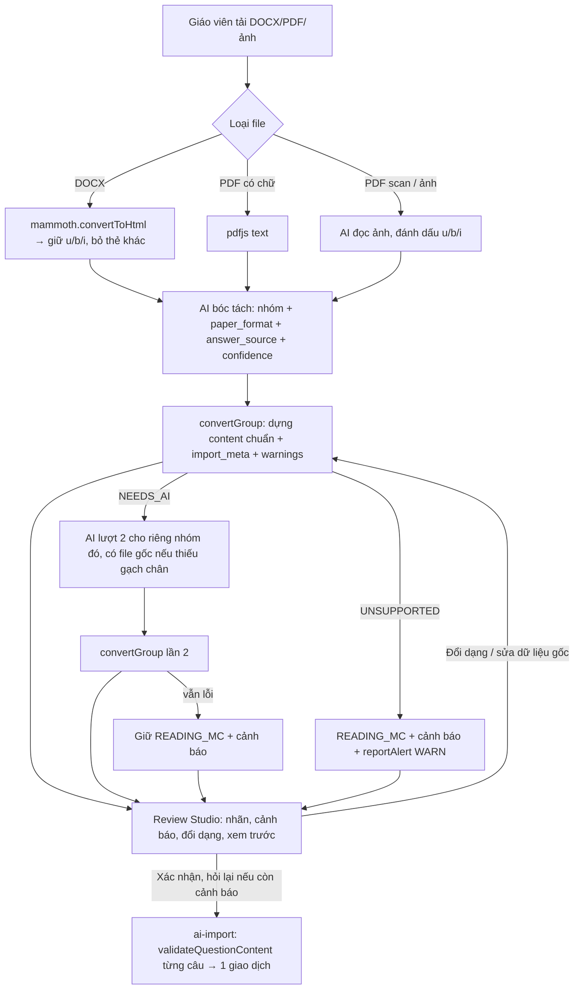

# FEAT-015: Chuyển đổi dạng câu hỏi khi AI nhập đề

> Trạng thái: SPEC_APPROVED (2026-11-23) · Quyết định: DEC-042 → DEC-046 (`docs/14-decisions.md`) · Phụ thuộc: FEAT-009 (AI nhập đề), FEAT-016 (cảnh báo admin)

## 1. Tổng quan & mục tiêu nghiệp vụ
Phần bóc tách đề của FEAT-009 (`lib/document-parser.ts`) đã chạy ổn, nhưng mọi câu đều bị quy về 3 dạng: `READING_FILL_IN` nếu category có chữ FILL/CLOZE/BLANK, `WRITING_ESSAY` nếu có ESSAY, còn lại là `READING_MC`. Đề giấy gần như luôn trình bày dưới dạng trắc nghiệm ABCD. Khi đưa lên hệ thống thì từng dạng phải chuyển sang đúng dạng câu hệ thống hỗ trợ (17 dạng, `lib/question-content-types.ts`).

**Lỗi đang có trong code (rà ngày 23/11/2026):**
- `ai-import` gán câu cloze `fill_subtype = INLINE_SELECT` và lấy nguyên văn đoạn văn làm `passage`. Code **không** tạo `inline_options_per_gap` và `correct_answers`.
- `lib/grading.ts` lấy cụm `(…)` trong `passage` làm đáp án, nên số thứ tự `(25)` bị coi là đáp án "25". Kết quả: học sinh không có phương án để chọn, và câu bị chấm sai.
- `normalizeStructuredResult` tự gán đáp án `"A"` khi AI không trả về đáp án.
- DOCX được đọc bằng `mammoth.extractRawText`, nên **mất gạch chân**. Các dạng phát âm, tìm lỗi sai, đồng nghĩa/trái nghĩa đều cần gạch chân.

**Mục tiêu:**
1. AI gắn nhãn **dạng câu trên giấy** (`paper_format`) cho từng câu con. Một **bộ chuyển đổi xác định** (`lib/question-conversion.ts`, hàm thuần, chạy được cả ở client và server) dựng content đúng chuẩn của từng dạng hệ thống (DEC-042).
2. Quy tắc ô trống: 1 ô dùng `OPTION_BANK`, từ 2 ô trở lên dùng `INLINE_SELECT`, hộp từ chung dùng `OPTION_BANK` chung (DEC-043).
3. Dạng chưa có trên hệ thống thì nhập tạm `READING_MC`, kèm cảnh báo cho giáo viên và báo admin qua FEAT-016 (DEC-044).
4. Giữ gạch chân, chữ đậm, chữ nghiêng từ file gốc và hiển thị được chúng ở câu con và phương án (DEC-045).
5. Lưu vết chuyển đổi trong `content.import_meta` (DEC-046).

Ngoài phạm vi: công cụ cũ `/admin/tests/import` (`parseExamRawTextWithAI` trong `lib/ai-engine.ts`); nhận diện audio cho Listening (câu Listening luôn có cảnh báo thiếu audio).

## 2. Phân quyền
Không đổi so với FEAT-009: `ai-parse` và `ai-import` cho `ADMIN` và `TEACHER` (`requireRole`); giáo viên dùng thử vẫn bị tính nội dung theo DEC-027. Cảnh báo admin do server tự gửi, giáo viên không thấy trang cảnh báo.

## 3. Luồng tương tác


## 4. Giao diện & 4 trạng thái UI
Màn hình: **SCR-24** `/teacher/library` (tab AI nhập đề, `components/teacher/AiExamIngestionStudio.tsx`) và SCR-23 `/teacher/tests/create` (cùng component). Không có màn hình mới.

| Trạng thái | Thay đổi |
| :--- | :--- |
| Đang tải | Thanh tiến trình thêm bước "Đang chuyển đổi dạng câu…" sau bước AI cấu trúc. |
| Rỗng | Giữ nguyên. |
| Lỗi | `ai-import` trả 400 `INVALID_CONTENT` → banner đỏ liệt kê số nhóm bị lỗi, cuộn tới nhóm đầu tiên. Lỗi AI lượt 2 không phải lỗi màn hình (nhóm đó rơi về trắc nghiệm kèm cảnh báo). |
| Có dữ liệu | Xem bảng dưới. |

Thẻ mỗi nhóm câu:
- Nhãn **"Trên giấy: <tên dạng giấy> → Hệ thống: <tên dạng hệ thống>"** (bảng §7.2), số câu gốc (vd "Câu 25–30") và độ tin cậy.
- **Huy hiệu cảnh báo** (amber; rose với `NO_ANSWER`), di chuột hoặc chạm để xem từng lý do (mã ở §7.3).
- Nút **Đổi dạng**: danh sách các dạng giấy dùng được cho nhóm. Chọn xong thì chạy lại `convertGroup` ngay trên trình duyệt, không gọi lại AI.
- Nút **Sửa**: sửa dữ liệu gốc (câu dẫn, phương án, đáp án, đoạn văn) rồi chuyển đổi lại. Đáp án chọn từ danh sách phương án.
- Nút **Xem như học sinh**: hiện `LessonPlayer` chỉ đọc, đã điền sẵn đáp án đúng, để giáo viên thấy câu sẽ hiển thị ra sao.

Thanh tóm tắt:
- "N nhóm · M câu gốc · K câu còn cảnh báo".
- Nếu tổng mục chấm khác số câu gốc thì hiện thêm **"Tổng điểm: X mục chấm (đề giấy: M câu)"** kèm chú thích (BR-I04).

Nút **Xác nhận & Tạo đề**:
- Còn câu `NO_ANSWER` → nút bị khoá, kèm câu "Chọn đáp án cho K câu trước khi nhập" (BR-I07).
- Còn cảnh báo khác → hộp thoại "Còn K câu cảnh báo sẽ được nhập dưới dạng tạm. Vẫn tạo đề?" với 2 nút *Quay lại sửa* / *Vẫn tạo đề* (BR-I08).

`LessonPlayer`: chữ câu con (`sub.text`) và phương án được hiển thị qua `sanitizeInlineHtml`, chỉ giữ `<u> <b> <strong> <i> <em> <br>`. Áp dụng cho bài học, đề thi, trang xem lại và Review Studio.

## 5. Tác động dữ liệu
Không thêm bảng hay cột. Chỉ thêm khoá JSON trong `questions.content`:

```ts
content.import_meta = {
  source: "AI_IMPORT",
  converter_version: 1,
  paper_format: PaperFormat,           // §7.2
  paper_numbers: number[],             // số câu trên đề giấy, vd [25,26,27]
  confidence: number,                  // 0–1, thấp nhất trong nhóm
  answer_source: "KEY" | "AI_SOLVED" | "TEACHER",
  warnings: { code: WarningCode; message: string }[]
}
```
- `sanitizeQuestionForStudent` **bỏ** `import_meta` trước khi gửi cho học sinh (BR-I10).
- Câu `READING_FILL_IN` / `LISTENING_FILL_IN` tạo từ nhập đề có `stimulus_text = NULL`, vì đoạn văn đã nằm trong `content.passage` (thay một phần BR-INGEST-04 của FEAT-009).
- Dữ liệu cũ không cần migration. Câu cloze đã nhập trước FEAT-015 vẫn chấm sai; giáo viên mở lại bằng trình soạn câu hỏi để sửa (ghi ở `docs/11` §4 D11).

## 6. Hợp đồng API
### 6.1 `POST /api/teacher/exams/ai-parse` (đổi phản hồi)
- Request giữ nguyên (multipart `file`, `targetSkill`). `maxDuration` nâng lên 120 giây.
- Phản hồi 200:
```json
{
  "success": true,
  "fileName": "de-thi.docx", "fileType": "docx", "engineUsed": "DIGITAL_PARSER",
  "groupsCount": 8, "questionsCount": 40,
  "extractedData": {
    "examTitle": "…", "suggestedDurationMinutes": 60,
    "groups": [ RawGroup ]
  },
  "conversion": {
    "converterVersion": 1,
    "groups": [ { "tempId": "group_3", "questions": [ ConvertedQuestion ], "warnings": [ … ] } ],
    "warningsCount": 3, "scoreItems": 41, "paperQuestions": 40
  }
}
```
- `RawGroup` là dữ liệu gốc theo đề giấy, client giữ lại để chuyển đổi lại:
```ts
{ tempId, groupNumber, skill, prompt, stimulus_html?: string, word_box?: string[],
  matching?: { left: {key,text}[]; right: {key,text}[] },
  sub_questions: { id, number, text_html, options: {key,text_html}[],
                   correct_answer: string | null, answer_source: "KEY"|"AI_SOLVED"|"NONE",
                   paper_format: PaperFormat, unsupported_reason?: string, confidence: number }[] }
```
- `ConvertedQuestion = { tempId, skill, category, prompt, stimulus_text: string|null, content }`. `content` đúng `CategoryContentMap[category]` và có thêm `import_meta`.
- Lỗi giữ như cũ (400 file sai hoặc quá 15MB, 500 qua `serverError` của FEAT-016). Mọi nhà cung cấp AI đều lỗi → 500 "AI đang bận, thử lại sau" và `reportAlert` ERROR nguồn `AI`.

### 6.2 `POST /api/teacher/exams/ai-import` (đổi request)
- Request: `{ examTitle, durationMinutes, destination, questions: ConvertedQuestion[] }`. Server **không** nhận dạng `sub_questions` thô nữa.
- Server chạy `validateQuestionContent(category, content)` cho từng câu. Có câu sai thì trả **400** `{ success:false, error:"Nhóm 3, 5 có nội dung không hợp lệ.", code:"INVALID_CONTENT", invalid:[{ index, tempId, reason }] }`, không ghi gì vào DB.
- Câu còn `correct_answer` rỗng (`NO_ANSWER`) → 400 cùng mã (BR-I07).
- Server dùng `skill`, `category`, `prompt`, `stimulus_text`, `content` như client gửi lên sau khi kiểm, và ghi đè `import_meta.source = "AI_IMPORT"`. Phần còn lại (giao dịch, gắn lộ trình, giới hạn dùng thử, quyền khoá học) giữ nguyên FEAT-009.

## 7. Quy tắc nghiệp vụ & máy trạng thái
### 7.1 Quy tắc
- **BR-I01** AI chỉ gắn nhãn `paper_format`, `answer_source`, `confidence` và trả dữ liệu gốc. Code `convertGroup(raw, override?)` dựng content. Cùng một đầu vào luôn ra cùng một kết quả (hàm thuần, không gọi mạng).
- **BR-I02** Một ô trống trong câu (gạch dưới `__`, `…`, `....`) dùng `READING_FILL_IN · OPTION_BANK`: `option_bank` gồm 4 phương án, `correct_answers = [đáp án]`. **Mỗi câu một bản ghi** (bank không dùng chung giữa các câu).
- **BR-I03** Từ 2 ô trở lên trong cùng một đoạn hoặc câu dùng `INLINE_SELECT`. `inline_options_per_gap[i] = { gap_index: i, options: 4 phương án của ô i }`, `correct_answers[i]` là chữ của phương án đúng. Đoạn cloze có ô đánh số `(n)`, `n.`, `__n__`, `[n]`, `(n) ____`, `____ (n)` → mỗi số câu là một ô.
- **BR-I04** Câu có nhiều ô mà phương án dạng cặp (`who / which`, `on – at`, `;`) và **cả 4 phương án tách được đúng k phần** → tách thành k ô `INLINE_SELECT`. Ô thứ i có các phần thứ i khác nhau (giữ thứ tự xuất hiện). **Mỗi ô 1 điểm**, nên câu đó thành k mục chấm (DEC-043, người dùng chấp nhận lệch điểm so với đề giấy). Không tách được thì giữ `READING_MC`, không cảnh báo.
- **BR-I05** Đề có hộp từ chung (`word_box`) → `OPTION_BANK` dùng chung cho cả nhóm, `option_bank = word_box`, đáp án lấy theo chữ.
- **BR-I06** Đoạn văn của câu điền ô trống được ghi theo dạng `(n) [đáp án]`. Ngoặc vuông có sẵn trong văn bản gốc được đổi thành ngoặc tròn **trước** khi chèn ô, để `parseFillInGaps` chỉ nhận đúng các ô. Số ô trong `passage` phải bằng `correct_answers.length` và bằng số mục `inline_options_per_gap` (nếu có).
- **BR-I07** Câu không có đáp án (`answer_source = NONE`) giữ `correct_answer = null` và có cảnh báo `NO_ANSWER`. **Không bao giờ tự gán "A".** Giáo viên phải chọn đáp án thì mới nhập được (client khoá nút, server trả 400). Đáp án do AI tự giải (`AI_SOLVED`) có cảnh báo `AI_SOLVED_ANSWER`.
- **BR-I08** Dạng chưa hỗ trợ (`UNSUPPORTED`: cần hình, cần bảng, dạng lạ) → `READING_MC` (hoặc `LISTENING_MC`) với phương án như trên giấy, cảnh báo `UNSUPPORTED_FORMAT`. Server gọi `reportAlert` mức WARN, nguồn `EXAM_IMPORT`, fingerprint `EXAM_IMPORT:UNSUPPORTED:<reason>`, chi tiết gồm mẫu nội dung nhóm tối đa 1.500 ký tự, đuôi file, `teacherId`; **không** gửi tên file. Không chặn việc nhập.
- **BR-I09** Nhóm mà code không dựng được (`NEEDS_AI`: không tìm thấy vị trí ô; dạng cần gạch chân mà không có `<u>`) được gọi AI lượt 2 riêng. Tối đa 10 nhóm mỗi file, chạy song song, mỗi lần tối đa 20 giây. Lượt 2 có kèm file gốc (PDF hoặc ảnh) nếu thiếu gạch chân. Vẫn không dựng được thì giữ `READING_MC` kèm cảnh báo `GAP_NOT_FOUND` hoặc `UNDERLINE_MISSING`, và `reportAlert` WARN `EXAM_IMPORT:CONVERSION_FAILED:<paper_format>`.
- **BR-I10** `import_meta` không bao giờ gửi cho học sinh (`sanitizeQuestionForStudent`).
- **BR-I11** Một nhóm lẫn nhiều dạng giấy thì được tách thành các khối liền nhau cùng dạng, giữ chung `prompt`. Nhóm cloze và nhóm hộp từ luôn tính theo cả nhóm.
- **BR-I12** Câu có `skill = Listening` dùng tiền tố `LISTENING_` cho MC, FILL_IN, ORDERING, MATCHING và luôn có cảnh báo `AUDIO_MISSING`.
- **BR-I13** `confidence < 0.6` → cảnh báo `LOW_CONFIDENCE`.
- **BR-I14** Chữ từ file gốc chỉ giữ các thẻ `<u> <b> <strong> <i> <em> <br>`, các thẻ khác bị bỏ, chỉ giữ nội dung chữ. Khi hiển thị dùng `sanitizeInlineHtml` (cùng bộ lọc với `sanitizeStimulusHtml`). Đáp án dùng để chấm luôn là chữ trơn: so sánh sau khi bỏ thẻ và chuẩn hoá khoảng trắng.

### 7.2 Bảng dạng giấy → dạng hệ thống (`PaperFormat`)
| `paper_format` | Trên giấy | Hệ thống | Ghi chú |
| :--- | :--- | :--- | :--- |
| `PRONUNCIATION` | Phần gạch chân phát âm khác | `READING_MC` | Cần `<u>` trong phương án |
| `STRESS` | Trọng âm khác | `READING_MC` | |
| `CLOZE_PASSAGE` | Đoạn văn có ô đánh số, mỗi ô ABCD | `READING_FILL_IN` · `INLINE_SELECT` (1 ô thì `OPTION_BANK`) | BR-I03, BR-I06 |
| `SENTENCE_BLANK` | Câu có 1 ô + ABCD | `READING_FILL_IN` · `OPTION_BANK` | BR-I02 |
| `SENTENCE_MULTI_BLANK` | Câu nhiều ô, phương án dạng cặp | `INLINE_SELECT` k ô, hoặc `READING_MC` | BR-I04 |
| `WORD_BOX` | Hộp từ chung | `READING_FILL_IN` · `OPTION_BANK` chung | BR-I05 |
| `SENTENCE_ARRANGEMENT` | Sắp xếp câu/ý a–e, đáp án là thứ tự | `READING_ORDERING` · `SENTENCE_ORDERING` | `correct_text` = các ý theo thứ tự đúng, bỏ nhãn a., b. Một ý chứa nhiều câu thì không tách được → `READING_MC` + `CONVERSION_FAILED` |
| `WORD_ARRANGEMENT` | Từ cách nhau bằng `/` | `READING_ORDERING` · `WORD_ORDERING` | `correct_text` = phương án đúng; tập từ phải khớp (bỏ dấu câu, không phân biệt hoa thường), lệch → `READING_MC` |
| `MATCHING` | Ghép cột trái – phải | `READING_MATCHING` | Mục bên phải thừa (nhiễu) bị bỏ, cảnh báo `DISTRACTORS_DROPPED` |
| `ERROR_IDENTIFICATION` | 4 phần gạch chân A–D trong câu | `READING_MC` | Cần `<u>` trong câu |
| `SYNONYM_ANTONYM` | Từ gạch chân, chọn đồng/trái nghĩa | `READING_MC` | Cần `<u>` trong câu |
| `READING_COMPREHENSION` | Đọc hiểu | `READING_MC` | Đoạn văn ở `stimulus_text` |
| `SENTENCE_TRANSFORMATION` | Câu gần nghĩa nhất | `READING_MC` | |
| `SENTENCE_COMBINATION` | Nối hai câu | `READING_MC` | |
| `DIALOGUE_RESPONSE` | Chọn câu đáp trong hội thoại | `READING_MC` | |
| `GENERAL_MC` | Trắc nghiệm khác | `READING_MC` | |
| `REWRITE_WITH_CUE` | Viết lại câu, có từ mở đầu (tự luận) | `WRITING_SENTENCE_REWRITE` | `original_sentence`, `starting_cue`, `correct_answer` = đáp án mẫu |
| `ESSAY` | Viết đoạn / bài luận | `WRITING_ESSAY` | `min_words` lấy từ đề ("about 150 words"), mặc định 150; `task_type` mặc định `Task 2` |
| `SHORT_ANSWER` | Trả lời ngắn | `WRITING_SHORT_ANSWER` | `max_words` mặc định 20 |
| `UNSUPPORTED` | Cần hình, bảng, dạng lạ | `READING_MC` + cảnh báo | BR-I08; `unsupported_reason`: `NEEDS_IMAGE`, `NEEDS_TABLE`, `UNKNOWN` |

### 7.3 Mã cảnh báo (`WarningCode`)
`NO_ANSWER` (chặn nhập) · `AI_SOLVED_ANSWER` · `UNSUPPORTED_FORMAT` · `GAP_NOT_FOUND` · `UNDERLINE_MISSING` · `CONVERSION_FAILED` · `DISTRACTORS_DROPPED` · `LOW_CONFIDENCE` · `AUDIO_MISSING`.

### 7.4 Máy trạng thái một nhóm (chỉ trong phiên nhập, không lưu DB)
```text
RAW ─convertGroup─▶ CONVERTED
RAW ─convertGroup─▶ NEEDS_AI ─AI lượt 2─▶ CONVERTED | FALLBACK_MC (cảnh báo)
RAW ─convertGroup─▶ UNSUPPORTED → FALLBACK_MC (cảnh báo + reportAlert)
CONVERTED | FALLBACK_MC ─giáo viên đổi dạng / sửa─▶ RAW (chuyển đổi lại)
```

## 8. Test case (TC-I) & Review Focus
| TC | Ca kiểm | BR | File test |
| :--- | :--- | :--- | :--- |
| TC-I01 | Cloze 6 ô `(25)…(30)` + ABCD → `INLINE_SELECT`, 6 mục `inline_options_per_gap`, `correct_answers` đúng chữ; `parseFillInGaps(passage).gaps` = đáp án (không còn "25") | BR-I03, BR-I06 | `question-conversion` |
| TC-I02 | **Đi vòng:** chuyển đổi → `sanitizeQuestionForStudent` → `gradeQuestion` với câu trả lời đúng = điểm tối đa, sai một ô = trừ đúng 1 | BR-I03, BR-I06 | `question-conversion` |
| TC-I03 | Câu 1 ô → `OPTION_BANK` 4 phương án, mỗi câu một bản ghi | BR-I02 | `question-conversion` |
| TC-I04 | Câu 2 ô, phương án `who / which` ×4 → 2 ô `INLINE_SELECT`, 2 mục chấm; một phương án không có `/` → giữ `READING_MC` | BR-I04 | `question-conversion` |
| TC-I05 | Hộp từ chung → `OPTION_BANK` chung, đáp án theo chữ | BR-I05 | `question-conversion` |
| TC-I06 | Sắp xếp câu a–e, đáp án "C. b-d-a-e-c" → `SENTENCE_ORDERING`, `splitOrderingItems` ra đúng 5 ý theo thứ tự | §7.2 | `question-conversion` |
| TC-I07 | Sắp xếp từ có tập từ lệch → `READING_MC` + `CONVERSION_FAILED` | §7.2 | `question-conversion` |
| TC-I08 | Đoạn văn có sẵn `[note]` → đổi thành `(note)`, số ô không đổi | BR-I06 | `question-conversion` |
| TC-I09 | Không có đáp án → `correct_answer = null`, cảnh báo `NO_ANSWER`, **không** có "A"; `ai-import` với câu đó → 400 `INVALID_CONTENT` | BR-I07 | `question-conversion`, `ai-import` |
| TC-I10 | `UNSUPPORTED` → `READING_MC` + cảnh báo + đúng một `reportAlert` WARN, chi tiết không chứa tên file | BR-I08 | `ai-import` (mock AI, mock `reportAlert`) |
| TC-I11 | Không tìm thấy ô → gọi AI lượt 2 đúng một lần cho nhóm đó; lượt 2 lỗi → `READING_MC` + `GAP_NOT_FOUND` | BR-I09 | `ai-import` |
| TC-I12 | DOCX có `<u>` → phương án phát âm giữ `<u>`; `<script>`/`onclick` bị bỏ | BR-I14 | `document-parser-html`, `stimulus-html` |
| TC-I13 | Học sinh nhận câu nhập từ AI không có `import_meta` và đáp án | BR-I10 | `question-conversion` (sanitize) |
| TC-I14 | `ai-import` từ chối content sai schema (thiếu `passage`, số ô ≠ số đáp án, category lạ) → 400, không ghi DB | §6.2 | `ai-import` |
| TC-I15 | Listening → tiền tố `LISTENING_` + `AUDIO_MISSING` | BR-I12 | `question-conversion` |
| TC-I16 | Studio: đổi dạng nhóm chuyển đổi lại không gọi API; còn `NO_ANSWER` thì khoá nút; còn cảnh báo thì hộp thoại xác nhận; tổng điểm khác số câu thì hiện dòng chú thích | §4 | `ai-studio-ui` |
| TC-I17 | `LessonPlayer` hiển thị `<u>` ở câu con và phương án, không chạy được `` | BR-I14 | `lesson-player` |

**Review Focus** (đặc tả ngầm hiểu, người dùng thật dễ gặp):
1. Đề có đáp án ở bảng cuối file nhưng số câu bảng đáp án lệch số câu trong đề → câu không khớp nhận `NO_ANSWER`, không gán bừa (TC-I09).
2. Ô trống viết bằng nhiều kiểu (`……`, `_____`, `(25) ___`, `___(25)___`) trong cùng một đề → đều nhận ra (TC-I01, có fixture nhiều kiểu).
3. Phương án có dấu `/` nhưng không phải dạng cặp (vd "A. 1/2 of the class") → không tách bừa: chỉ tách khi **cả 4** phương án tách được đúng k phần, với k = số ô (TC-I04).
4. Giáo viên đổi dạng qua lại nhiều lần → luôn chuyển từ dữ liệu gốc, không chồng chuyển đổi lên kết quả cũ (TC-I16).
5. AI trả JSON thiếu trường hoặc `paper_format` lạ → coi là `GENERAL_MC` + `LOW_CONFIDENCE`, không sập (TC-I14 phía parse).

## 9. Task triển khai & DoD
| Task | Nội dung | Phụ thuộc | Độ khó / Nhạy cảm | DoD |
| :--- | :--- | :--- | :--- | :--- |
| TASK-051 | `lib/question-conversion.ts` (`PaperFormat`, `convertGroup`, `validateQuestionContent`, `countScoreItems`), `sanitizeInlineHtml` trong `lib/stimulus-html.ts`, `sanitizeQuestionForStudent` bỏ `import_meta` | — | HIGH (đúng/sai điểm) | TC-I01 → 09, 13, 15 xanh |
| TASK-052 | `lib/document-parser.ts`: DOCX `convertToHtml`, prompt AI gắn nhãn, bỏ gán "A", AI lượt 2, `reportAlert`; `ai-parse` trả `conversion`; `ai-import` nhận `ConvertedQuestion[]` + kiểm | 051, 048 | HIGH | TC-I10, 11, 12, 14 xanh; `docs/07` cập nhật mô tả `ai-parse` / `ai-import` |
| TASK-053 | Review Studio (nhãn, cảnh báo, đổi dạng, sửa dữ liệu gốc, xem như học sinh, tổng điểm, hộp thoại, khoá `NO_ANSWER`); `LessonPlayer` hiển thị thẻ inline | 051, 052 | MED | TC-I16, 17 xanh; `npx next build`; đủ 4 trạng thái (`docs/03` §4) |

Xác minh chung: `npx vitest run && npx tsc --noEmit && npx next build`. Sau khi xong: chạy thử AI nhập đề với file DOCX/PDF thật (`docs/11` N2) và ghi báo cáo QA ở `docs/qa/reports/`.
