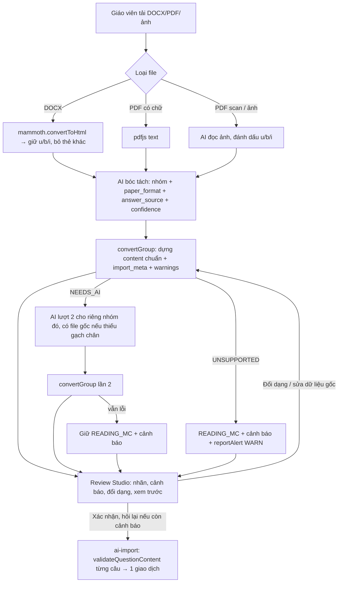

# FEAT-015: Chuyển đổi dạng câu hỏi khi AI nhập đề

> Trạng thái: DONE (2026-11-23, TASK-051 → 054 Claude tự làm, chưa deploy; đã thử file thật — §10) · Quyết định: DEC-042 → DEC-046, DEC-049, DEC-050 (`docs/14-decisions.md`) · Phụ thuộc: FEAT-009 (AI nhập đề), FEAT-016 (cảnh báo admin)

## 1. Tổng quan & mục tiêu nghiệp vụ
Phần bóc tách đề của FEAT-009 (`lib/document-parser.ts`) đã chạy ổn, nhưng mọi câu đều bị quy về 3 dạng: `READING_FILL_IN` nếu category có chữ FILL/CLOZE/BLANK, `WRITING_ESSAY` nếu có ESSAY, còn lại là `READING_MC`. Đề giấy gần như luôn trình bày dưới dạng trắc nghiệm ABCD. Khi đưa lên hệ thống thì từng dạng phải chuyển sang đúng dạng câu hệ thống hỗ trợ (17 dạng, `lib/question-content-types.ts`).

**Lỗi đang có trong code (rà ngày 23/11/2026):**
- `ai-import` gán câu cloze `fill_subtype = INLINE_SELECT` và lấy nguyên văn đoạn văn làm `passage`. Code **không** tạo `inline_options_per_gap` và `correct_answers`.
- `lib/grading.ts` lấy cụm `(…)` trong `passage` làm đáp án, nên số thứ tự `(25)` bị coi là đáp án "25". Kết quả: học sinh không có phương án để chọn, và câu bị chấm sai.
- `normalizeStructuredResult` tự gán đáp án `"A"` khi AI không trả về đáp án.
- DOCX được đọc bằng `mammoth.extractRawText`, nên **mất gạch chân**. Các dạng phát âm, tìm lỗi sai, đồng nghĩa/trái nghĩa đều cần gạch chân.

**Mục tiêu:**
1. AI gắn nhãn **dạng câu trên giấy** (`paper_format`) cho từng câu con. Một **bộ chuyển đổi xác định** (`lib/question-conversion.ts`, hàm thuần, chạy được cả ở client và server) dựng content đúng chuẩn của từng dạng hệ thống (DEC-042).
2. Quy tắc ô trống: 1 ô dùng `OPTION_BANK`, từ 2 ô trở lên dùng `INLINE_SELECT`, hộp từ chung dùng `OPTION_BANK` chung (DEC-043).
3. Dạng chưa có trên hệ thống thì nhập tạm `READING_MC`, kèm cảnh báo cho giáo viên và báo admin qua FEAT-016 (DEC-044).
4. ~~Giữ gạch chân, chữ đậm, chữ nghiêng từ file gốc~~ — thay bởi DEC-050: câu con và phương án lưu chữ trơn.
5. Lưu vết chuyển đổi trong `content.import_meta` (DEC-046).

Ngoài phạm vi: công cụ cũ `/admin/tests/import` (`parseExamRawTextWithAI` trong `lib/ai-engine.ts`); nhận diện audio cho Listening (câu Listening luôn có cảnh báo thiếu audio).

## 2. Phân quyền
Không đổi so với FEAT-009: `ai-parse` và `ai-import` cho `ADMIN` và `TEACHER` (`requireRole`); giáo viên dùng thử vẫn bị tính nội dung theo DEC-027. Cảnh báo admin do server tự gửi, giáo viên không thấy trang cảnh báo.

## 3. Luồng tương tác


## 4. Giao diện & 4 trạng thái UI
Màn hình: **SCR-24** `/teacher/library` (tab AI nhập đề, `components/teacher/AiExamIngestionStudio.tsx`) và SCR-23 `/teacher/tests/create` (cùng component). Không có màn hình mới.

| Trạng thái | Thay đổi |
| :--- | :--- |
| Đang tải | Thanh tiến trình thêm bước "Đang chuyển đổi dạng câu…" sau bước AI cấu trúc. |
| Rỗng | Giữ nguyên. |
| Lỗi | `ai-import` trả 400 `INVALID_CONTENT` → banner đỏ liệt kê số nhóm bị lỗi, cuộn tới nhóm đầu tiên. Lỗi AI lượt 2 không phải lỗi màn hình (nhóm đó rơi về trắc nghiệm kèm cảnh báo). |
| Có dữ liệu | Xem bảng dưới. |

Thẻ mỗi nhóm câu:
- Nhãn **"Trên giấy: <tên dạng giấy> → Hệ thống: <tên dạng hệ thống>"** (bảng §7.2), số câu gốc (vd "Câu 25–30") và độ tin cậy.
- **Huy hiệu cảnh báo** (amber; rose với `NO_ANSWER`), di chuột hoặc chạm để xem từng lý do (mã ở §7.3).
- Nút **Đổi dạng**: danh sách các dạng giấy dùng được cho nhóm. Chọn xong thì chạy lại `convertGroup` ngay trên trình duyệt, không gọi lại AI.
- Nút **Sửa**: sửa dữ liệu gốc (câu dẫn, phương án, đáp án, đoạn văn) rồi chuyển đổi lại. Đáp án chọn từ danh sách phương án.
- Nút **Xem như học sinh**: hiện `LessonPlayer` chỉ đọc, đã điền sẵn đáp án đúng, để giáo viên thấy câu sẽ hiển thị ra sao.

Thanh tóm tắt:
- "N nhóm · M câu gốc · K câu còn cảnh báo".
- Nếu tổng mục chấm khác số câu gốc thì hiện thêm **"Tổng điểm: X mục chấm (đề giấy: M câu)"** kèm chú thích (BR-I04).

Nút **Xác nhận & Tạo đề**:
- Còn câu `NO_ANSWER` → nút bị khoá, kèm câu "Chọn đáp án cho K câu trước khi nhập" (BR-I07).
- Còn cảnh báo khác → hộp thoại "Còn K câu cảnh báo sẽ được nhập dưới dạng tạm. Vẫn tạo đề?" với 2 nút *Quay lại sửa* / *Vẫn tạo đề* (BR-I08).

`LessonPlayer`: chữ câu con (`sub.text`) và phương án được hiển thị qua `sanitizeInlineHtml`, chỉ giữ `<u> <b> <strong> <i> <em> <br>`. Áp dụng cho bài học, đề thi, trang xem lại và Review Studio.

## 5. Tác động dữ liệu
Không thêm bảng hay cột. Chỉ thêm khoá JSON trong `questions.content`:

```ts
content.import_meta = {
  source: "AI_IMPORT",
  converter_version: 1,
  paper_format: PaperFormat,           // §7.2
  paper_numbers: number[],             // số câu trên đề giấy, vd [25,26,27]
  confidence: number,                  // 0–1, thấp nhất trong nhóm
  answer_source: "KEY" | "AI_SOLVED" | "TEACHER",
  warnings: { code: WarningCode; message: string }[]
}
```
- `sanitizeQuestionForStudent` **bỏ** `import_meta` trước khi gửi cho học sinh (BR-I10).
- Câu `READING_FILL_IN` / `LISTENING_FILL_IN` tạo từ nhập đề có `stimulus_text = NULL`, vì đoạn văn đã nằm trong `content.passage` (thay một phần BR-INGEST-04 của FEAT-009).
- Dữ liệu cũ không cần migration. Câu cloze đã nhập trước FEAT-015 vẫn chấm sai; giáo viên mở lại bằng trình soạn câu hỏi để sửa (ghi ở `docs/11` §4 D11).

## 6. Hợp đồng API
### 6.1 `POST /api/teacher/exams/ai-parse` (đổi phản hồi)
- Request giữ nguyên (multipart `file`, `targetSkill`). `maxDuration` nâng lên 120 giây.
- Phản hồi 200:
```json
{
  "success": true,
  "fileName": "de-thi.docx", "fileType": "docx", "engineUsed": "DIGITAL_PARSER",
  "groupsCount": 8, "questionsCount": 40,
  "extractedData": {
    "examTitle": "…", "suggestedDurationMinutes": 60,
    "groups": [ RawGroup ]
  },
  "conversion": {
    "converterVersion": 1,
    "groups": [ { "tempId": "group_3", "questions": [ ConvertedQuestion ], "warnings": [ … ] } ],
    "warningsCount": 3, "scoreItems": 41, "paperQuestions": 40
  }
}
```
- `RawGroup` là dữ liệu gốc theo đề giấy, client giữ lại để chuyển đổi lại:
```ts
{ tempId, groupNumber, skill, prompt, stimulus_html?: string, word_box?: string[],
  matching?: { left: {key,text}[]; right: {key,text}[] },
  sub_questions: { id, number, text_html, options: {key,text_html}[],
                   correct_answer: string | null, answer_source: "KEY"|"AI_SOLVED"|"NONE",
                   paper_format: PaperFormat, unsupported_reason?: string, confidence: number }[] }
```
- `ConvertedQuestion = { tempId, skill, category, prompt, stimulus_text: string|null, content }`. `content` đúng `CategoryContentMap[category]` và có thêm `import_meta`.
- Lỗi giữ như cũ (400 file sai hoặc quá 15MB, 500 qua `serverError` của FEAT-016). Mọi nhà cung cấp AI đều lỗi (`AiUnavailableError`) → **503** "AI đang bận, vui lòng thử lại sau ít phút." và `reportAlert` ERROR `AI:EXAM_IMPORT:ALL_PROVIDERS_FAILED` (không báo thêm lỗi API 500).
- Code: `lib/document-parser.ts` (đọc file, AI gắn nhãn, `refineGroupWithAi`), `lib/exam-import.ts` (`convertParsedGroups`: chuyển đổi + AI lượt 2 + báo admin), `lib/question-conversion.ts` (hàm thuần).

### 6.2 `POST /api/teacher/exams/ai-import` (đổi request)
- Request: `{ examTitle, durationMinutes, destination, questions: ConvertedQuestion[] }`. Server **không** nhận dạng `sub_questions` thô nữa.
- Server chạy `validateQuestionContent(category, content)` cho từng câu. Có câu sai thì trả **400** `{ success:false, error:"Câu hỏi số 2, 4 có nội dung không hợp lệ.", code:"INVALID_CONTENT", invalid:[{ index, tempId, reason }] }` (số = thứ tự trong `questions[]`), không ghi gì vào DB. Studio đánh dấu nhóm có `tempId` tương ứng.
- Câu còn `correct_answer` rỗng (`NO_ANSWER`) → 400 cùng mã (BR-I07).
- Server dùng `skill`, `category`, `prompt`, `stimulus_text`, `content` như client gửi lên sau khi kiểm, và ghi đè `import_meta.source = "AI_IMPORT"`. Phần còn lại (giao dịch, gắn lộ trình, giới hạn dùng thử, quyền khoá học) giữ nguyên FEAT-009.

## 7. Quy tắc nghiệp vụ & máy trạng thái
### 7.1 Quy tắc
- **BR-I01** AI chỉ gắn nhãn `paper_format`, `answer_source`, `confidence` và trả dữ liệu gốc. Code `convertGroup(raw, override?)` dựng content. Cùng một đầu vào luôn ra cùng một kết quả (hàm thuần, không gọi mạng).
- **BR-I02** Một ô trống trong câu (gạch dưới `__`, `…`, `....`) dùng `READING_FILL_IN · OPTION_BANK`: `option_bank` gồm 4 phương án, `correct_answers = [đáp án]`. **Mỗi câu một bản ghi** (bank không dùng chung giữa các câu).
- **BR-I03** Từ 2 ô trở lên trong cùng một đoạn hoặc câu dùng `INLINE_SELECT`. `inline_options_per_gap[i] = { gap_index: i, options: 4 phương án của ô i }`, `correct_answers[i]` là chữ của phương án đúng. Đoạn cloze có ô đánh số `(n)`, `n.`, `__n__`, `[n]`, `(n) ____`, `____ (n)` → mỗi số câu là một ô.
- **BR-I04** Câu có nhiều ô mà phương án dạng cặp (`who / which`, `on – at`, `;`) và **cả 4 phương án tách được đúng k phần** → tách thành k ô `INLINE_SELECT`. Ô thứ i có các phần thứ i khác nhau (giữ thứ tự xuất hiện). **Mỗi ô 1 điểm**, nên câu đó thành k mục chấm (DEC-043, người dùng chấp nhận lệch điểm so với đề giấy). Không tách được thì giữ `READING_MC`, không cảnh báo.
- **BR-I05** Đề có hộp từ chung (`word_box`) → `OPTION_BANK` dùng chung cho cả nhóm, `option_bank = word_box`, đáp án lấy theo chữ.
- **BR-I06** Đoạn văn của câu điền ô trống được ghi theo dạng `(n) [đáp án]`. Ngoặc vuông có sẵn trong văn bản gốc được đổi thành ngoặc tròn **trước** khi chèn ô, để `parseFillInGaps` chỉ nhận đúng các ô. Số ô trong `passage` phải bằng `correct_answers.length` và bằng số mục `inline_options_per_gap` (nếu có).
- **BR-I07** Câu không có đáp án (`answer_source = NONE`) giữ `correct_answer = null` và có cảnh báo `NO_ANSWER`. **Không bao giờ tự gán "A".** Giáo viên phải chọn đáp án thì mới nhập được (client khoá nút, server trả 400). Đáp án do AI tự giải (`AI_SOLVED`) có cảnh báo `AI_SOLVED_ANSWER`.
- **BR-I08** Dạng chưa hỗ trợ (`UNSUPPORTED`: cần hình, cần bảng, dạng lạ) → `READING_MC` (hoặc `LISTENING_MC`) với phương án như trên giấy, cảnh báo `UNSUPPORTED_FORMAT`. Server gọi `reportAlert` mức WARN, nguồn `EXAM_IMPORT`, fingerprint `EXAM_IMPORT:UNSUPPORTED:<reason>`, chi tiết gồm mẫu nội dung nhóm tối đa 1.500 ký tự, đuôi file, `teacherId`; **không** gửi tên file. Không chặn việc nhập.
- **BR-I09** Nhóm mà code không dựng được (`NEEDS_AI`: không tìm thấy vị trí ô) được gọi AI lượt 2 riêng (lý do thiếu gạch chân đã bỏ — BR-I25). Tối đa 10 nhóm mỗi file, chạy song song, mỗi lần tối đa 20 giây. Vẫn không dựng được thì giữ `READING_MC` kèm cảnh báo `GAP_NOT_FOUND`, và `reportAlert` WARN `EXAM_IMPORT:CONVERSION_FAILED:<paper_format>`.
- **BR-I10** `import_meta` không bao giờ gửi cho học sinh (`sanitizeQuestionForStudent`).
- **BR-I11** Một nhóm lẫn nhiều dạng giấy thì được tách thành các khối liền nhau cùng dạng, giữ chung `prompt`. Nhóm cloze và nhóm hộp từ luôn tính theo cả nhóm.
- **BR-I12** Câu có `skill = Listening` dùng tiền tố `LISTENING_` cho MC, FILL_IN, ORDERING, MATCHING và luôn có cảnh báo `AUDIO_MISSING`.
- **BR-I13** `confidence < 0.6` → cảnh báo `LOW_CONFIDENCE`.
- **BR-I15** (DEC-049) Ghép nối lấy cột phải theo thứ tự ưu tiên: `matching.right` → phương án của từng câu → danh sách "A …" / "vii …" trong đoạn dẫn. Đúng 1-1, không phương án thừa → `READING_MATCHING`. Có phương án nhiễu, đáp án lặp (phân loại) hoặc thiếu đáp án → `*_FILL_IN · INLINE_SELECT`, mỗi mục là một dòng `n. mục [nhãn đáp án]`, mọi ô dùng chung đủ danh sách lựa chọn (giữ cả nhiễu). Nhãn = `khoá. nội dung`, trừ khi nội dung đã chứa khoá ("Paragraph D"). Câu MC có hơn 4 phương án cũng đi đường này (trắc nghiệm hệ thống chỉ có A–D).
- **BR-I16** (DEC-049) `SHORT_ANSWER` ở Reading/Listening mà mọi câu có đáp án → `*_FILL_IN · FREE_TYPING`: ô lấy từ đoạn dẫn đánh số `(n) ____` (giữ xuống dòng), không có đoạn dẫn thì mỗi câu một dòng `n. câu [đáp án]`. Chấm ô điền (`lib/grading.ts` `acceptedAnswers`) nhận các phương án cách nhau bằng ` / ` (có khoảng trắng hai bên, để "and/or" vẫn là một đáp án) và từ tuỳ chọn trong ngoặc tròn: `(space) race` nhận "space race" và "race".
- **BR-I17** (DEC-049) Bài đọc dài dùng chung cho nhiều nhóm (kiểu IELTS) được AI chép **một lần** vào `passages[]`; nhóm tham chiếu bằng `passage_id` → `RawGroup.passage_html` → `stimulus_text` của mọi câu trong nhóm, nên các câu liền nhau cùng bài đọc thành một màn chia đôi (`lib/exam-layout.ts`). Đoạn dẫn riêng của nhóm chưa dùng trong content (vd danh sách câu nhận định) được nối vào `prompt`. Câu nhập theo FEAT-015 (có `import_meta`) không bị `sanitizeQuestionForStudent` coi ngoặc tròn trong bài đọc là ô trống. Lời dẫn nhắc "Reading Passage / the passage / paragraphs A–" mà nhóm không có bài đọc (< 600 ký tự) → server cấu trúc lại một lần; vẫn thiếu thì cảnh báo `PASSAGE_MISSING` (không chặn).
- **BR-I18** (DEC-049) PDF scan có lớp chữ rác (watermark, số trang lặp) vẫn phải OCR: bỏ các chuỗi ngắn xuất hiện nguyên trang ở ≥ 2 trang, ít hơn nửa số trang còn ≥ 120 ký tự → coi là scan (`pdfTextLooksScanned`). OCR theo cụm 4 trang chạy song song, AI đánh dấu `=== PAGE n ===`; trang thiếu được chép lại riêng, vẫn thiếu → `AI_UNAVAILABLE` (503), **không bao giờ tạo đề thiếu trang mà không báo**. Giới hạn một lần nhập: PDF scan ≤ 40 trang, văn bản ≤ 150.000 ký tự, đầu ra AI bị cắt (`MAX_TOKENS`) → 400 `DOCUMENT_TOO_LONG` kèm hướng dẫn tách file, không báo admin. Lượt OCR dùng tối thiểu 16.384 token đầu ra, lượt cấu trúc 32.768.
- **BR-I19** (DEC-049) Kiểm đủ câu: đọc các tiêu đề "Questions a–b", "Questions a and b", "Question n" trong văn bản; AI trả thiếu > 10 % số câu đề tự khai → cấu trúc lại một lần, giữ kết quả thiếu ít câu hơn (rồi ít nhóm rơi bài đọc hơn). Đáp án AI ghi bằng nội dung phương án ("FALSE", "NOT GIVEN") được đổi về khoá chữ cái của phương án đó.
- **BR-I20** (DEC-049) Số câu đề giấy: tiền tố "Câu n." / "Question n:" / "n." trùng số câu và gạch đầu dòng hội thoại được bỏ khỏi chữ câu; chữ câu chỉ là dãy "A. … B. … C. …" (ngữ âm, trọng âm) để trống. LessonPlayer hiện `sub.number` (số câu gốc) thay cho số thứ tự trong nhóm.
- **BR-I21** (DEC-050, thay bản DEC-049) "Viết câu từ từ gợi ý" (`People / thought / story / …` → chọn A–D) có đáp án → `*_ORDERING · WORD_ORDERING`, `correct_text` = câu đúng; học sinh xếp **toàn bộ từ của câu đúng** (kể cả từ nối đáp án thêm vào). Câu ≥ 3 cụm ngăn bởi "/" (mỗi cụm ≤ 4 từ, không có chỗ trống) mà AI gắn `GENERAL_MC` / `SENTENCE_TRANSFORMATION` / `SENTENCE_COMBINATION` / `REWRITE_WITH_CUE` cũng được nhận là sắp xếp từ. Gợi ý và đáp án không chung nửa số từ gợi ý → giữ trắc nghiệm, không cảnh báo. Không có phương án/đáp án → `CONVERSION_FAILED`.
- **BR-I22** (DEC-049) Không bịa đoạn văn: đoạn điền từ chỉ có ở bài đọc chung (`passage_html`) thì vẫn dựng ô trên bài đó (không gắn lại làm `stimulus_text`). AI lượt 2 được gửi kèm bài đọc chung, bị cấm thêm chữ; bản sửa có > 10 % từ không có trong bản gốc bị loại. Lời dẫn "Read the following passage…", "đoạn văn", "bài đọc" cũng tính là nhắc bài đọc; ngưỡng bài đọc tối thiểu 200 ký tự (bài THCS/THPT ngắn) → thiếu thì cấu trúc lại / `PASSAGE_MISSING`.
- **BR-I23** (DEC-049) Kỹ năng lưu của câu luôn suy từ tiền tố dạng câu (`READING_*` → Reading…), cả ở bộ chuyển đổi lẫn `POST /api/teacher/exams/ai-import` (không tin `skill` client gửi). Nhãn phần thi AI đặt ("Phonetics", "Communication") giữ ở `import_meta.paper_skill`. Lý do: `groupQuestionsBySkill` xếp màn thi theo 4 kỹ năng chuẩn — nhãn tự do làm đảo thứ tự đề.
- **BR-I24** (DEC-050) Câu nhập AI mở **Sửa** trong trình soạn (`QuestionSetEditor`) phải hiện đủ trường như câu tạo trực tiếp, và lưu lại không mất dữ liệu (`lib/question-editor-mapping.ts`, `buildStandardQuestionContent`): trắc nghiệm đọc `sub_questions` (lời dẫn trống được, phương án C/D trống được, giữ `number`), đáp án luôn lưu chữ cái A–D (trước đây câu tạo tay lưu chữ của phương án nên màn thi gửi "A" bị chấm sai); điền ô đọc `inline_options_per_gap` (và `option_banks` cũ) thành từ nhiễu từng ô, lưu lại luôn bằng `inline_options_per_gap`, `correct_answers` suy từ `[..]` trong đoạn văn, kho từ / danh sách ô luôn chứa đáp án; có thêm kiểu `FREE_TYPING`; sắp xếp giữ `ordering_type`; viết lại câu đọc trường phẳng `original_sentence/starting_cue/correct_answer` — nhiều câu con thì mỗi câu một câu hỏi; trả lời ngắn giữ `sample_answer`; mọi dạng giữ `import_meta`, `min_words`, `task_type`. Đổi dạng / kỹ năng trong form **không xoá** dữ liệu đã soạn; bấm Lưu khi đang mở sửa một câu thì lưu cả thay đổi chưa bấm "Cập nhật". Đề độc lập không bị tự gắn vào khoá học đầu tiên khi lưu.
- **BR-I25** (DEC-050) Câu con và phương án trắc nghiệm nhập AI lưu **chữ trơn**: bỏ `<u>`, `<b>`… (trình soạn dùng ô nhập chữ, thẻ HTML hiện nguyên văn). Bỏ cảnh báo `UNDERLINE_MISSING`, bỏ AI lượt 2 khôi phục gạch chân và `restoreUnderlines` (mã cảnh báo chỉ còn ở dữ liệu cũ). Bài đọc / ngữ cảnh (`stimulus_text`) vẫn giữ HTML.
- **BR-I26** (DEC-050) `OPTION_BANK` trên màn học sinh (`LessonPlayer`, dùng chung cho làm bài, xem trước, Review Studio) là **kho từ bấm để điền**: chọn một ô (hoặc ô trống đầu tiên), bấm từ trong kho để điền, tự chuyển sang ô trống kế; từ đã dùng mờ đi; bấm ô đã điền để trả từ về kho. Không còn hiện như danh sách chọn của `INLINE_SELECT`.
- **BR-I14** Chữ từ file gốc chỉ giữ các thẻ `<u> <b> <strong> <i> <em> <br>` khi bóc tách (để AI nhận dạng câu ngữ âm/tìm lỗi), các thẻ khác bị bỏ. Câu con và phương án khi lưu thành chữ trơn (thay một phần bởi BR-I25, DEC-050). Đáp án dùng để chấm luôn là chữ trơn.

### 7.2 Bảng dạng giấy → dạng hệ thống (`PaperFormat`)
| `paper_format` | Trên giấy | Hệ thống | Ghi chú |
| :--- | :--- | :--- | :--- |
| `PRONUNCIATION` | Phần gạch chân phát âm khác | `READING_MC` | Lưu chữ trơn, không giữ gạch chân (BR-I25) |
| `STRESS` | Trọng âm khác | `READING_MC` | |
| `CLOZE_PASSAGE` | Đoạn văn có ô đánh số, mỗi ô ABCD | `READING_FILL_IN` · `INLINE_SELECT` (1 ô thì `OPTION_BANK`) | BR-I03, BR-I06 |
| `SENTENCE_BLANK` | Câu có 1 ô + ABCD | `READING_FILL_IN` · `OPTION_BANK` | BR-I02 |
| `SENTENCE_MULTI_BLANK` | Câu nhiều ô, phương án dạng cặp | `INLINE_SELECT` k ô, hoặc `READING_MC` | BR-I04 |
| `WORD_BOX` | Hộp từ chung | `READING_FILL_IN` · `OPTION_BANK` chung | BR-I05 |
| `SENTENCE_ARRANGEMENT` | Sắp xếp câu/ý a–e, đáp án là thứ tự | `READING_ORDERING` · `SENTENCE_ORDERING` | `correct_text` = các ý theo thứ tự đúng, bỏ nhãn a., b. Một ý chứa nhiều câu thì không tách được → `READING_MC` + `CONVERSION_FAILED` |
| `WORD_ARRANGEMENT` | Từ cách nhau bằng `/` | `READING_ORDERING` · `WORD_ORDERING` | `correct_text` = phương án đúng; đáp án thêm từ nối vẫn sắp xếp (xếp toàn bộ từ của câu đúng); không chung nửa số từ gợi ý → `READING_MC` (BR-I21) |
| `MATCHING` | Ghép cột trái – phải, đoạn nào chứa thông tin, heading, phân loại | `READING_MATCHING` khi đúng 1-1 không thừa; còn lại `READING_FILL_IN` · `INLINE_SELECT` (mỗi mục một danh sách đủ lựa chọn) | BR-I15 (thay quy tắc bỏ phương án nhiễu `DISTRACTORS_DROPPED` của converter v1) |
| `ERROR_IDENTIFICATION` | 4 phần gạch chân A–D trong câu | `READING_MC` | Chữ trơn (BR-I25) |
| `SYNONYM_ANTONYM` | Từ gạch chân, chọn đồng/trái nghĩa | `READING_MC` | Chữ trơn (BR-I25) |
| `READING_COMPREHENSION` | Đọc hiểu, TRUE/FALSE/NOT GIVEN, YES/NO/NOT GIVEN | `READING_MC` (> 4 phương án → như `MATCHING`) | Bài đọc ở `stimulus_text` (BR-I17) |
| `SENTENCE_TRANSFORMATION` | Câu gần nghĩa nhất | `READING_MC` | |
| `SENTENCE_COMBINATION` | Nối hai câu | `READING_MC` | |
| `DIALOGUE_RESPONSE` | Chọn câu đáp trong hội thoại | `READING_MC` | |
| `GENERAL_MC` | Trắc nghiệm khác | `READING_MC` | |
| `REWRITE_WITH_CUE` | Viết lại câu, có từ mở đầu (tự luận) | `WRITING_SENTENCE_REWRITE` | `original_sentence`, `starting_cue`, `correct_answer` = đáp án mẫu |
| `ESSAY` | Viết đoạn / bài luận | `WRITING_ESSAY` | `min_words` lấy từ đề ("about 150 words"), mặc định 150; `task_type` mặc định `Task 2` |
| `SHORT_ANSWER` | Hoàn thành câu / tóm tắt / bảng / ghi chú, trả lời ngắn (viết vài từ) | Reading/Listening có đáp án → `*_FILL_IN` · `FREE_TYPING`; Writing hoặc thiếu đáp án → `WRITING_SHORT_ANSWER` (`max_words` 20) | BR-I16 |
| `UNSUPPORTED` | Cần hình, bảng, dạng lạ | `READING_MC` + cảnh báo | BR-I08; `unsupported_reason`: `NEEDS_IMAGE`, `NEEDS_TABLE`, `UNKNOWN` |

### 7.3 Mã cảnh báo (`WarningCode`)
`NO_ANSWER` (chặn nhập) · `AI_SOLVED_ANSWER` · `UNSUPPORTED_FORMAT` · `GAP_NOT_FOUND` · `CONVERSION_FAILED` · `LOW_CONFIDENCE` · `AUDIO_MISSING` · `PASSAGE_MISSING` (BR-I17). `DISTRACTORS_DROPPED` chỉ còn ở dữ liệu nhập bằng converter v1 (`converter_version = 1`); `UNDERLINE_MISSING` chỉ còn ở dữ liệu nhập trước DEC-050.

### 7.4 Máy trạng thái một nhóm (chỉ trong phiên nhập, không lưu DB)
```text
RAW ─convertGroup─▶ CONVERTED
RAW ─convertGroup─▶ NEEDS_AI ─AI lượt 2─▶ CONVERTED | FALLBACK_MC (cảnh báo)
RAW ─convertGroup─▶ UNSUPPORTED → FALLBACK_MC (cảnh báo + reportAlert)
CONVERTED | FALLBACK_MC ─giáo viên đổi dạng / sửa─▶ RAW (chuyển đổi lại)
```

## 8. Test case (TC-I) & Review Focus
| TC | Ca kiểm | BR | File test |
| :--- | :--- | :--- | :--- |
| TC-I01 | Cloze 6 ô `(25)…(30)` + ABCD → `INLINE_SELECT`, 6 mục `inline_options_per_gap`, `correct_answers` đúng chữ; `parseFillInGaps(passage).gaps` = đáp án (không còn "25") | BR-I03, BR-I06 | `question-conversion` |
| TC-I02 | **Đi vòng:** chuyển đổi → `sanitizeQuestionForStudent` → `gradeQuestion` với câu trả lời đúng = điểm tối đa, sai một ô = trừ đúng 1 | BR-I03, BR-I06 | `question-conversion` |
| TC-I03 | Câu 1 ô → `OPTION_BANK` 4 phương án, mỗi câu một bản ghi | BR-I02 | `question-conversion` |
| TC-I04 | Câu 2 ô, phương án `who / which` ×4 → 2 ô `INLINE_SELECT`, 2 mục chấm; một phương án không có `/` → giữ `READING_MC` | BR-I04 | `question-conversion` |
| TC-I05 | Hộp từ chung → `OPTION_BANK` chung, đáp án theo chữ | BR-I05 | `question-conversion` |
| TC-I06 | Sắp xếp câu a–e, đáp án "C. b-d-a-e-c" → `SENTENCE_ORDERING`, `splitOrderingItems` ra đúng 5 ý theo thứ tự | §7.2 | `question-conversion` |
| TC-I07 | Sắp xếp từ khớp → `WORD_ORDERING`; `People / thought / story…` đáp án thêm từ → `WORD_ORDERING` với câu đúng; gợi ý lệch quá xa → `READING_MC`; không có đáp án → `CONVERSION_FAILED` | BR-I21 | `question-conversion` |
| TC-I08 | Đoạn văn có sẵn `[note]` → đổi thành `(note)`, số ô không đổi | BR-I06 | `question-conversion` |
| TC-I09 | Không có đáp án → `correct_answer = null`, cảnh báo `NO_ANSWER`, **không** có "A"; `ai-import` với câu đó → 400 `INVALID_CONTENT` | BR-I07 | `question-conversion`, `ai-import` |
| TC-I10 | `UNSUPPORTED` → `READING_MC` + cảnh báo + đúng một `reportAlert` WARN, chi tiết không chứa tên file | BR-I08 | `ai-import` (mock AI, mock `reportAlert`) |
| TC-I11 | Không tìm thấy ô → gọi AI lượt 2 đúng một lần cho nhóm đó; lượt 2 lỗi → `READING_MC` + `GAP_NOT_FOUND` | BR-I09 | `ai-import` |
| TC-I12 | DOCX có `<u>` → văn bản bóc tách giữ `<u>`; `<script>`/`onclick` bị bỏ | BR-I14 | `document-parser-html`, `stimulus-html` |
| TC-I13 | Học sinh nhận câu nhập từ AI không có `import_meta` và đáp án | BR-I10 | `question-conversion` (sanitize) |
| TC-I14 | `ai-import` từ chối content sai schema (thiếu `passage`, số ô ≠ số đáp án, category lạ) → 400, không ghi DB | §6.2 | `ai-import` |
| TC-I15 | Listening → tiền tố `LISTENING_` + `AUDIO_MISSING` | BR-I12 | `question-conversion` |
| TC-I16 | Studio: đổi dạng nhóm chuyển đổi lại không gọi API; còn `NO_ANSWER` thì khoá nút; còn cảnh báo thì hộp thoại xác nhận; tổng điểm khác số câu thì hiện dòng chú thích | §4 | `ai-studio-ui` |
| TC-I17 | `LessonPlayer` hiển thị `<u>` ở câu con và phương án, không chạy được `` | BR-I14 | `lesson-player` |

| TC-I18 | Ghép nối 1-1 → `READING_MATCHING`; có nhiễu / đáp án lặp / > 4 phương án / lựa chọn chỉ có trong bảng đoạn dẫn → `INLINE_SELECT` giữ đủ lựa chọn, chấm đúng | BR-I15 | `question-conversion` |
| TC-I19 | Tóm tắt Reading có đáp án → `FREE_TYPING`; chấm nhận ` / ` và `(từ tuỳ chọn)`; Writing / thiếu đáp án → `WRITING_SHORT_ANSWER` | BR-I16 | `question-conversion` |
| TC-I20 | `passages` + `passage_id` → `passage_html`; bài đọc thành `stimulus_text` mọi câu; ngoặc tròn trong bài không bị ẩn; thiếu bài đọc → `PASSAGE_MISSING` | BR-I17 | `document-parser-html`, `question-conversion` |
| TC-I21 | PDF scan có watermark → nhận là scan; PDF chữ thật có watermark → không; tách kết quả OCR theo `=== PAGE n ===` | BR-I18 | `document-parser-html` |
| TC-I22 | `ai-parse` gặp `DocumentTooLongError` → 400 `DOCUMENT_TOO_LONG`, không gọi `reportAlert` | BR-I18 | `ai-import` |
| TC-I23 | Đọc số câu đề tự khai từ tiêu đề "Questions a–b"; đáp án ghi "not given" → khoá `C` | BR-I19 | `document-parser-html` |
| TC-I24 | "<b>Câu 5.</b> When…" → "When…"; "1990 was…" giữ nguyên; dãy phương án ngữ âm → rỗng; "- Laura:" → "Laura:" | BR-I20 | `document-parser-html` |
| TC-I25 | ~~`People / thought / story…` → `READING_MC`~~ — thay bởi TC-I07, TC-I29 (BR-I21 bản DEC-050) | BR-I21 | `question-conversion` |
| TC-I26 | Cloze chỉ ở `passage_html` → `INLINE_SELECT`, `stimulus_text` null; AI lượt 2 trả đoạn "gold rush" mới → bị loại; "Read the following passage" thiếu bài → `PASSAGE_MISSING` | BR-I22 | `question-conversion`, `document-parser-html` |
| TC-I27 | Nhóm "Phonetics" → `READING_MC` + `skill` Reading + `paper_skill` | BR-I23 | `question-conversion` |
| TC-I28 | Phát âm / tìm lỗi sai: câu và phương án thành chữ trơn (không `<u>`, `<b>`, `<script>`); không `UNDERLINE_MISSING`, không AI lượt 2 | BR-I25 | `question-conversion` |
| TC-I29 | AI gắn `GENERAL_MC` cho `People / thought / …` → vẫn `WORD_ORDERING`; câu có chỗ trống `He / ____ / …` giữ trắc nghiệm | BR-I21 | `question-conversion` |
| TC-I30 | Trắc nghiệm nhập AI → trình soạn: lời dẫn trống, 3 phương án, chữ trơn, số câu; đáp án chữ của phương án (dữ liệu cũ) → chữ cái; lưu lại chấm đúng đáp án "B"; chuẩn hoá hai lần cho cùng kết quả | BR-I24 | `question-editor-mapping` |
| TC-I31 | Điền ô: từ nhiễu từng ô đọc từ `inline_options_per_gap` / `option_banks`; lưu lại ra `inline_options_per_gap` + `correct_answers` theo đoạn văn; kho từ luôn chứa đáp án; `FREE_TYPING` giữ nguyên | BR-I24 | `question-editor-mapping` |
| TC-I32 | Sắp xếp giữ `WORD_ORDERING`; viết lại câu (phẳng ⇄ câu con, thêm `[gợi ý]`); trả lời ngắn giữ `sample_answer`; giữ `import_meta`, `min_words` | BR-I24 | `question-editor-mapping` |
| TC-I33 | Kho từ bấm-điền: điền ô đang chọn / ô trống đầu, tự chuyển ô; thẻ đã dùng mờ, kho lặp từ đếm từng thẻ | BR-I26 | `question-editor-mapping` |

**Review Focus** (đặc tả ngầm hiểu, người dùng thật dễ gặp):
1. Đề có đáp án ở bảng cuối file nhưng số câu bảng đáp án lệch số câu trong đề → câu không khớp nhận `NO_ANSWER`, không gán bừa (TC-I09).
2. Ô trống viết bằng nhiều kiểu (`……`, `_____`, `(25) ___`, `___(25)___`) trong cùng một đề → đều nhận ra (TC-I01, có fixture nhiều kiểu).
3. Phương án có dấu `/` nhưng không phải dạng cặp (vd "A. 1/2 of the class") → không tách bừa: chỉ tách khi **cả 4** phương án tách được đúng k phần, với k = số ô (TC-I04).
4. Giáo viên đổi dạng qua lại nhiều lần → luôn chuyển từ dữ liệu gốc, không chồng chuyển đổi lên kết quả cũ (TC-I16).
5. AI trả JSON thiếu trường hoặc `paper_format` lạ → coi là `GENERAL_MC` + `LOW_CONFIDENCE`, không sập (TC-I14 phía parse).
6. Giáo viên mở sửa câu nhập AI, đổi sang dạng khác rồi đổi về, rồi bấm Lưu ngay (chưa bấm "Cập nhật") → dữ liệu còn nguyên, lưu đủ (TC-I30 → 32).

## 9. Task triển khai & DoD
| Task | Nội dung | Phụ thuộc | Độ khó / Nhạy cảm | DoD |
| :--- | :--- | :--- | :--- | :--- |
| TASK-051 | `lib/question-conversion.ts` (`PaperFormat`, `convertGroup`, `validateQuestionContent`, `countScoreItems`), `sanitizeInlineHtml` trong `lib/stimulus-html.ts`, `sanitizeQuestionForStudent` bỏ `import_meta` | — | HIGH (đúng/sai điểm) | TC-I01 → 09, 13, 15 xanh |
| TASK-052 | `lib/document-parser.ts`: DOCX `convertToHtml`, prompt AI gắn nhãn, bỏ gán "A", AI lượt 2, `reportAlert`; `ai-parse` trả `conversion`; `ai-import` nhận `ConvertedQuestion[]` + kiểm | 051, 048 | HIGH | TC-I10, 11, 12, 14 xanh; `docs/07` cập nhật mô tả `ai-parse` / `ai-import` |
| TASK-053 | Review Studio (nhãn, cảnh báo, đổi dạng, sửa dữ liệu gốc, xem như học sinh, tổng điểm, hộp thoại, khoá `NO_ANSWER`); `LessonPlayer` hiển thị thẻ inline | 051, 052 | MED | TC-I16, 17 xanh; `npx next build`; đủ 4 trạng thái (`docs/03` §4) |
| TASK-055 | Sửa câu nhập AI mượt như câu tạo tay: ánh xạ content ⇄ trình soạn, chuẩn hoá lưu (đáp án chữ cái, `inline_options_per_gap`), giữ dữ liệu khi đổi dạng, chữ trơn thay gạch chân, sắp xếp từ cho câu gợi ý "/", kho từ bấm-điền (BR-I21, I24 → I26, DEC-050) | 054 | HIGH (đúng/sai điểm) | TC-I07, I28 → 33 xanh; `npx next build`; sửa dữ liệu đề DOCX đã nhập |
| TASK-054 | Thử file thật (§10): nhận diện PDF scan + OCR theo cụm trang, bài đọc chung, ghép nối/phân loại → `INLINE_SELECT`, tóm tắt → `FREE_TYPING`, chấm đáp án thay thế, kiểm đủ câu, giới hạn file, số câu gốc, chống bịa đoạn văn (BR-I15 → I23, DEC-049) | 051 → 053 | HIGH | TC-I18 → 27 xanh; 2 file thật ra 40/40 câu |

Xác minh chung: `npx vitest run && npx tsc --noEmit && npx next build`. Sau khi xong: chạy thử AI nhập đề với file DOCX/PDF thật (`docs/11` N2) và ghi báo cáo QA ở `docs/qa/reports/`.

## 10. Thử với file thật (2026-11-23)
File *Collins Practice Tests for IELTS 1* (PDF scan 158 trang, 3,6 MB, lớp chữ chỉ có watermark), model `gemini-flash-lite-latest` → dự phòng `gemini-3.5-flash-lite`.

| Lần | Đầu vào | Kết quả | Dẫn tới |
| :--- | :--- | :--- | :--- |
| Trước sửa | Cả file | Không OCR (watermark ≥ 50 ký tự), ra 21 câu nhặt từ vài trang có chữ, không báo gì | BR-I18 |
| Trước sửa | Test 1 Reading (trang 9–20 + trang đáp án) | 0 câu (không OCR); ép OCR thì mất cả 3 bài đọc, 21 câu ghép nối rơi về trắc nghiệm hỏng, tóm tắt thành Writing | BR-I15 → I17 |
| Sau sửa | Cả file | 400 `DOCUMENT_TOO_LONG` (158 > 40 trang) | |
| Sau sửa | Test 1 đầy đủ 22 trang | Hạn mức Gemini (429) làm hỏng OCR lại trang 10–12, bản cũ âm thầm bỏ 3 trang | BR-I18 (thiếu trang → 503) |
| Sau sửa | Test 1 Reading | Một lần AI dừng ở 12/40 câu và ghi đáp án "FALSE" | BR-I19 |
| Cuối | Test 1 Reading | 40/40 câu, 3 bài đọc, đáp án lấy từ bảng đáp án, 0 cảnh báo, 45 giây; nhập vào tài khoản giáo viên qua `ai-import`; trả lời đúng hết = 40/40, không lộ đáp án, 3 màn chia đôi | |

File *De-thi-1.docx* (đề tiếng Anh THCS 40 câu, có bảng đáp án cuối file):

| Lần | Kết quả | Dẫn tới |
| :--- | :--- | :--- |
| 1 | 40/40 đáp án khớp bảng; chữ câu lặp "1. Câu 5."; câu ngữ âm in phương án hai lần; câu 39–40 báo `CONVERSION_FAILED` và báo admin dù là trắc nghiệm hợp lệ | BR-I20, BR-I21 |
| 2 | AI để đoạn điền từ ở `passages` → không tìm thấy ô → AI lượt 2 **bịa** một đoạn "gold rush" có đủ ô (25)–(30) và được nhận | BR-I22 |
| 3 | AI bỏ mất cả 2 bài đọc; lời dẫn "Read the following passage" không được nhận ra nên không cấu trúc lại, không cảnh báo | BR-I22 |
| 4 | AI làm rơi gạch chân câu 1–2; câu lưu `skill` "Phonetics", "Grammar"… → màn thi bị xếp lại (câu 25–34 lên đầu) | BR-I23 |
| Cuối | 40/40 câu đúng bảng đáp án, 2 bài đọc đủ, 0 cảnh báo; nhập vào tài khoản giáo viên (20 bản ghi, 41 mục chấm); trả lời đúng hết = 41/41, bỏ trống = 0, không lộ đáp án, màn thi đúng thứ tự đề giấy | |
| Sau dùng thử | Giáo viên báo: thẻ `<u>` hiện nguyên văn khi sửa; câu con trắc nghiệm không sửa được; kho từ hiện như danh sách chọn; sửa câu danh sách chọn không thấy từ nhiễu; đổi dạng rồi đổi về mất dữ liệu; câu 39–40 vẫn là trắc nghiệm. Đã sửa (TASK-055) và cập nhật trực tiếp đề đã nhập: 21 bản ghi (câu 39, 40 thành 2 câu sắp xếp từ), không còn thẻ HTML, trả lời đúng hết = 41/41 | BR-I21, BR-I24 → I26 |

Còn hạn chế (chưa làm): Listening không có audio (`AUDIO_MISSING`); Writing Task 1 cần bảng/biểu đồ và Speaking rơi về `UNSUPPORTED` + `NO_ANSWER` (giáo viên xoá nhóm trước khi nhập); "Choose TWO letters" vẫn là trắc nghiệm một đáp án; AI có lúc bỏ ngoặc từ tuỳ chọn trong đáp án (`space race` thay cho `(space) race`).

