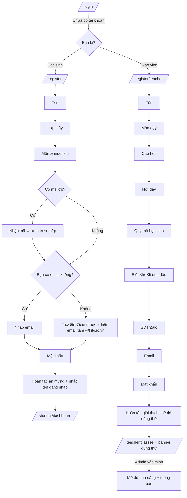

# FEAT-012: Đăng nhập mới, đăng ký kiểu phỏng vấn & giáo viên dùng thử

> Trạng thái: DONE (TASK-035 → 037 đã nghiệm thu; đối chiếu code 2026-11-03) · Quyết định: DEC-026 → DEC-029 (`docs/14-decisions.md`)

## 1. Tổng quan & mục tiêu nghiệp vụ
Hiện tại:
- `/login` và `/register` là form tĩnh, không ăn nhập với landing mới (DEC-024).
- `/teacher/login` là trang đăng nhập riêng nhưng có mật khẩu demo điền sẵn và một form "đăng ký" giả.
- Đăng ký công khai chỉ tạo `STUDENT` và bắt buộc phải có email. API gán cứng `target_band = 'IELTS 6.5'`.
- Tài khoản giáo viên chỉ admin tạo được.

FEAT-012 gồm:
- **Một trang `/login` duy nhất**, thiết kế lại theo ngôn ngữ của landing. Ô đăng nhập nhận email **hoặc tên đăng nhập**, đăng nhập xong chuyển trang theo vai trò. `/teacher/login` chuyển hướng về `/login`.
- **Đăng ký học sinh dạng phỏng vấn** `/register`: mỗi màn hình hỏi đúng một câu, có mascot KitoKit dẫn dắt như một người bạn (xưng "mình", gọi "bạn"). Học sinh không có email thì tạo **tên đăng nhập**; hệ thống tự sinh email tạm `<tên đăng nhập>@kito.io.vn`, học sinh đổi được sau (DEC-026).
- **Đăng ký giáo viên tự do** `/register/teacher`: cũng dạng phỏng vấn, có thêm vài câu khảo sát. Tài khoản tạo ra ở chế độ **dùng thử có giới hạn** (DEC-027). Admin xem câu trả lời khảo sát rồi **xác minh** để mở đủ tính năng (DEC-028).

Ngoài phạm vi:
- đăng nhập bằng Google/Zalo
- xác minh email bằng mã OTP
- học sinh tự mua khoá học (DEC-019 giữ nguyên)
- thanh toán gói giáo viên

## 2. Phân quyền
| Hành động | Khách | STUDENT | TEACHER dùng thử | TEACHER đã xác minh | ADMIN |
| :--- | :---: | :---: | :---: | :---: | :---: |
| Đăng ký học sinh / giáo viên | ✓ | — | — | — | — |
| Đổi email tạm sang email thật | — | của mình | của mình | của mình | mọi người |
| Tạo lớp | — | — | tối đa 1 | ✓ | ✓ |
| Tạo bài học / đề (soạn tay hoặc AI nhập) | — | — | tối đa 3, tính chung cả hai | ✓ | ✓ |
| Có học sinh trong lớp | — | — | tối đa 3 học sinh khác nhau | theo `max_slots` | ✓ |
| Số lần nộp mỗi bài/đề của học sinh trong lớp | — | — | 1 lần | theo cài đặt lớp | — |
| Xem khảo sát, xác minh / từ chối giáo viên | — | — | — | — | ✓ |

- Vai trò của tài khoản mới do **route** quyết định, không đọc từ body.
- Đăng ký công khai không bao giờ tạo được `ADMIN`, cũng không tạo được `TEACHER` đã xác minh.

## 3. Luồng tương tác


### 3.1 Khung phỏng vấn (dùng chung cho cả hai luồng)
- **Bố cục:**
  - Màn rộng: mascot nằm bên trái, bong bóng thoại chứa câu hỏi, ô trả lời ở bên phải.
  - Màn hẹp: mascot nhỏ ở trên, bong bóng thoại ngay dưới, ô trả lời chiếm phần còn lại.
  - Trên cùng có thanh tiến độ (gradient xanh đậm → nhạt, DEC-022). Nút ← Quay lại nằm **cùng hàng với nút Tiếp** ở cuối vùng trả lời (`components/onboarding/StepActions.tsx`).
- **Mỗi màn chỉ có một câu hỏi.**
  - Câu chọn sẵn hiện dạng **chip lớn**. Câu chọn một: bấm chip là sang câu tiếp. Câu chọn nhiều: có nút "Tiếp".
  - Câu nhập chữ: có một ô nhập, Enter để tiếp, lỗi kiểm tra hiện ngay dưới ô và do mascot nói.
- **Mascot:** dùng `public/brand/kitokit-mark-transparent.png`. Cảm xúc thể hiện bằng chuyển động:
  - nhún nhẹ khi đứng yên
  - nghiêng đầu khi đổi câu
  - gật khi câu trả lời hợp lệ
  - lắc khi có lỗi
  - nhảy kèm confetti khi hoàn tất

  Chữ trong bong bóng hiện dần như đang gõ, bấm vào là hiện hết. Khi có `prefers-reduced-motion` thì tắt toàn bộ chuyển động.
- **Câu thoại cá nhân hoá:** từ màn thứ hai trở đi, mascot gọi người dùng bằng tên, vd "Rất vui được gặp **An**! An đang học lớp mấy?".
- **Lưu nháp:** câu trả lời lưu ở `sessionStorage`, tải lại trang không bị mất. **Không bao giờ lưu mật khẩu.** Mọi lần đọc/ghi bọc `try/catch`.
- Kiểm tra dữ liệu ở từng màn, rồi server **kiểm tra lại toàn bộ** khi nộp. Nếu server báo lỗi ở một trường thì quay về đúng màn hỏi trường đó.
- Màu chỉ dùng token (DEC-022, không viết mã hex trong class), font tiêu đề `font-display`, thân Lexend.

### 3.2 Câu hỏi luồng học sinh (`/register`)
Mascot xưng "mình", gọi người dùng là "bạn". Câu hỏi mẫu (kỹ sư có thể chỉnh lời, giữ nguyên ý):

| # | Mascot hỏi | Kiểu trả lời | Bắt buộc | Lưu vào |
| :- | :--- | :--- | :---: | :--- |
| 0 | "Chào bạn! Mình là Kito, mình sẽ giúp bạn tạo tài khoản trong 1 phút nhé." | nút "Bắt đầu" | — | — |
| 1 | "Bạn tên là gì?" | chữ, 2–100 ký tự | ✓ | `users.name` |
| 2 | "{Tên} đang học lớp mấy?" | chip một lựa chọn: Lớp 1 … Lớp 12, Đại học, Đã đi làm | ✓ | `users.grade_level` |
| 3 | "Bạn muốn học gì cùng Kito?" | chip nhiều lựa chọn, lấy từ môn hệ thống (`subjects`, `owner_id IS NULL`) và thêm "Khác" | ✓ (≥1) | `users.learning_goals.subjects` |
| 3b | (chỉ hiện khi đã chọn Tiếng Anh) "Mục tiêu tiếng Anh của bạn là gì?" | chip một lựa chọn: Học trên lớp, Cambridge (Starters/Movers/Flyers/KET/PET), IELTS, TOEIC, Thi vào 10, Chưa rõ; chọn IELTS/TOEIC thì có thêm ô điểm mục tiêu (tuỳ chọn) | — | `users.learning_goals.english_goal`, `users.target_band` |
| 4 | "Thầy cô có cho bạn mã lớp không?" | 2 nút: "Có mã lớp" / "Chưa có, bỏ qua" | — | — |
| 4a | "Nhập mã lớp vào đây nhé." | chữ; gọi `GET /api/classes/lookup/[ref]` để hiện tên lớp và giáo viên cho học sinh xác nhận | — | ghi danh sau khi tạo tài khoản |
| 5 | "Bạn có email không?" | 2 nút: "Có" / "Không có" | ✓ | — |
| 5a | "Email của bạn là gì?" | email hợp lệ, **không** được dùng đuôi `@kito.io.vn` | ✓ nếu chọn "Có" | `users.email` |
| 5b | "Không sao! Mình cùng tạo một **tên đăng nhập** nhé. Bạn sẽ dùng nó để đăng nhập." | chữ; gợi ý sẵn từ tên bỏ dấu + 2–4 số (vd `an.nguyen24`); kiểm tra trùng ngay khi gõ (chờ ~400ms rồi gọi API); bên dưới hiện "Email tạm của bạn: `an.nguyen24@kito.io.vn` — bạn đổi được sau" | ✓ nếu chọn "Không có" | `users.username`, email tạm |
| 6 | "Giờ đặt mật khẩu bí mật nhé. Ít nhất 6 ký tự." | mật khẩu kèm nút hiện/ẩn; **không** có ô nhập lại, thay vào đó có vạch báo độ mạnh | ✓ | `users.password` (scrypt) |
| 7 | "Xong rồi! Chào mừng {Tên} đến với KitoKit 🎉" | confetti; nếu có tên đăng nhập thì hiện lớn trong ô có nút **sao chép**, kèm "Nhớ tên đăng nhập này nhé!"; nếu đã vào lớp thì hiện tên lớp; nút "Vào học thôi" | — | — |

- Học sinh nào có email thì **cũng được cấp `username`**: server tự sinh từ phần trước `@` của email, thêm số nếu bị trùng. Như vậy mọi tài khoản đều có tên đăng nhập.
- **Mã lớp không hợp lệ** hoặc **lớp đã đủ chỗ** (kể cả do giới hạn dùng thử của giáo viên, mục 6): tài khoản vẫn được tạo, chỉ là chưa vào lớp. Mascot báo "Lớp này đã đủ bạn rồi, bạn nhờ thầy cô kiểm tra nhé", màn hoàn tất không hiện tên lớp.
- **Học sinh dưới 13 tuổi:** không hỏi ngày sinh và không thu SĐT ở giai đoạn này.

### 3.3 Câu hỏi luồng giáo viên (`/register/teacher`)
> Cập nhật 02/11: thêm danh xưng ở màn tên; câu ngay sau gọi "thầy/cô + tên riêng" (vd "cô Hoa"), các câu sau chỉ gọi danh xưng ("Cô dạy khoảng bao nhiêu học sinh ạ?"). Bỏ câu hỏi tính năng mong muốn (API vẫn nhận `needs` tuỳ chọn cho client cũ).
Cùng khung phỏng vấn, mascot vẫn là "Kito" nhưng xưng hô lịch sự hơn: mascot xưng "Kito", gọi người dùng là "thầy cô".

| # | Mascot hỏi | Kiểu trả lời | Bắt buộc | Lưu vào |
| :- | :--- | :--- | :---: | :--- |
| 0 | "Chào thầy cô! Kito sẽ hỏi vài câu để chuẩn bị không gian dạy học phù hợp nhất." | "Bắt đầu" | — | — |
| 1 | "Kito nên gọi thầy hay cô, và tên của mình là gì ạ?" | 2 nút danh xưng **Thầy / Cô** (bắt buộc) + ô họ tên | ✓ | `answers.honorific` (`THAY`/`CO`), `users.name` |
| 2 | "Thầy cô dạy môn gì?" | chip nhiều lựa chọn (môn hệ thống + "Khác: …") | ✓ | `teacher_profiles.answers.subjects` |
| 3 | "Học sinh của thầy cô ở cấp nào?" | chip nhiều lựa chọn: Mầm non, Tiểu học, THCS, THPT, Luyện thi chứng chỉ, Đại học, Người đi làm | ✓ | `answers.levels` |
| 4 | "Thầy cô đang dạy ở đâu?" | chip một lựa chọn: Trường công lập, Trường tư thục/quốc tế, Trung tâm, Gia sư/dạy tự do; sau đó có ô tên trường/trung tâm (tuỳ chọn) | ✓ | `answers.workplace_type`, `answers.workplace_name` |
| 5 | "Thầy cô dạy khoảng bao nhiêu học sinh?" | chip: Dưới 10, 10–50, 50–200, Trên 200 | ✓ | `answers.student_count` |
| 7 | "Thầy cô biết KitoKit qua đâu?" | chip: Facebook, Zalo, Bạn bè/đồng nghiệp giới thiệu, Tìm kiếm Google, Khác | — | `answers.source` |
| 8 | "Số điện thoại / Zalo để Kito liên hệ xác minh ạ?" | SĐT Việt Nam, 9–11 số | ✓ | `users.phone` |
| 9 | "Email đăng nhập của thầy cô?" | email bắt buộc (giáo viên **không** dùng email tạm), cấm đuôi `@kito.io.vn` | ✓ | `users.email` |
| 10 | "Cuối cùng, đặt mật khẩu nhé." | mật khẩu ≥ 8 ký tự | ✓ | `users.password` |
| 11 | "Tài khoản dùng thử đã sẵn sàng!" | thẻ tóm tắt giới hạn dùng thử (1 lớp · 3 bài học/đề · 3 học sinh · mỗi học sinh nộp 1 lần mỗi bài) kèm dòng "Kito sẽ liên hệ xác minh trong 1–2 ngày làm việc để mở đủ tính năng"; nút "Vào không gian dạy học" | — | — |

### 3.4 Trang đăng nhập `/login`
- **Bố cục:**
  - Màn rộng chia đôi. Nửa trái: nền gradient `brand`, mascot có quầng sáng, bong bóng thoại đổi câu chào theo giờ trong ngày, 3 lợi ích ngắn. Nửa phải: thẻ đăng nhập.
  - Màn hẹp: chỉ còn mascot nhỏ phía trên thẻ.
- **Thẻ đăng nhập gồm:**
  - ô "Email hoặc tên đăng nhập", ô mật khẩu có nút hiện/ẩn, liên kết "Quên mật khẩu?"
  - nút "Đăng nhập" màu `accent`
  - phía dưới là 2 thẻ chọn: "Tôi là học sinh → Tạo tài khoản" và "Tôi là giáo viên → Dùng thử miễn phí"
- **Không điền sẵn** tài khoản demo.
- Nếu URL có `?next=` thì sau khi đăng nhập quay về đó, nhưng chỉ nhận đường dẫn nội bộ bắt đầu bằng `/`. Không có `next` thì chuyển theo vai trò: ADMIN → `/admin`, TEACHER → `/teacher/classes`, STUDENT → `/student/dashboard`.
- **Quên mật khẩu với tài khoản email tạm:** nếu tài khoản chỉ có email tạm thì `forgot-password` không gửi thư. Trang vẫn hiện thông điệp chung như mọi trường hợp (chống dò tài khoản) và thêm một dòng hướng dẫn cố định: "Nếu bạn đăng ký bằng tên đăng nhập, hãy nhờ thầy cô hoặc quản trị viên đặt lại mật khẩu."

## 4. Trạng thái giao diện
| Màn | Đang tải | Rỗng | Lỗi | Thành công |
| :--- | :--- | :--- | :--- | :--- |
| Đăng nhập | nút quay, khoá form | — | khung đỏ + mascot lắc; 429 thì báo số phút chờ | chuyển trang |
| Phỏng vấn – kiểm tra tên đăng nhập / mã lớp | chấm "…" trong bong bóng | — | "Tên này có bạn dùng rồi, thử `an.nguyen25` nhé" (kèm gợi ý thay thế) | dấu ✓ xanh, mascot gật |
| Phỏng vấn – nộp | mascot "đang chuẩn bị…", khoá nút | — | quay về màn có lỗi kèm câu thoại lỗi; lỗi mạng → nút "Thử lại", không mất dữ liệu | màn hoàn tất |
| Banner dùng thử (giáo viên) | — | — | — | "Đang dùng thử · 1/1 lớp · 2/3 bài · 3/3 học sinh — Chờ xác minh" |
| Admin – giáo viên chờ xác minh | khung xương | "Chưa có giáo viên nào chờ xác minh" | thông báo lỗi kèm nút tải lại | danh sách + chi tiết khảo sát |

## 5. Dữ liệu & API

### 5.1 Migration `docs/db-migration-013-onboarding.sql` (kèm DDL tương ứng trong `ensureSchema()`)
```sql
ALTER TABLE users ADD COLUMN IF NOT EXISTS username VARCHAR(30);
CREATE UNIQUE INDEX IF NOT EXISTS idx_users_username ON users (LOWER(username));
ALTER TABLE users ADD COLUMN IF NOT EXISTS email_is_placeholder BOOLEAN NOT NULL DEFAULT FALSE;
ALTER TABLE users ADD COLUMN IF NOT EXISTS grade_level VARCHAR(30);
ALTER TABLE users ADD COLUMN IF NOT EXISTS learning_goals JSONB;
-- NULL với STUDENT/ADMIN; giáo viên: TRIAL | VERIFIED | REJECTED
ALTER TABLE users ADD COLUMN IF NOT EXISTS teacher_status VARCHAR(20);
UPDATE users SET teacher_status = 'VERIFIED' WHERE role = 'TEACHER' AND teacher_status IS NULL;

CREATE TABLE IF NOT EXISTS teacher_profiles (
  user_id VARCHAR(50) PRIMARY KEY REFERENCES users(id) ON DELETE CASCADE,
  answers JSONB NOT NULL,
  reviewed_by VARCHAR(50),
  reviewed_at TIMESTAMPTZ,
  review_note TEXT,
  created_at TIMESTAMPTZ DEFAULT NOW()
);
```
- `username`: 4–30 ký tự, gồm `a-z 0-9 . _`, bắt đầu bằng chữ cái, lưu chữ thường. Một số tên bị cấm (`admin`, `root`, `support`, `kitokit`, `kito`, …).
- Tài khoản cũ chưa có `username` thì vẫn đăng nhập bằng email hoặc id như hiện tại.

### 5.2 API
| Route | Quyền | Mô tả |
| :--- | :--- | :--- |
| `POST /api/auth/login` | công khai | Ô nhập (`identifier`) khớp `LOWER(email)`, `LOWER(username)` hoặc `id`. Giữ nguyên giới hạn số lần thử và thông điệp lỗi chung. Phản hồi có thêm `username` thật, `teacherStatus`, `emailIsPlaceholder`. |
| `GET /api/auth/username-available?u=` | công khai, 30 lần/phút/IP | `{ success, available, suggestions: string[] }`; kiểm tra định dạng và danh sách tên cấm. |
| `POST /api/auth/register` | công khai, 5 lần/giờ/IP, có bẫy bot | Body: `{ name, gradeLevel, goals, hasEmail, email?, username?, password, classCode?, website (bẫy bot) }`. Tạo `STUDENT`. Không có email thì `email = username@kito.io.vn` và `email_is_placeholder = true`. Có `classCode` thì ghi danh vào lớp bằng cùng logic với `POST /api/student/enroll` (tách ra hàm dùng chung, có kiểm tra chỗ trống và giới hạn dùng thử). Tạo xong đặt cookie đăng nhập luôn. Phản hồi: `{ success, user, username, enrolled: { classId, className } \| null, enrollError?: string }`. |
| `POST /api/auth/register/teacher` | công khai, 5 lần/giờ/IP, có bẫy bot | Tạo `TEACHER`, `teacher_status = 'TRIAL'`, `slot_limit = 9`. Ghi `teacher_profiles` **trong cùng giao dịch**. Đặt cookie. Sau đó gửi thông báo (bảng `notifications`) cho mọi ADMIN: "Giáo viên mới chờ xác minh: {tên}". |
| `GET /api/teacher/trial-usage` | TEACHER | `{ success, status, limits: { classes:1, contents:3, students:3 }, used: { classes, contents, students } }`; giáo viên đã xác minh thì `limits = null`. |
| `GET /api/admin/teachers?status=TRIAL` | ADMIN | Lọc theo `teacher_status`, kèm `answers` của khảo sát. |
| `POST /api/admin/teachers/[id]/verify` | ADMIN | Body `{ decision: 'VERIFIED' \| 'REJECTED', note? }`. Xác minh thì `slot_limit` lên giá trị mặc định cho giáo viên (250, đọc từ `system_settings` nếu có). Ghi `reviewed_by/at/note` và gửi thông báo cho giáo viên. |
| `PUT /api/profile` | đã đăng nhập | **Chỉ tài khoản đang dùng email tạm** mới đổi được `email` ở đây (đổi email thật cần xác minh, để sau; gửi `email` khi đã có email thật thì bỏ qua): kiểm tra trùng, cấm đuôi `@kito.io.vn`, đổi xong đặt `email_is_placeholder = false`. Trang hồ sơ hiện nhắc "Bạn đang dùng email tạm — thêm email thật để lấy lại mật khẩu khi quên". |

- Hằng số `PLACEHOLDER_EMAIL_DOMAIN = "kito.io.vn"` đặt trong `lib/brand.ts` hoặc `lib/onboarding.ts`, không viết cứng rải rác.
- `forgot-password` bỏ qua tài khoản có `email_is_placeholder = true`: không gửi thư, nhưng phản hồi giống hệt trường hợp bình thường.

## 6. Quy tắc nghiệp vụ — giới hạn dùng thử (`teacher_status = 'TRIAL'`)
Mọi kiểm tra chạy **ở server**, gom vào một module `lib/teacher-trial.ts` (hàm `assertTrialAllows(teacherId, kind)`). Khi chạm giới hạn, API trả `403 { success:false, error: "<tiếng Việt>", code: "TRIAL_LIMIT", limit: kind }`.

| Giới hạn | Áp dụng tại | Cách đếm |
| :--- | :--- | :--- |
| **1 lớp** | `POST /api/teacher/classes` | `COUNT(*) FROM classes WHERE teacher_id = $1` |
| **3 nội dung** (bài học + đề, soạn tay hoặc AI nhập) | `POST /api/teacher/lessons`, các route tạo đề (`/api/teacher/exams`, AI nhập đề) | số `lessons` + số `exams` có `created_by = $1` (xoá đi thì được tạo lại) |
| **3 học sinh** | mọi đường ghi danh: `POST /api/student/enroll` (link/mã mời), đăng ký kèm mã lớp, giáo viên thêm hoặc tạo học sinh (`/api/teacher/classes/[id]/students`, `/api/admin/create-user` khi người gọi là giáo viên) | `COUNT(DISTINCT e.student_id)` qua mọi lớp của giáo viên; lớp tạo khi đang dùng thử có `max_slots = LEAST(max_slots, 3)` |
| **1 lần nộp mỗi bài/đề** | nộp đề trong lớp (`class_assignments.max_attempts` bị ép bằng 1 khi giao và khi kiểm tra); nộp bài học trong lộ trình lớp (DEC-010 làm lại không giới hạn **không áp dụng** với lớp của giáo viên dùng thử) | kiểm tra số lượt đã nộp của học sinh đó với bài/đề đó trong lớp |
| **Slot chấm AI** | dùng cơ chế trừ `slot_limit` sẵn có (DEC-018) | dùng thử bắt đầu với `slot_limit = 9` (3 học sinh × 3 nội dung); hết slot thì như hiện tại: `NEEDS_REVIEW`. Giáo viên dùng thử **không** gửi được đơn mua slot (`/api/teacher/slot-requests` trả `TRIAL_LIMIT`). |

- **Xác minh** (`VERIFIED`): bỏ mọi giới hạn trên ngay lập tức, không cần đăng nhập lại vì giới hạn đọc từ DB ở mỗi request. Dữ liệu tạo trong lúc dùng thử giữ nguyên.
- **Từ chối** (`REJECTED`): giữ nguyên giới hạn dùng thử. Banner hiện ghi chú của admin. Admin muốn khoá hẳn thì dùng `users.status` có sẵn.
- **Phía giáo viên dùng thử:** layout giáo viên có banner tiến độ dùng thử (lấy từ `trial-usage`). Các nút tạo lớp/bài/đề/thêm học sinh khi đã hết lượt thì hiện khoá kèm chú thích, server vẫn chặn độc lập.
- **Phía admin:** `/admin/teachers` thêm tab "Chờ xác minh" (có số đếm), trang chi tiết hiện câu trả lời khảo sát kèm hai nút Xác minh / Từ chối (có ô ghi chú).

## 7. Bảo mật
- Hai route đăng ký: giới hạn theo IP và có bẫy bot (trường ẩn `website`, giống `POST /api/leads`). Mật khẩu băm scrypt (bất biến 6).
- Vai trò lấy theo route; body có `role` thì bỏ qua.
- `next` sau đăng nhập chỉ nhận đường dẫn nội bộ, chặn chuyển hướng ra ngoài (open redirect).
- Kiểm tra tên đăng nhập trống hay trùng là việc chấp nhận được với một form đăng ký công khai, nhưng có giới hạn tần suất. Đăng nhập vẫn giữ thông điệp lỗi chung.
- Không ai đăng ký được email thật thuộc đuôi `@kito.io.vn`.

## 8. Test case (Claude viết, khoá trong `tests.lock`)
1. Đăng ký học sinh **có email**: tạo `STUDENT`, `email_is_placeholder = false`, `username` tự sinh và không trùng, cookie được đặt.
2. Đăng ký học sinh **không email**: `email = username@kito.io.vn`, `email_is_placeholder = true`; đăng nhập được bằng `username` (không phân biệt hoa thường) và bằng email tạm.
3. `username` sai định dạng, nằm trong danh sách cấm, hoặc trùng → 400 kèm thông điệp tiếng Việt; `username-available` trả gợi ý thay thế.
4. Email người dùng nhập có đuôi `@kito.io.vn` → 400 (cả khi đăng ký lẫn khi đổi email ở hồ sơ).
5. Body chứa `role: "ADMIN"` → tài khoản vẫn là `STUDENT` (hoặc `TEACHER`/`TRIAL` với route giáo viên).
6. Gọi đăng ký quá 5 lần/giờ/IP → 429; điền bẫy bot → trả thành công giả nhưng không tạo bản ghi.
7. Đăng ký kèm mã lớp hợp lệ → được ghi danh; mã sai hoặc lớp đầy → tài khoản vẫn tạo, `enrolled = null`, có `enrollError`.
8. Đăng ký giáo viên → `TEACHER`/`TRIAL`, `slot_limit = 9`, có bản ghi `teacher_profiles`, mọi ADMIN nhận thông báo.
9. Giáo viên dùng thử tạo lớp thứ 2 → 403 `TRIAL_LIMIT`; tạo nội dung thứ 4 (2 bài học + 1 đề có sẵn + 1 mới) → 403.
10. Học sinh thứ 4 vào lớp của giáo viên dùng thử bằng bất kỳ đường nào (link mời, mã khi đăng ký, giáo viên thêm) → bị chặn.
11. Học sinh lớp giáo viên dùng thử nộp đề lần 2, hoặc nộp bài học lần 2 → bị chặn; giáo viên đã xác minh thì theo cài đặt lớp như cũ.
12. Admin xác minh → hết mọi giới hạn ngay ở request kế tiếp, `slot_limit` lên mặc định, giáo viên nhận thông báo; STUDENT hoặc TEACHER gọi route xác minh → 403.
13. `forgot-password` với tài khoản email tạm → không gửi thư, phản hồi giống hệt trường hợp email không tồn tại.
14. Đăng nhập kèm `next=https://evil.com` → bỏ qua, chuyển theo vai trò.
15. E2E (Playwright): đi trọn luồng phỏng vấn học sinh không email (kể cả bấm quay lại một bước rồi đi tiếp), luồng giáo viên, và đăng nhập lại bằng tên đăng nhập.

## 9. Chia task giao Antigravity
| Task | Nội dung | Phụ thuộc |
| :--- | :--- | :--- |
| TASK-035 | Migration 013, đăng nhập bằng tên đăng nhập, `username-available`, hai route đăng ký, đổi email ở hồ sơ, `forgot-password` bỏ qua email tạm | — |
| TASK-036 | Giao diện: `/login` mới, khung phỏng vấn dùng chung (`components/onboarding/`), luồng học sinh và giáo viên, `/teacher/login` chuyển hướng, gỡ form giả | TASK-035 (API) |
| TASK-037 | `lib/teacher-trial.ts` và gắn vào mọi route liên quan, `trial-usage`, banner dùng thử, admin xác minh, thông báo | TASK-035 (cột `teacher_status`) — chạy song song được với TASK-036 vì không chung file |
