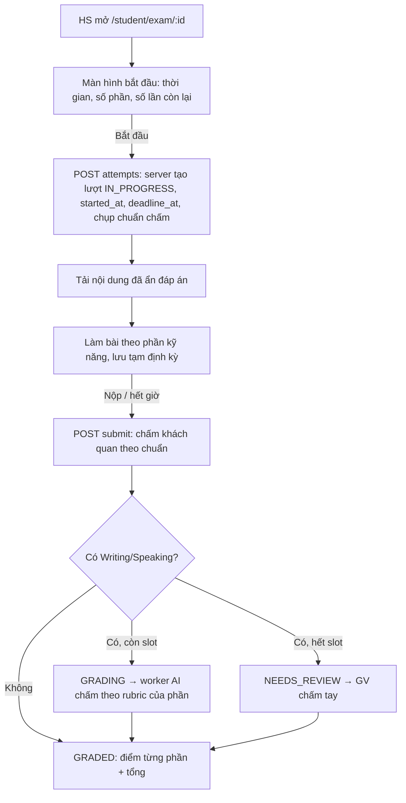

# FEAT-011: Chuẩn chấm theo loại đề & chấm đề thi phía server

> Trạng thái: SPEC_APPROVED (2026-10-31) · Quyết định: DEC-014 → DEC-018 (`docs/14-decisions.md`)

## 1. Tổng quan & mục tiêu
Trang làm đề hiện tải đáp án xuống trình duyệt, tự chấm câu khách quan (`auto_graded_score`, mặc định 7.0), gọi AI chấm Writing/Speaking đồng bộ khi nộp, đếm giờ ở trình duyệt; mọi đề chấm theo một thang cố định. FEAT-011:
- **Chuẩn chấm** (`scoring_standards`) do admin định nghĩa: phần thi theo kỹ năng (thang, quy đổi tuyến tính/bảng tra, rubric tiêu chí cho AI), quy tắc điểm tổng (trung bình / cộng / trọng số, làm tròn, điểm đạt, điểm sàn). Đề chọn một chuẩn; khóa học có chuẩn mặc định (DEC-014, DEC-015).
- **Lượt thi do server quản lý**: bắt đầu → server ghi giờ; nội dung đề đã ẩn đáp án; nộp → server chấm khách quan ngay, AI chấm nền phần Writing/Speaking, trừ slot; giới hạn số lần theo lớp (DEC-016 → DEC-018).
- Trang làm đề dùng lại `LessonPlayer` (thêm ghi âm Speaking) trong khung thi có đồng hồ và chia phần theo kỹ năng.

## 2. Phân quyền
| Hành động | ADMIN | TEACHER | STUDENT |
| :--- | :---: | :---: | :---: |
| Tạo/sửa/xoá chuẩn chấm | ✔ (chuẩn hệ thống chỉ sửa, không xoá) | xem | — |
| Chọn chuẩn cho đề / chuẩn mặc định cho khóa | ✔ | đề/khóa của mình | — |
| Làm đề (bắt đầu, lưu tạm, nộp) | — | — | đề được phép (mục 7, BR-E03) |
| Sửa điểm Writing/Speaking (grade-override) | ✔ | đề của mình hoặc lớp mình | — |

## 3. Luồng


## 4. Giao diện
| Mã | Màn hình | Ghi chú |
| :--- | :--- | :--- |
| SCR-E1 | Quản lý chuẩn chấm `/admin/scoring-standards` (menu admin mới) | Danh sách + form: tên, khung, phần thi (kỹ năng, min/max/step, tuyến tính/bảng tra + bảng `min_correct → score`, rubric AI cho Writing/Speaking), quy tắc tổng. Chuẩn hệ thống có nhãn, không xoá. |
| SCR-E2 | Chọn chuẩn khi soạn đề | Select trong `QuestionSetEditor` (mode EXAM); mặc định chuẩn của khóa đã chọn. |
| SCR-E3 | Chuẩn mặc định của khóa | Select trong modal tạo/sửa khóa ở `/teacher/tests`. |
| SCR-E4 | Làm đề `/student/exam/[examId]?classId=` | Màn hình bắt đầu → khung thi (đồng hồ theo `deadline_at`, tab phần kỹ năng, `LessonPlayer`, ghi âm Speaking) → nộp → kết quả điểm từng phần + tổng (+ đạt/không đạt). |
| SCR-E5 | Xem lại bài `/student/exam/review/[submissionId]` | Hiện `section_scores`, `total_score`, kết quả từng câu (sau khi nộp mới có đáp án). |
Đủ 4 trạng thái (tải / lỗi + Thử lại / rỗng / dữ liệu).

## 5. Dữ liệu — `docs/db-migration-009-scoring-standards.sql`
`scoring_standards` (mới, seed IELTS / TOEIC L&R / HSK 1 / Thang 10); `exams.scoring_standard_id`; `courses.default_scoring_standard_id`; `submissions` thêm `class_ref, started_at, submitted_at, graded_at, deadline_at, is_late, results, section_scores, total_score, passed, standard_snapshot`. Rubric tiêu chí (`scoring_rubrics`) giữ nguyên, được phần Writing/Speaking tham chiếu qua `rubric_id`.

Cấu trúc JSON:
```ts
section = { skill: "Reading"|"Listening"|"Writing"|"Speaking", min: number, max: number, step: number,
            conversion: "LINEAR"|"TABLE", table_question_count?: number,
            table?: { min_correct: number; score: number }[], rubric_id?: string }
aggregation = { method: "AVERAGE"|"SUM"|"WEIGHTED", round_step: number,
                weights?: Record<skill, number>, pass_score?: number, section_min?: Record<skill, number> }
```

## 6. API
- **Chuẩn chấm**: `GET /api/scoring-standards` (ADMIN, TEACHER) · `POST`, `PUT/DELETE /api/scoring-standards/[id]` (ADMIN; chuẩn `is_system` không xoá được → 409; chuẩn đang được đề/khóa dùng không xoá được → 409).
- **Đề/khóa**: `POST/PUT /api/teacher/exams` nhận `scoring_standard_id`; `POST/PUT /api/teacher/courses` nhận `default_scoring_standard_id` (phải tồn tại).
- **Học sinh** (STUDENT):
  - `POST /api/student/exams/[examId]/attempts { classId? }` → tạo hoặc **trả lại lượt đang làm** (không reset giờ) `{ attempt: { id, started_at, deadline_at, status, answers } , remaining_attempts }`; vượt số lần → 409; không được phép làm → 403.
  - `GET /api/student/exams/[examId]/content` → `{ exam: { id, title, duration_minutes, skills }, standard: { id, name, sections:[{skill,min,max}] }, questions (sanitize), flashcards (sanitize) }` — chỉ khi có lượt `IN_PROGRESS`.
  - `PUT /api/student/exam-attempts/[id]/answers { answers }` (lưu tạm, chỉ khi `IN_PROGRESS`).
  - `POST /api/student/exam-attempts/[id]/submit { answers }` → chấm, `200 { attempt }`.
  - `/api/exams/[id]/content` cũ: với STUDENT phải trả bản đã ẩn đáp án.
  - `POST /api/submissions` cũ (trình duyệt tự gửi điểm) → `410 Gone`.
- **Nội bộ**: `POST /api/exam/grade-async { submissionId }` (chỉ `x-internal-token`) viết lại bằng `queryPg`.
- **Giáo viên**: `PUT /api/exam/grade-override { submissionId, section_scores: { Writing?, Speaking? }, feedback? }` viết lại bằng `queryPg`, tính lại tổng.

## 7. Quy tắc nghiệp vụ
- **BR-E01 Chuẩn áp dụng**: `exams.scoring_standard_id` → không có thì `courses.default_scoring_standard_id` của khóa chứa đề (qua `curriculum_items.exam_id`) → không có thì `std_internal_10`. Chụp vào `standard_snapshot` lúc bắt đầu; chấm theo bản chụp.
- **BR-E02 Điểm phần**: nhóm câu theo `questions.skill`. `ratio = (objective_earned + ai_earned) / (objective_max + ai_max)` (mục AI: điểm AI quy về 0–1 theo thang phần). `TABLE` và phần không có mục AI: `n = round(objective_earned / objective_max × table_question_count)`, điểm = `score` của dòng có `min_correct` lớn nhất ≤ `n`. Ngược lại `LINEAR`: `min + ratio × (max − min)`. Làm tròn theo `step` (làm tròn nửa lên), kẹp trong [min, max]. Phần không có câu nào → không tính (null).
- **BR-E03 Được làm đề**: có `classId` → học sinh đã ghi danh lớp và đề nằm trong `class_assignments` của lớp hoặc là mục `EXAM` đang mở/hoàn thành trong lộ trình lớp; không có `classId` → đề thuộc ngân hàng luyện tập (mọi đề) và không giới hạn số lần.
- **BR-E04 Số lần**: theo lớp — `class_assignments.max_attempts` (nếu có) hoặc 1 cho mục lộ trình; đếm các lượt đã nộp (`status ≠ IN_PROGRESS`) của học sinh cho đề ở lớp đó.
- **BR-E05 Giờ**: `deadline_at = started_at + duration_minutes`; nộp sau `deadline_at + 2 phút` → `is_late = true` (vẫn chấm). Lưu tạm sau hạn bị từ chối (409).
- **BR-E06 Tổng**: chỉ các phần có điểm. `AVERAGE` trung bình, `SUM` cộng, `WEIGHTED` Σ(w·s)/Σw; làm tròn theo `round_step`. `passed` = có `pass_score` thì `total ≥ pass_score` và mọi `section_min` đạt; không có → null.
- **BR-E07 AI**: có mục AI (Writing essay/short answer, Speaking) → trừ 1 slot giáo viên (lớp: `classes.teacher_id`; luyện tập: `exams.created_by`) bằng một UPDATE có điều kiện; có slot → `GRADING` + sự kiện `GRADING_REQUESTED { submissionId }`; hết slot → `NEEDS_REVIEW` (điểm phần AI để trống, tổng tính khi giáo viên chấm). Worker gọi AI theo rubric `rubric_id` của phần với thang phần, thử tối đa 3 lần, lỗi → điểm phần AI = min và ghi `last_grading_error`.
- **BR-E08 Không lộ đáp án**: nội dung đề cho học sinh luôn qua `sanitizeQuestionForStudent`; đáp án chỉ có trong `results` sau khi nộp.

Trạng thái `submissions.status`: `IN_PROGRESS → GRADED | GRADING | NEEDS_REVIEW`; `GRADING → GRADED`; `NEEDS_REVIEW → GRADED` (grade-override).

## 8. Test case
TC-E01 điểm phần tuyến tính & bảng tra (kể cả đề ngắn quy về 40 câu) · TC-E02 tổng AVERAGE/SUM/WEIGHTED, điểm đạt, điểm sàn · TC-E03 chọn chuẩn theo thứ tự đề → khóa → mặc định · TC-E04 bắt đầu lại không reset giờ, nộp trễ đánh dấu `is_late` · TC-E05 vượt số lần lớp → 409, luyện tập không giới hạn · TC-E06 nội dung không lộ đáp án · TC-E07 có AI → GRADING, trừ 1 slot; hết slot → NEEDS_REVIEW · TC-E08 grade-override tính lại tổng · TC-E09 `POST /api/submissions` → 410.

## 9. Task
| Task | Nội dung | Phụ thuộc |
| :--- | :--- | :--- |
| TASK-018 | Migration 009 vào `ensureSchema`; `lib/exam-scoring.ts` (điểm phần, tổng, làm tròn); `gradeQuestion` thêm tuỳ chọn chấm Speaking bằng AI; `lib/lesson-ai-grading.ts` hỗ trợ Speaking | — |
| TASK-019 | API chuẩn chấm + trang admin SCR-E1 + menu; `lib/rubric-resolver.ts` bỏ Supabase trình duyệt (dùng `queryPg`) | — (song song TASK-018) |
| TASK-020 | API lượt thi học sinh, chấm khi nộp, `grade-async` + `grade-override` bằng pg, `/api/exams/[id]/content` ẩn đáp án, `POST /api/submissions` → 410 | TASK-018 |
| TASK-021 | Chọn chuẩn khi soạn đề (SCR-E2) + chuẩn mặc định khóa (SCR-E3), API đề/khóa nhận trường mới | TASK-019 |
| TASK-022 | Trang làm đề SCR-E4 dùng `LessonPlayer` + ghi âm Speaking; trang xem lại SCR-E5 | TASK-020 (hợp đồng API) |
