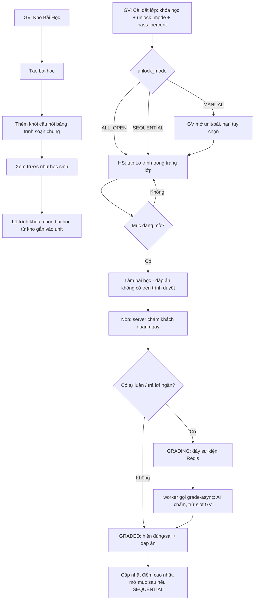
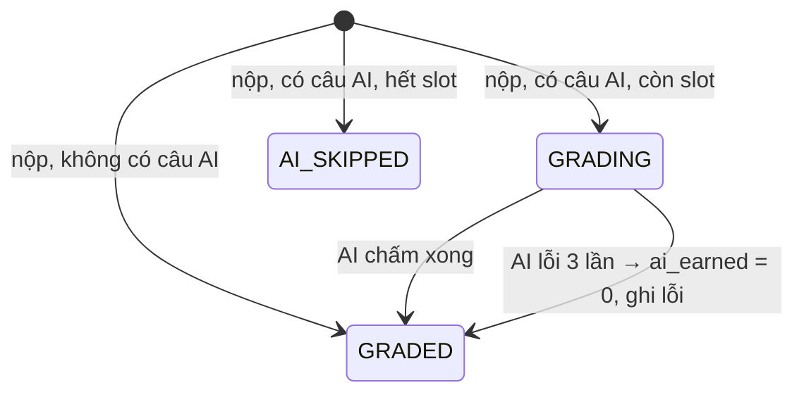

# FEAT-010: Kho bài học & học theo lộ trình lớp

> Trạng thái: SPEC_APPROVED (2026-10-31) · Quyết định: DEC-001 → DEC-013 (`docs/14-decisions.md`)

## 1. Tổng quan & mục tiêu nghiệp vụ
Hiện nút `LESSON` trong cây lộ trình chỉ là một tiêu đề, không có nội dung; học sinh không nhìn thấy lộ trình ở đâu.
FEAT-010 thêm:
- **Kho bài học** tách khỏi quản lý lộ trình: giáo viên soạn bài học gồm nhiều khối bài tập theo kỹ năng, dùng chung kho câu hỏi và trình soạn với đề thi (DEC-001, DEC-002).
- Cây lộ trình gắn bài học từ kho (`lesson_id`), như đề thi gắn `exam_id`.
- **Học theo lộ trình lớp**: mỗi lớp theo một khóa học, mở bài theo chế độ lớp (`MANUAL` / `ALL_OPEN` / `SEQUENTIAL`); học sinh làm bài, server chấm ngay câu khách quan, AI chấm nền tự luận; làm lại không giới hạn, tính điểm cao nhất.

Ngoài phạm vi: dạng Speaking trong bài học; nhân bản bài học; chia sẻ bài học giữa giáo viên.

## 2. Phân quyền
| Hành động | ADMIN | TEACHER | STUDENT |
| :--- | :---: | :---: | :---: |
| Xem/tạo/sửa/xoá bài học | mọi bài | bài `created_by = mình` | — |
| Gắn bài học vào lộ trình | mọi khóa | khóa của mình + bài học của mình | — |
| Cài đặt lớp (khóa, chế độ mở, ngưỡng), mở/khoá mục | mọi lớp | lớp `teacher_id = mình` | — |
| Xem tiến độ học sinh của lớp | mọi lớp | lớp của mình | — |
| Xem lộ trình lớp, làm bài học | — | — | lớp đã ghi danh, mục đang mở |
| Xem lịch sử làm bài | mọi | học sinh lớp mình | của chính mình |

Mọi route kiểm quyền bằng `requireRole` (CONTEXT bất biến 2); danh tính học sinh lấy từ token (bất biến 3).

## 3. Luồng tương tác


## 4. Giao diện & 4 trạng thái UI
| Mã | Màn hình | Đường dẫn | Ghi chú |
| :--- | :--- | :--- | :--- |
| SCR-L1 | Kho Bài Học | `/teacher/lessons` | Menu giáo viên mới "Kho Bài Học". Danh sách (tiêu đề, kỹ năng, số khối, số khóa đang dùng, cập nhật lúc), tìm theo tiêu đề, lọc kỹ năng, nút "Tạo bài học". |
| SCR-L2 | Soạn bài học | `/teacher/lessons/[id]` (`new` để tạo) | Tiêu đề, mô tả, kỹ năng (tự suy ra từ khối); danh sách khối (lên/xuống, sửa, xoá); "+ Thêm khối" mở trình soạn câu hỏi dùng chung; "Xem trước như học sinh". |
| SCR-L3 | Xem trước bài học | modal trong SCR-L2 | Dùng đúng trình làm bài của học sinh; nộp thử chấm nhưng không lưu. |
| SCR-L4 | Bộ chọn bài học trong lộ trình | modal trong `/teacher/tests` | Chọn bài học của mình (tìm kiếm); lối tắt "Tạo bài học mới" mở SCR-L2 ở tab mới. |
| SCR-L5 | Cài đặt lộ trình lớp | tab "Lộ trình" trong `/teacher/classes/[classId]` | Chọn khóa học, `unlock_mode`, `pass_percent`; cây lộ trình với công tắc mở/khoá + hạn (chỉ `MANUAL`); bảng tiến độ học sinh × mục. |
| SCR-L6 | Lộ trình học sinh | tab "Lộ trình" trong `/student/class/[classId]` | Thanh % tiến độ; cây unit → bài/đề; biểu tượng khoá / mở / hoàn thành + điểm cao nhất + hạn. |
| SCR-L7 | Làm bài học | `/student/lesson/[lessonId]?classId=` | Các khối theo thứ tự, mỗi khối hiện ngữ cảnh (chỉ dẫn + text/audio). Nộp → kết quả từng câu + đáp án; phần AI "Đang chấm…" tự cập nhật; nút "Làm lại"; lịch sử các lần làm. |

Mọi màn hình đủ 4 trạng thái: **đang tải** (skeleton), **lỗi** (thông báo + "Thử lại"), **rỗng** (kho trống: "Chưa có bài học — Tạo bài học đầu tiên"; lớp chưa gắn khóa: "Giáo viên chưa gắn khóa học cho lớp"; lộ trình trống), **có dữ liệu**.
Validate: tiêu đề bài học 1–255 ký tự; bài học phải có ≥ 1 khối mới gắn được vào lộ trình; `pass_percent` 1–100.

## 5. Tác động dữ liệu (migration `docs/db-migration-006-lessons.sql`)
```sql
CREATE TABLE IF NOT EXISTS lessons (
  id VARCHAR(50) PRIMARY KEY,                 -- "lsn_" + uuid
  title VARCHAR(255) NOT NULL,
  description TEXT,
  skills TEXT[] NOT NULL DEFAULT '{}',
  question_ids JSONB NOT NULL DEFAULT '[]',   -- thứ tự khối, trỏ bảng questions dùng chung
  created_by VARCHAR(50) NOT NULL,
  created_at TIMESTAMPTZ DEFAULT NOW(),
  updated_at TIMESTAMPTZ DEFAULT NOW()
);
CREATE INDEX IF NOT EXISTS idx_lessons_created_by ON lessons (created_by);

ALTER TABLE curriculum_items ADD COLUMN IF NOT EXISTS lesson_id VARCHAR(50);
DELETE FROM curriculum_items WHERE type = 'LESSON' AND lesson_id IS NULL;   -- DEC-012

ALTER TABLE classes ADD COLUMN IF NOT EXISTS course_id TEXT;
ALTER TABLE classes ADD COLUMN IF NOT EXISTS unlock_mode VARCHAR(20) NOT NULL DEFAULT 'MANUAL';
ALTER TABLE classes ADD COLUMN IF NOT EXISTS pass_percent INTEGER NOT NULL DEFAULT 70;

CREATE TABLE IF NOT EXISTS class_unlocks (
  class_id VARCHAR(50) NOT NULL,
  curriculum_item_id VARCHAR(50) NOT NULL,     -- unit hoặc bài/đề; mở unit = mở mọi mục con
  student_id VARCHAR(50),                      -- NULL = cả lớp; có giá trị = mở riêng cho HS bị kẹt (DEC-008)
  due_date TIMESTAMPTZ,
  unlocked_by VARCHAR(50) NOT NULL,
  unlocked_at TIMESTAMPTZ DEFAULT NOW()
);
CREATE UNIQUE INDEX IF NOT EXISTS uq_class_unlocks
  ON class_unlocks (class_id, curriculum_item_id, COALESCE(student_id, ''));

CREATE TABLE IF NOT EXISTS lesson_attempts (
  id VARCHAR(50) PRIMARY KEY,                  -- "att_" + uuid
  lesson_id VARCHAR(50) NOT NULL,
  class_id VARCHAR(50) NOT NULL,
  student_id VARCHAR(50) NOT NULL,
  answers JSONB NOT NULL DEFAULT '{}',
  results JSONB NOT NULL DEFAULT '[]',         -- kết quả từng câu (GradeResult[])
  objective_earned NUMERIC NOT NULL DEFAULT 0,
  objective_max NUMERIC NOT NULL DEFAULT 0,
  ai_earned NUMERIC,                           -- NULL khi chưa chấm AI
  ai_max NUMERIC NOT NULL DEFAULT 0,
  score_percent NUMERIC,                       -- NULL khi còn GRADING
  status VARCHAR(20) NOT NULL DEFAULT 'GRADED',-- GRADING | GRADED | AI_SKIPPED
  created_at TIMESTAMPTZ DEFAULT NOW(),
  graded_at TIMESTAMPTZ
);
CREATE INDEX IF NOT EXISTS idx_lesson_attempts_lookup ON lesson_attempts (class_id, student_id, lesson_id);
```
`lib/db-pg.ts` `ensureSchema()` chạy cùng DDL (riêng câu `DELETE` của DEC-012 an toàn khi chạy lặp vì API bắt buộc `lesson_id`).
Neo4j: không đổi.

## 6. Hợp đồng API
Lỗi chung `{ success: false, error }`; 401 chưa đăng nhập, 403 sai vai trò/không sở hữu, 404 không có, 409 xung đột.

**Câu hỏi (dùng chung đề & bài học)** — ADMIN, TEACHER
- `POST /api/teacher/questions` `{ skill, category, prompt, stimulus_text?, stimulus_audio_url?, content }` → `201 { question }`; `category` thuộc 15 dạng (DEC-001), `content` qua `buildStandardQuestionContent`.
- `PUT /api/teacher/questions/[id]` → `200 { question }`. (Thay việc trang tạo đề ghi thẳng Supabase.)

**Kho bài học** — ADMIN, TEACHER (sở hữu theo DEC-004)
- `GET /api/teacher/lessons?q=&skill=` → `{ lessons: [{ id, title, description, skills, block_count, usage_count, updated_at }] }`
- `POST /api/teacher/lessons` `{ title, description? }` → `201 { lesson }`
- `GET /api/teacher/lessons/[id]` → `{ lesson, questions (theo thứ tự, CÓ đáp án — chỉ cho giáo viên), flashcards }`
- `PUT /api/teacher/lessons/[id]` `{ title?, description?, question_ids? }` → `{ lesson }`; `question_ids` phải là câu hỏi tồn tại; `skills` tự tính từ câu hỏi.
- `DELETE /api/teacher/lessons/[id]` → `200 { success }` hoặc `409 { error, usages: [{ course_id, course_title, curriculum_item_id }] }` (DEC-005).

**Lộ trình** — `/api/teacher/curriculum` (TASK-006) thêm `lesson_id`: `LESSON` bắt buộc `lesson_id` là bài học người gọi được dùng; phản hồi item có `lesson_id`.

**Lớp** — ADMIN, TEACHER phụ trách lớp
- `PUT /api/teacher/classes/[classId]/settings` `{ course_id?, unlock_mode?, pass_percent? }` → `{ class }`
- `GET /api/teacher/classes/[classId]/roadmap` → `{ class, items (cây), unlocks }`
- `POST /api/teacher/classes/[classId]/unlocks` `{ curriculum_item_id, student_id?, due_date? }` → `201`; `DELETE …/unlocks?curriculum_item_id=&student_id=` → `200`
- `GET /api/teacher/classes/[classId]/progress` → `{ students: [{ id, name }], items: [{ id, title, type }], cells: { [studentId]: { [itemId]: { best_percent, attempts, completed } } } }`

**Học sinh** — STUDENT đã ghi danh lớp
- `GET /api/student/classes/[classId]/roadmap` → `{ class: { id, name, unlock_mode, pass_percent }, progress_percent, items: [{ id, parent_id, type, title, lesson_id, exam_id, order_index, state: "LOCKED"|"OPEN"|"COMPLETED", best_percent, due_date }] }`
- `GET /api/student/lessons/[lessonId]?classId=` → `{ lesson: { id, title, description }, questions: <đã qua sanitizeQuestionForStudent>, flashcards: <không có correct_english_word> }`; mục khoá → 403.
- `POST /api/student/lessons/[lessonId]/attempts` `{ classId, answers }` → `201 { attempt }` (đã chấm khách quan; `status` GRADING nếu có câu AI).
- `GET /api/student/lessons/[lessonId]/attempts?classId=` → `{ attempts }` (mới nhất trước); `GET /api/student/attempts/[id]` → `{ attempt }` (để hỏi lại khi GRADING).

**Nội bộ** — `POST /api/lessons/grade-async` `{ attemptId }`, chỉ `x-internal-token` (CONTEXT bất biến 5); worker nhận sự kiện `LESSON_GRADING_REQUESTED`.

## 7. Quy tắc nghiệp vụ & máy trạng thái
- **BR-L01** Bài học thuộc `created_by`; TEACHER chỉ thao tác bài học của mình (DEC-004).
- **BR-L02** Không xoá bài học đang được `curriculum_items.lesson_id` tham chiếu → 409 kèm danh sách (DEC-005).
- **BR-L03** Gắn vào lộ trình yêu cầu bài học ≥ 1 khối.
- **BR-L04** Trạng thái mục với học sinh:
  - `ALL_OPEN`: mọi mục `OPEN`.
  - `MANUAL`: `OPEN` nếu có dòng `class_unlocks` (cả lớp hoặc riêng học sinh) cho chính mục hoặc unit cha.
  - `SEQUENTIAL`: duyệt cây theo thứ tự (unit theo `order_index`, rồi mục con); mục đầu tiên luôn `OPEN`; mục sau `OPEN` khi mọi mục trước đã `COMPLETED`; dòng `class_unlocks` riêng học sinh mở ngoại lệ.
  - `COMPLETED` (mọi chế độ): bài học có `best_percent ≥ pass_percent`; đề thi có bài nộp với `final_score ≥ passing_score` (không có `passing_score` → có bài nộp) (DEC-008). Unit không tính là mục học.
- **BR-L05** Đổi `unlock_mode` được bất cứ lúc nào; dòng `class_unlocks` giữ nguyên, chỉ có hiệu lực ở `MANUAL` (và ngoại lệ riêng học sinh ở `SEQUENTIAL`).
- **BR-L06** Chấm khách quan trên server bằng `lib/grading.ts`, tính theo **điểm thành phần**: mỗi câu con MC, mỗi ô trống, mỗi cặp nối, mỗi thẻ flashcard = 1 điểm; sắp xếp và viết lại câu = 1 điểm (đúng toàn bộ). So sánh bỏ khoảng trắng thừa, không phân biệt hoa thường.
- **BR-L07** Tự luận (`WRITING_ESSAY`) và trả lời ngắn (`WRITING_SHORT_ANSWER`, mỗi câu con) chấm AI, mỗi mục tối đa 1 điểm = band/9. Dạng Speaking trong bài học không được tính (max 0).
- **BR-L08** `score_percent = (objective_earned + ai_earned) / (objective_max + ai_max) × 100`, làm tròn 1 chữ số; tổng max = 0 → 100.
- **BR-L09** Đáp án (`correct_answer(s)`, `correct_text`, `pairs` ghép sẵn, `correct_english_word`, `sample_answer`, đáp án trong ngoặc của đoạn văn) **không bao giờ** có trong phản hồi cho học sinh trước khi nộp; kết quả sau nộp mới kèm đáp án (DEC-009).
- **BR-L10** Làm lại không giới hạn; `best_percent` = max `score_percent` các lần `GRADED`/`AI_SKIPPED` (DEC-010).
- **BR-L11** Mỗi lần nộp có câu AI trừ **1 slot** của giáo viên phụ trách lớp (`users.slot_limit`); hết slot → không chấm AI, `status = AI_SKIPPED`, `ai_earned = 0`, kết quả ghi "Chưa chấm (hết lượt AI)".
- **BR-L12** Học sinh chỉ nộp được bài học đang `OPEN` trong lớp đã ghi danh, và bài học phải thuộc lộ trình khóa của lớp.

Máy trạng thái `lesson_attempts.status`:


## 8. Test case
| Mã | Nội dung | Loại |
| :--- | :--- | :--- |
| TC-L01 | Chấm khách quan đúng cho từng dạng (MC nhiều câu con, điền ô 3 kiểu, sắp xếp từ/câu, nối cặp, flashcard, điền tự do, viết lại câu có gợi ý) | unit |
| TC-L02 | `sanitizeQuestionForStudent` không để lọt bất kỳ đáp án nào (kể cả trong đoạn văn) | unit/bảo mật |
| TC-L03 | TEACHER không xem/sửa/xoá/gắn bài học của giáo viên khác | integration |
| TC-L04 | Xoá bài học đang dùng → 409 kèm danh sách khóa | integration |
| TC-L05 | Trạng thái mục theo 3 chế độ mở, gồm ngoại lệ mở riêng học sinh | unit/integration |
| TC-L06 | Học sinh nộp bài khoá / lớp chưa ghi danh / bài không thuộc khóa → 403 | integration/bảo mật |
| TC-L07 | Nộp có tự luận → GRADING, worker chấm xong → GRADED, trừ đúng 1 slot; hết slot → AI_SKIPPED | integration |
| TC-L08 | Điểm cao nhất mở mục kế tiếp ở `SEQUENTIAL` | integration |
| TC-L09 | Trình soạn câu hỏi tách thành component: trang tạo đề hoạt động như cũ | hồi quy |
| TC-L10 | Phản hồi API học sinh không chứa đáp án (quét toàn bộ JSON) | bảo mật |

## 9. Task triển khai & DoD
Lệnh xác minh chung: `npx vitest run && npx tsc --noEmit -p tsconfig.json` (mỗi task có `verify.sh` riêng).

| Task | Nội dung | DoD |
| :--- | :--- | :--- |
| TASK-007 | Migration 006 + `ensureSchema`; `lib/grading.ts`: `gradeQuestion`, `sanitizeQuestionForStudent`, `computeScorePercent` | TC-L01, TC-L02 xanh |
| TASK-008 | API câu hỏi `/api/teacher/questions`; API kho bài học; lộ trình nhận `lesson_id` | TC-L03, TC-L04 xanh |
| TASK-009 | Tách trình soạn câu hỏi khỏi `app/teacher/tests/create/page.tsx` thành component dùng chung, lưu câu hỏi qua API | TC-L09; trang tạo đề không còn ghi Supabase trực tiếp |
| TASK-010 | UI SCR-L1, SCR-L2, SCR-L3, SCR-L4 + menu giáo viên | 4 trạng thái UI; test tĩnh |
| TASK-011 | API cài đặt lớp, mở/khoá, `lib/roadmap.ts` tính trạng thái mục (BR-L04) | TC-L05 xanh |
| TASK-012 | API học sinh: roadmap, nội dung bài (đã sanitize), nộp bài, chấm AI nền qua worker + slot | TC-L06, TC-L07, TC-L08, TC-L10 xanh |
| TASK-013 | UI SCR-L5 (cài đặt + mở/khoá + tiến độ), SCR-L6, SCR-L7 | 4 trạng thái UI; test tĩnh |
