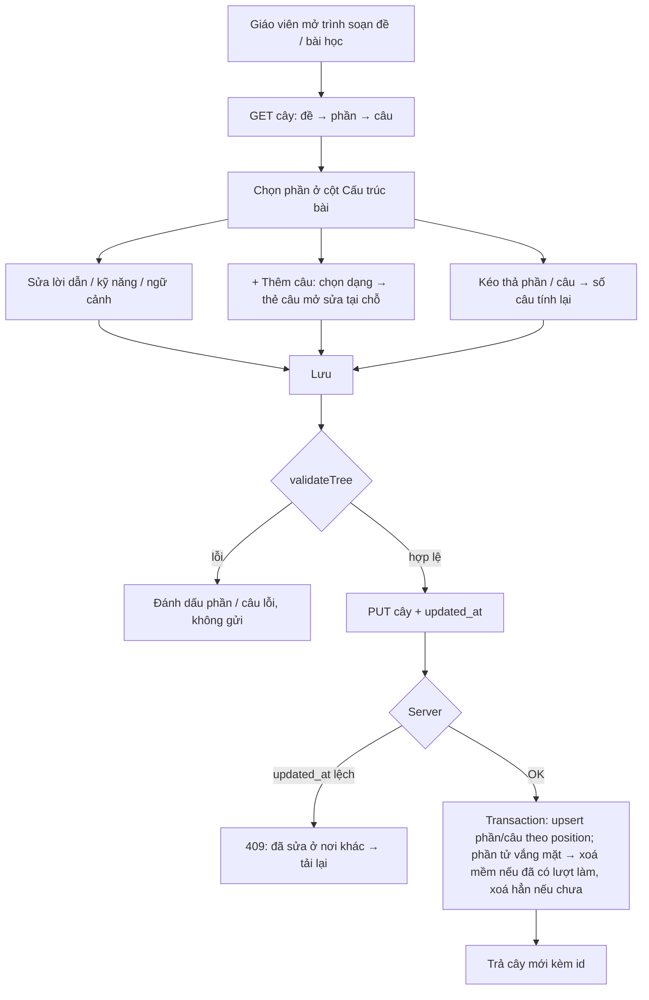
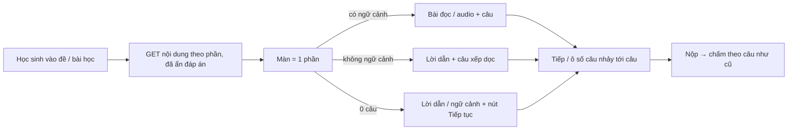

# FEAT-017: Bài học & đề thi theo Phần (sections)

> Trạng thái: SPEC_APPROVED (2026-11-24) · Quyết định: DEC-051 → DEC-054 (`docs/14-decisions.md`) · Thay: cách tổ chức `question_ids` + `stimulus_*` của FEAT-010 / FEAT-011, `sub_questions` trắc nghiệm · Phụ thuộc: FEAT-015 (bộ chuyển đổi nhập đề)

## 1. Tổng quan & mục tiêu nghiệp vụ
Hiện nay đề thi và bài học là một mảng `question_ids`. Mỗi câu hỏi tự mang ngữ cảnh (`stimulus_text`, `stimulus_audio_url`) và chỉ có **một dạng**. Câu trắc nghiệm gom nhiều ý vào `content.sub_questions`.

Vấn đề với giáo viên dùng thử:
- Một bài đọc trên đề giấy thường có vài câu trắc nghiệm, vài câu điền ô và một câu sắp xếp. Muốn làm vậy, giáo viên phải tạo nhiều câu và **dán lại bài đọc** vào từng câu.
- Màn thi (`lib/exam-layout.ts` `buildScreens`) chỉ gom các câu liền nhau có ngữ cảnh **giống từng ký tự**. Sửa một chữ ở một câu là bài đọc bị tách đôi.
- Bài học (`LessonPlayer`) lặp lại bài đọc ở mỗi câu.
- Số câu không khớp đề giấy: đoạn điền 10 ô chỉ hiện là "Câu 21".

**Mục tiêu:**
1. Đề thi / bài học = danh sách **Phần**. Mỗi phần có lời dẫn, kỹ năng và ngữ cảnh tuỳ chọn, chứa 0..n câu thuộc nhiều dạng khác nhau. Ngữ cảnh chỉ lưu một lần.
2. Mỗi ý độc lập là một bản ghi câu. Số câu liên tục qua các phần, theo số ý chấm điểm (DEC-052).
3. Trình soạn chia theo phần. Cột phải là cấu trúc bài (DEC-054).
4. Màn học sinh: mỗi phần một màn. Phần chỉ có lời dẫn hoặc ngữ cảnh thì học sinh đọc xong bấm Tiếp tục.
5. Refactor hoàn toàn, code mới không đọc định dạng cũ. Dữ liệu hiện có (321 đề, 796 câu, chủ yếu 3 khoá Cambridge) được chuyển bằng script một lần (DEC-053).

**Ngoài phạm vi:** kho bài đọc dùng chung giữa nhiều đề, giới hạn số lần nghe theo phần, video trong ngữ cảnh.

## 2. Phân quyền
Không đổi so với FEAT-010 / FEAT-011.
- `TEACHER` chỉ đọc / ghi phần và câu của đề / bài học do mình tạo (bất biến 4). Quyền xét theo `created_by` của đề / bài học cha, không theo từng phần.
- `ADMIN` thao tác mọi thứ.
- `STUDENT` chỉ đọc nội dung đã ẩn đáp án qua các API học sinh. Điều kiện truy cập giữ nguyên BR-L12, BR-E03.

## 3. Luồng tương tác




## 4. Giao diện & 4 trạng thái UI
### 4.1 Trình soạn (SCR-23 `/teacher/tests/create`, SCR-25 `/teacher/lessons/[id]`)
Hai màn dùng chung một component mới `components/section-builder/SectionEditor.tsx`, thay `QuestionSetEditor`.

```text
┌─ Soạn Phần 2 ─────────────────────────┬─ Cấu trúc bài ────────┐
│ Kỹ năng: [Reading ▾]                  │ ☰ Phần 1  Ngữ âm      │
│ Lời dẫn: Read the passage and...      │    Câu 1–4            │
│ Ngữ cảnh: [Không] [Chữ ●] [Audio] [Cả hai] │ ☰ Phần 2 "People   │
│ ┌──────────────────────────────────┐  │    often say..."  ◀   │
│ │ People often say that...         │  │    Câu 5–12           │
│ └──────────────────────────────────┘  │ ☰ Phần 3  Hướng dẫn   │
│ ☰ Câu 5    Trắc nghiệm  The word... ✎ 🗑 │    (không có câu)     │
│ ☰ Câu 6    Trắc nghiệm  According...✎ 🗑 │ ☰ Phần 4  Điền ô      │
│ ☰ Câu 7–11 Điền ô (5)   ...         ✎ 🗑 │    Câu 13–22          │
│ ☰ Câu 12   Sắp xếp      ...         ✎ 🗑 │ [+ Thêm phần]         │
│ [+ Thêm câu: dạng ▾]                  │ Tổng: 22 câu · 4 phần │
└───────────────────────────────────────┴───────────────────────┘
```

- **Cột Cấu trúc bài:**
  - Mỗi mục là một phần, hiện tên ngắn: lời dẫn hoặc ~40 ký tự đầu của ngữ cảnh, hoặc "Phần N" nếu cả hai trống.
  - Dưới tên là "Câu a–b", hoặc "(không có câu)".
  - Kéo thả để sắp xếp. Bấm để chọn. Menu ⋯ có: Nhân bản phần, Xoá phần.
- **Vùng soạn phần:**
  - Kỹ năng (Reading / Listening / Writing / Speaking).
  - Lời dẫn: textarea, một dòng tới vài dòng.
  - Ngữ cảnh: `NONE` / `TEXT_ONLY` / `AUDIO_ONLY` / `COMBINED`. Chữ dùng trình soạn HTML sẵn có, ảnh chèn trong HTML. Audio là upload hoặc TTS như hiện nay.
- **Thẻ câu:**
  - Thu gọn: số câu, dạng, ~60 ký tự đầu.
  - Bấm ✎ mở form sửa **tại chỗ**, dùng lại các form dạng câu hiện có trong `QuestionSetEditor` (đã ánh xạ đủ trường ở DEC-050), tách thành component theo dạng.
  - Chỉ mở một thẻ một lúc. Mở thẻ khác thì thẻ đang mở được giữ nguyên dữ liệu (không mất như lỗi cũ).
- **"+ Thêm câu":** chỉ liệt kê các dạng thuộc kỹ năng của phần (BR-P04). Câu mới thêm vào cuối phần và mở sẵn form.
- **Kéo câu:** trong một phần, hoặc sang phần **cùng kỹ năng** ở cột phải. Thả vào phần khác kỹ năng thì không nhận (BR-P04).
- **Thanh trên:** tiêu đề, mô tả, thời gian (đề), chuẩn chấm, khoá học như hiện nay, nút Xem trước, nút Lưu.
- **Cảnh báo đã có lượt làm** (BR-P09): băng vàng "Đề đã có N lượt làm. Câu / phần bị xoá vẫn hiện trong bài cũ; sửa đáp án không chấm lại bài cũ."

| Trạng thái | Hiển thị |
| :--- | :--- |
| Đang tải | Khung xương cột phải + vùng soạn |
| Rỗng (đề mới) | Một Phần 1 trống, đã chọn sẵn; nút "+ Thêm câu" nổi bật |
| Lỗi tải | Thông báo tiếng Việt + nút Thử lại |
| Lỗi lưu | Phần / câu lỗi được tô đỏ ở cả hai cột, tooltip lý do (BR-P02, P03, P05); `409` → hộp thoại "Đề đã được sửa ở nơi khác. Tải lại?" |
| Thành công | Toast "Đã lưu", cây được thay bằng cây server trả (id thật) |

### 4.2 Màn học sinh (SCR-12 `/student/lesson/[lessonId]`, SCR-13 `/student/exam/[examId]`)
- Mỗi phần một màn, theo thứ tự giáo viên xếp. Bỏ việc nhóm theo kỹ năng của `groupQuestionsBySkill`.
- Bố cục giữ DEC-020, chọn theo kỹ năng và ngữ cảnh của phần:
  - Listening → audio trên cùng;
  - Reading có ngữ cảnh dài (≥ `SPLIT_MIN_CHARS`) → chia đôi;
  - còn lại → FOCUS.
- Lời dẫn của phần hiện đầu màn.
- Phần 0 câu: hiện lời dẫn / ngữ cảnh và nút **Tiếp tục**. Ô điều hướng hiện phần này bằng biểu tượng 📖, không có số, không tính vào "đã trả lời".
- Ô điều hướng số câu dùng `numberedCount()`. Câu chiếm N số (điền 10 ô) hiện "21–30" và nhảy tới câu đó.
- SCR-14 (xem lại) và Review Studio / xem trước (SCR-24) hiện theo phần, kể cả câu đã xoá mềm có trong bài nộp đó.

## 5. Tác động dữ liệu (migration 019, 020)
**019 — thêm (ensureSchema):**
```sql
CREATE TABLE IF NOT EXISTS sections (
  id TEXT PRIMARY KEY,                         -- sec_<uuid>
  exam_id TEXT REFERENCES exams(id) ON DELETE CASCADE,
  lesson_id TEXT REFERENCES lessons(id) ON DELETE CASCADE,
  position INT NOT NULL,
  skill TEXT NOT NULL,                         -- Reading | Listening | Writing | Speaking
  instruction TEXT,                            -- lời dẫn
  stimulus_type TEXT NOT NULL DEFAULT 'NONE',  -- NONE | TEXT_ONLY | AUDIO_ONLY | COMBINED
  stimulus_text TEXT,                          -- HTML (ảnh nhúng trong HTML)
  stimulus_audio_url TEXT,
  stimulus_audio_text TEXT,                    -- nội dung TTS
  stimulus_audio_gender TEXT,
  deleted_at TIMESTAMPTZ,
  created_at TIMESTAMPTZ NOT NULL DEFAULT NOW(),
  updated_at TIMESTAMPTZ NOT NULL DEFAULT NOW(),
  CONSTRAINT sections_one_parent CHECK ((exam_id IS NULL) <> (lesson_id IS NULL))
);
CREATE INDEX IF NOT EXISTS sections_exam_idx ON sections (exam_id, position) WHERE deleted_at IS NULL;
CREATE INDEX IF NOT EXISTS sections_lesson_idx ON sections (lesson_id, position) WHERE deleted_at IS NULL;
ALTER TABLE questions ADD COLUMN IF NOT EXISTS section_id TEXT REFERENCES sections(id) ON DELETE CASCADE;
ALTER TABLE questions ADD COLUMN IF NOT EXISTS position INT;
ALTER TABLE questions ADD COLUMN IF NOT EXISTS deleted_at TIMESTAMPTZ;
CREATE INDEX IF NOT EXISTS questions_section_idx ON questions (section_id, position) WHERE deleted_at IS NULL;
ALTER TABLE exams ADD COLUMN IF NOT EXISTS updated_at TIMESTAMPTZ NOT NULL DEFAULT NOW();
```

**020 — bỏ (chạy tay sau khi script chuyển dữ liệu xong, `docs/15` §3):**
- `exams.question_ids`, `exams.stimulus_type`, `exams.stimulus_text`, `exams.stimulus_audio_url`;
- `lessons.question_ids`;
- `questions.stimulus_text`, `questions.stimulus_audio_url`;
- `ALTER TABLE questions ALTER COLUMN section_id SET NOT NULL`, `position SET NOT NULL`.

**`questions.content` đổi (khoá JSON, không cần migration):**

| Dạng | Trước | Sau |
| :--- | :--- | :--- |
| `READING_MC`, `LISTENING_MC` | `{ sub_questions: [{ id, text, option_a…d, correct_answer }] }` | `{ text, option_a, option_b, option_c, option_d, correct_answer: "A".."D", audio_url? }`, một ý một bản ghi |
| `WRITING_SHORT_ANSWER` | `{ sub_questions: [{ text, max_words, sample_answer }] }` | `{ text, max_words, sample_answer? }` |
| `WRITING_SENTENCE_REWRITE` | phẳng hoặc `sub_questions` | phẳng `{ original_sentence, correct_answer, starting_cue }` |
| Các dạng khác | — | giữ nguyên |

- `questions.skill` vẫn giữ, khi lưu luôn bằng `sections.skill`. Nhờ vậy chấm điểm theo phần kỹ năng (BR-E02) không đổi.
- `questions.prompt` là đề bài riêng của câu (vd đề bài luận), tuỳ chọn. Lời dẫn chung nằm ở `sections.instruction`.
- `submissions.answers` / `lesson_attempts.answers` vẫn theo id câu. Trắc nghiệm giờ là `answers[questionId] = "B"`, không còn khoá id câu con.

**Script chuyển dữ liệu** (`scripts/migrate-sections.ts`, chạy một lần, có `--dry-run`):
1. Mỗi đề / bài học: duyệt `question_ids` theo thứ tự.
2. Câu liền nhau có cùng `stimulus_text` + `stimulus_audio_url` (khác rỗng) gộp thành một phần.
3. Câu không có ngữ cảnh: mỗi câu cũ thành một phần, `instruction` = `prompt` cũ.
4. Trong phần gộp:
   - `instruction` = `prompt` của câu đầu;
   - câu sau có `prompt` khác thì giữ ở `questions.prompt`;
   - `skill` = `skill` của câu đầu. Nếu khác kỹ năng thì tách phần mới.
5. `exams.stimulus_text` / `stimulus_audio_url` của đề (nếu có) → một phần 0 câu đứng đầu.
6. Trắc nghiệm / trả lời ngắn có `sub_questions` → mỗi ý thành một câu, id `<id cũ>_<số thứ tự>`. Câu gốc bị xoá.
7. Câu điền ô kiểu cũ có đoạn văn ở `stimulus_text` (nhánh trong `lib/grading.ts`) → chuyển đoạn văn vào `content.passage`.
8. Câu mồ côi (không đề / bài học nào tham chiếu) → xoá.
9. Xoá `submissions`, `lesson_attempts` và các bảng điểm phụ thuộc (dữ liệu thử, DEC-053).
10. In báo cáo: số đề, phần, câu trước / sau, tổng `numberedCount` từng đề, các đề cần xem tay.

## 6. Hợp đồng API
### 6.1 Cây đề / bài học (giáo viên)
`GET /api/teacher/exams/[id]`, `GET /api/teacher/lessons/[id]` → `200`:
```json
{ "success": true,
  "exam": { "id": "...", "title": "...", "updated_at": "2026-11-24T08:00:00Z", "attempt_count": 0, "...": "các trường cũ" },
  "sections": [
    { "id": "sec_…", "position": 0, "skill": "Reading", "instruction": "Read the passage…",
      "stimulus_type": "TEXT_ONLY", "stimulus_text": "<p>…</p>", "stimulus_audio_url": null,
      "questions": [ { "id": "q_…", "position": 0, "category": "READING_MC", "prompt": null, "content": { } } ] } ] }
```

`POST /api/teacher/exams`, `PUT /api/teacher/exams/[id]` (bài học tương tự) nhận:
```json
{ "exam": { "title": "...", "updated_at": "<giá trị đã GET>", "...": "các trường cũ" },
  "sections": [ { "id": "sec_… | bỏ trống nếu mới", "skill": "...", "instruction": "...", "stimulus_type": "...", "...": "",
                  "questions": [ { "id": "q_… | bỏ trống", "category": "...", "prompt": null, "content": { } } ] } ] }
```
- Thứ tự trong mảng chính là `position`.
- Server chạy `buildStandardQuestionContent` cho từng câu, rồi `validateTree`, rồi ghi trong **một transaction** (BR-P07).
- Id gửi lên nhưng không thuộc đề này → `400` "Phần / câu không thuộc đề này".
- Mã lỗi:
  - `400` cây không hợp lệ, kèm `{ errors: [{ section_index, question_index?, message }] }`;
  - `403` không phải chủ;
  - `404` không tìm thấy;
  - `409` `updated_at` lệch: "Đề đã được sửa ở nơi khác, tải lại để tiếp tục".
- `POST /api/teacher/questions`, `PUT /api/teacher/questions/[id]` **bị bỏ** (TASK-057). Câu chỉ tạo / sửa qua lần lưu cả cây.

### 6.2 Học sinh
`GET /api/student/exams/[examId]/content`, `GET /api/student/lessons/[lessonId]`:
- Trả `sections[]` (bỏ `deleted_at`), mỗi phần có `questions[]` đã qua `sanitizeQuestionForStudent`.
- Kèm `number_start` / `number_count` của từng câu, do server tính bằng `numberedCount`.

Nộp bài (`POST /api/student/exam-attempts/[id]/submit`, `POST /api/student/lessons/[lessonId]/attempts`): payload `answers` giữ nguyên dạng, chấm theo câu. Câu đã xoá mềm không chấm.

### 6.3 Các route khác phải đổi theo
- `GET /api/submissions/[id]`, `GET /api/teacher/grading/attempts/[kind]/[attemptId]` trả cây có câu đã xoá mềm nằm trong bài nộp.
- `/api/teacher/exams/[id]/preview`, `/api/teacher/lessons/[id]/preview` (`lib/teacher-preview.ts`) trả theo phần.
- `/api/teacher/exams/[id]/duplicate`, `/api/teacher/lessons/[id]/duplicate` và chuyển loại (`lib/library-ops.ts`):
  - nhân bản = chép sâu phần + câu;
  - chuyển bài học ↔ đề = đổi `exam_id` / `lesson_id` của các phần.
- `POST /api/teacher/exams/ai-import` nhận nhóm → mỗi nhóm thành một phần (TASK-060).
- `/api/exams/[id]`, `/api/exams/[id]/content`, `/api/teacher/curriculum`, `/api/teacher/flashcards/[id]`, `/api/lessons/grade-async`: bỏ đọc `question_ids`, đọc theo phần.

## 7. Quy tắc nghiệp vụ (BR-P) & máy trạng thái
- **BR-P01** Đề / bài học = danh sách phần có thứ tự. Mỗi phần thuộc đúng một đề hoặc một bài học (CHECK). Dùng lại = sao chép.
- **BR-P02** Đề / bài học có ít nhất 1 phần. **Đề thi** có ít nhất 1 câu tính điểm. Bài học có thể chỉ có phần đọc.
- **BR-P03** Phần có thể 0 câu, nhưng không được trống hoàn toàn: phải có lời dẫn, ngữ cảnh chữ, hoặc audio. Nếu không → lỗi "Phần N trống".
- **BR-P04** Dạng câu phải thuộc kỹ năng của phần (`skillOfCategory(category) === section.skill`). `questions.skill` luôn bằng `sections.skill`.
- **BR-P05** Ngữ cảnh khớp `stimulus_type`:
  - `AUDIO_ONLY` / `COMBINED` phải có audio (URL hoặc nội dung TTS);
  - `TEXT_ONLY` / `COMBINED` phải có chữ;
  - phần Listening có câu thì phải có audio ở phần, hoặc ở từng câu trắc nghiệm.
- **BR-P06** Số câu = tổng `numberedCount` các câu đứng trước (qua mọi phần, bỏ câu xoá mềm) + 1. `numberedCount`:
  - điền ô / tự gõ chỗ trống = số ô;
  - nối = số cặp;
  - mọi dạng khác (trắc nghiệm, trả lời ngắn, viết lại câu, sắp xếp, bài luận, Speaking, flashcard) = 1.
  Không lưu số câu. `scoring_standards.table_question_count` so với tổng `numberedCount` của phần kỹ năng.
- **BR-P07** Lưu cả cây trong một transaction. `position` = chỉ số trong mảng. Phần / câu vắng mặt trong payload thì xoá, theo BR-P09. Lỗi giữa chừng → rollback toàn bộ.
- **BR-P08** Kiểm xung đột: `exam.updated_at` / `lesson.updated_at` client gửi phải bằng giá trị trong DB, không thì `409`. Lưu xong cập nhật `updated_at`.
- **BR-P09** Đề / bài học đã có lượt làm (`submissions` / `lesson_attempts`):
  - xoá phần / câu là xoá mềm (`deleted_at`);
  - sửa nội dung / đáp án thì không chấm lại bài cũ;
  - trình soạn hiện số lượt làm.
  Chưa có lượt làm thì xoá hẳn.
- **BR-P10** Học sinh không nhận phần / câu xoá mềm. Trang xem lại bài nộp nhận cả câu xoá mềm có trong `results` của bài đó.
- **BR-P11** Màn học sinh: một phần một màn theo `position`. Phần 0 câu có nút Tiếp tục, không tính vào số câu đã trả lời.
- **BR-P12** Trắc nghiệm là một ý một bản ghi, `correct_answer` là chữ cái A–D (DEC-050). Không còn `content.sub_questions` ở bất kỳ dạng nào. Code mới không đọc `sub_questions` (DEC-053).
- **BR-P13** Nhân bản đề / bài học chép sâu phần + câu (id mới). Chuyển bài học ↔ đề giữ nguyên id phần / câu.
- **BR-P14** AI nhập đề: mỗi nhóm đề giấy → một phần:
  - `instruction` = lời dẫn nhóm, ngữ cảnh = bài đọc / audio của nhóm;
  - các câu `convertGroup` sinh ra nằm trong phần đó, trắc nghiệm tách mỗi ý một câu.
  - Bài đọc dùng chung nhiều nhóm (DEC-049) → các nhóm liền nhau dùng chung một phần.

Máy trạng thái: không thêm trạng thái mới. Xoá mềm là cờ `deleted_at`, không phải trạng thái.

## 8. Test case (TC-P) & Review Focus
| TC | Ca kiểm | BR | Test |
| :--- | :--- | :--- | :--- |
| TC-P01 | `numberedCount`: trắc nghiệm 1, điền 10 ô → 10, nối 5 cặp → 5, bài luận 1; số câu liên tục qua 3 phần (1–4, 5–14, 15) | P06 | `exam-structure` |
| TC-P02 | Câu xoá mềm không chiếm số; phần 0 câu không chiếm số | P06, P10 | `exam-structure` |
| TC-P03 | `validateTree`: đề 0 phần → lỗi; đề toàn phần 0 câu → lỗi; bài học toàn phần đọc → hợp lệ | P02 | `exam-structure` |
| TC-P04 | Phần không lời dẫn, không ngữ cảnh, 0 câu → lỗi "Phần N trống"; chỉ có lời dẫn → hợp lệ | P03 | `exam-structure` |
| TC-P05 | Câu `LISTENING_MC` trong phần Reading → lỗi; `questions.skill` lưu bằng `sections.skill` | P04 | `exam-structure`, `exams-api` |
| TC-P06 | `AUDIO_ONLY` thiếu audio → lỗi; Listening có câu mà không có audio nào → lỗi | P05 | `exam-structure` |
| TC-P07 | PUT cây: đổi thứ tự 2 phần, chuyển 1 câu sang phần khác, thêm 1 câu, bỏ 1 câu → DB đúng `position`, `section_id`, câu bỏ bị xoá hẳn | P07 | `exams-api`, `lessons-api` |
| TC-P08 | PUT cây lỗi giữa chừng (câu thứ 3 sai) → không ghi gì (rollback) | P07 | `exams-api` |
| TC-P09 | PUT với `updated_at` cũ → 409, DB không đổi | P08 | `exams-api` |
| TC-P10 | Đề có 1 bài nộp: bỏ 1 câu → `deleted_at` có giá trị; học sinh mới không thấy; xem lại bài nộp cũ vẫn thấy câu và điểm | P09, P10 | `exams-api`, `exam-attempts-api` |
| TC-P11 | Gửi id câu thuộc đề khác → 400; TEACHER khác → 403 | P01, bất biến 4 | `exams-api` |
| TC-P12 | Nội dung học sinh theo phần không lộ đáp án, không có câu xoá mềm, có `number_start` đúng | P10, BR-E08 | `exam-attempts-api`, `student-lessons-api` |
| TC-P13 | Nộp đề có trắc nghiệm một ý (`answers[qid]="B"`), điền ô, sắp xếp trong cùng một phần → điểm đúng | P12 | `exam-attempts-api`, `grading` |
| TC-P14 | `buildScreens` theo phần: 3 phần → 3 màn theo `position`, không nhóm lại theo kỹ năng; phần 0 câu là màn có cờ `readOnly` | P11 | `exam-layout` |
| TC-P15 | Nhân bản đề → id phần / câu mới, nội dung y hệt; chuyển bài học → đề giữ id | P13 | `library-convert-duplicate` |
| TC-P16 | AI nhập đề: nhóm có 3 trắc nghiệm + 1 sắp xếp → 1 phần, 4 câu; 2 nhóm cùng bài đọc → 1 phần | P14 | `ai-import`, `question-conversion` |
| TC-P17 | Script chuyển dữ liệu `--dry-run` trên mẫu: câu liền nhau cùng ngữ cảnh → 1 phần; `sub_questions` 5 ý → 5 câu; tổng `numberedCount` trước = sau | DEC-053 | `migrate-sections` |
| TC-P18 | Code không còn đọc `sub_questions`, `question_ids`, `questions.stimulus_text` (quét mã nguồn) | P12, DEC-053 | `docs-sync` hoặc `exam-structure` |
| TC-P19 | Trình soạn: kéo câu sang phần khác kỹ năng bị từ chối; mở thẻ câu B khi thẻ A đang sửa → dữ liệu A còn nguyên | P04, DEC-054 | `section-editor` (logic thuần) |
| TC-P20 | Màn học sinh: phần 0 câu hiện nút Tiếp tục, ô điều hướng không đếm phần đó là chưa trả lời | P11 | `exam-layout` |

**Review Focus** (người dùng thật dễ gặp):
1. Lưu khi có một phần trống hoàn toàn (mới bấm "+ Thêm phần" rồi quên): phần đó tô đỏ, báo "Phần N trống", không lưu. → TC-P04
2. Xoá một phần đang có 8 câu: hỏi xác nhận "Xoá phần và 8 câu bên trong?". Đề đã có lượt làm thì xoá mềm. → TC-P07, TC-P10
3. Kéo câu sang phần khác kỹ năng: không cho thả. Kéo trong cùng kỹ năng thì số câu cập nhật ngay ở cả hai cột. → TC-P19, TC-P01
4. Hai tab cùng sửa một đề: tab lưu sau nhận 409 và hộp thoại tải lại, không ghi đè. → TC-P09
5. Học sinh đang làm đề thì giáo viên xoá một câu: bài nộp vẫn chấm các câu còn lại; xem lại vẫn thấy câu đã xoá. → TC-P10, TC-P13

## 9. Task triển khai & DoD
| Task | Nội dung | Phụ thuộc | Kiểm |
| :--- | :--- | :--- | :--- |
| TASK-056 | Migration 019 + `ensureSchema`; `lib/exam-structure.ts`: `numberedCount`, `numberQuestions`, `validateTree`, `loadTree`, `saveTree` (transaction, xoá mềm / hẳn, 409); bỏ nhánh `sub_questions` trong `buildStandardQuestionContent` / `grading.ts` | — | TC-P01 → 09; `npm test`, `tsc` |
| TASK-057 | API giáo viên GET / POST / PUT cây (đề, bài học); bỏ `/api/teacher/questions*`; API học sinh, nộp bài, chấm nền, xem lại, trang chấm, preview, `library-ops` theo phần | 056 | TC-P10 → 13, 15, 18; `docs-sync` |
| TASK-058 | Prototype trình soạn (duyệt trước, đổi `Design: APPROVED`) → `components/section-builder/SectionEditor.tsx` thay `QuestionSetEditor` ở SCR-23, SCR-25; form từng dạng tách component | 057 | TC-P19; `next build`; thử tay tạo đề 3 phần 4 dạng |
| TASK-059 | Màn học sinh: `buildScreens` theo phần, `LessonPlayer` theo phần, phần 0 câu, ô điều hướng `number_start`; SCR-14, Review Studio, xem trước | 057 | TC-P14, 20; `next build` |
| TASK-060 | AI nhập đề → phần (`lib/exam-import.ts`, `ai-import`, Review Studio hiện theo phần) | 056, 057 | TC-P16 |
| TASK-061 | `scripts/migrate-sections.ts` (`--dry-run`, báo cáo) + migration 020; chạy trên production **chỉ khi người dùng đồng ý**, cùng đợt deploy code FEAT-017 | 056 → 060 | TC-P17; báo cáo dry-run trên bản sao DB |

**DoD chung:**
- `npm test`, `tsc --noEmit`, `next build` xanh; `tests/docs-sync.test.ts` xanh.
- Grep trong `app/ lib/ components/` không còn `question_ids`, `sub_questions`, `questions.stimulus_text` (trừ script chuyển dữ liệu và migration).
- Thử tay trên trình duyệt:
  - tạo đề 3 phần (1 phần chỉ lời dẫn), 4 dạng câu, kéo thả, lưu, mở lại thấy đủ;
  - học sinh làm, nộp, xem lại đúng số câu.
- Đề Cambridge sau chuyển: tổng `numberedCount` mỗi đề bằng trước khi chuyển.
- Docs cập nhật theo code thật (`docs/03` `Code: DONE`, trạng thái FEAT → DONE).
