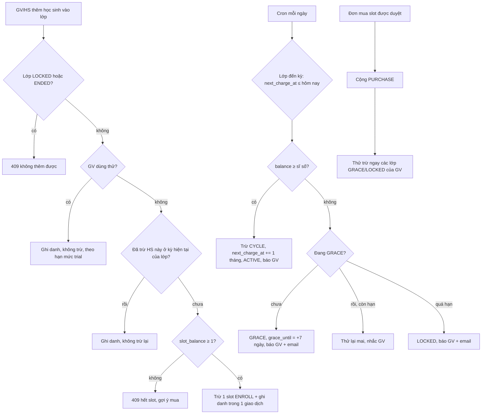

> Trạng thái: SPEC_APPROVED (2026-11-08) · DEC-042 → DEC-047 · TASK-052 → TASK-051

# FEAT-015: Ví slot học sinh-tháng

## 1. Tổng quan & mục tiêu nghiệp vụ
Đổi cách tính slot từ "1 slot = 1 học sinh, dùng vĩnh viễn" (DEC-031) sang **1 slot = 1 học sinh × 1 tháng của một lớp**. Doanh thu đi theo thời gian học thật, nên bù được chi phí vận hành và AI phát sinh hằng tháng.

- Giáo viên có một **ví slot** (`users.slot_balance`). Mua slot qua đơn hàng (FEAT-013) sẽ cộng vào ví. Mọi lần cộng/trừ đều có dòng lịch sử trong `slot_ledger`.
- **Trừ trước:** học sinh vào lớp thì trừ ngay 1 slot cho kỳ hiện tại của lớp. Đến mỗi kỳ mới (ngày khai giảng + n tháng), hệ thống tự trừ đúng **sĩ số ngày đó** và báo giáo viên (thông báo + email).
- **Không đủ slot khi đến kỳ:** không trừ. Lớp vào **ân hạn 7 ngày**, mỗi ngày thử trừ lại và nhắc giáo viên. Quá hạn mà vẫn thiếu thì lớp **tạm khoá**. Mua đủ thì trừ ngay và mở lại lớp.
- Giáo viên dùng thử không bị trừ (vẫn theo hạn mức DEC-027). Xác minh xong **không tặng slot** (bỏ 250 slot của BR-T04). Muốn tặng thì admin cộng tay, có ghi lý do.
- Một đơn giá cho mỗi slot. Có trang công khai `/pricing` kèm máy tính "sĩ số × số tháng".
- **Ngoài phạm vi:** hạn mức chi phí AI. Sẽ quyết sau khi có số liệu từ báo cáo chi phí AI (TASK-050).

Ví dụ: lớp khai giảng 15/11, 30 học sinh. Thêm 30 học sinh thì trừ 30 slot. 15/12 sĩ số 28 thì trừ 28. 10/01 thêm 1 học sinh thì trừ 1. 15/01 sĩ số 29 thì trừ 29. Kết thúc lớp 20/02 thì không trừ kỳ 15/03.

## 2. Phân quyền
| Chức năng | ADMIN | TEACHER | STUDENT |
| :--- | :--- | :--- | :--- |
| Xem ví & lịch sử | mọi giáo viên | của mình | — |
| Cộng/trừ tay số dư (bắt buộc lý do) | ✓ | — | — |
| Đổi ngày khai giảng, kết thúc lớp | ✓ | lớp của mình | — |
| Xem trạng thái tính phí của lớp | ✓ | lớp của mình | thấy banner khi lớp ân hạn/khoá |
| `/pricing` | công khai | công khai | công khai |
| Chạy kỳ tính phí (`/api/cron/slot-billing`) | chỉ server với `CRON_SECRET` | — | — |

## 3. Luồng tương tác


## 4. Giao diện & 4 trạng thái UI
| SCR | Đường dẫn | Thay đổi |
| :--- | :--- | :--- |
| SCR-29 (sửa) | `/teacher/slots` | Thành **"Ví slot"**: số dư; dự báo lần trừ tới của từng lớp (ngày, sĩ số, số slot); cảnh báo "không đủ cho kỳ tới"; lịch sử `slot_ledger` (lọc theo lớp, phân trang); nút mua slot (giữ luồng đơn hàng). |
| SCR-21 (sửa) | `/teacher/classes/[classId]` | Tab cài đặt: "Ngày khai giảng" (sửa được tới trước lần trừ CYCLE đầu tiên), nút "Kết thúc lớp" (xác nhận, không hoàn tác). Banner vàng khi GRACE ("còn N ngày"), đỏ khi LOCKED, kèm nút "Mua slot". |
| SCR-44 (sửa) | `/admin/teachers/[id]` | Khối "Ví slot": số dư, lịch sử, form cộng/trừ tay (số nguyên ≠ 0, lý do bắt buộc ≤ 500 ký tự). Bỏ ô sửa `slot_limit`. |
| SCR-11 (sửa) | `/student/class/[classId]` | LOCKED: banner "Lớp đang tạm khoá, liên hệ giáo viên"; nút làm bài/nộp bị ẩn. GRACE: không đổi. |
| SCR-53 (mới) | `/pricing` | Công khai, Server Component: đơn giá/slot, giải thích "1 slot = 1 học sinh × 1 tháng", máy tính sĩ số × số tháng = số slot × đơn giá, FAQ ngắn (trừ khi nào, thiếu slot thì sao, không hoàn slot), nút "Đăng ký giáo viên". Link ở landing và footer. Đơn giá chưa cấu hình (0) → hiện "Liên hệ để nhận báo giá" + hotline. |

Mọi trang mới/sửa có đủ 4 trạng thái: đang tải / lỗi (thông điệp + thử lại) / rỗng (vd chưa có lịch sử) / có dữ liệu.

## 5. Tác động dữ liệu (migration 018 `docs/db-migration-018-slot-wallet.sql`, ensureSchema)
```sql
ALTER TABLE users   ADD COLUMN IF NOT EXISTS slot_balance INT NOT NULL DEFAULT 0;
ALTER TABLE classes ADD COLUMN IF NOT EXISTS start_date DATE;            -- điền = created_at::date khi NULL
ALTER TABLE classes ADD COLUMN IF NOT EXISTS ended_at TIMESTAMPTZ;
ALTER TABLE classes ADD COLUMN IF NOT EXISTS billing_status VARCHAR(10) NOT NULL DEFAULT 'ACTIVE'; -- ACTIVE|GRACE|LOCKED|ENDED
ALTER TABLE classes ADD COLUMN IF NOT EXISTS grace_until TIMESTAMPTZ;
ALTER TABLE classes ADD COLUMN IF NOT EXISTS next_charge_at DATE;        -- ngày bắt đầu kỳ chưa trừ kế tiếp
ALTER TABLE classes ADD COLUMN IF NOT EXISTS billing_period INT NOT NULL DEFAULT 0; -- số thứ tự kỳ hiện tại (0 = kỳ đầu)

CREATE TABLE IF NOT EXISTS slot_ledger (
  id VARCHAR(50) PRIMARY KEY,
  teacher_id VARCHAR(50) NOT NULL,
  delta INT NOT NULL,                       -- + cộng, − trừ
  balance_after INT NOT NULL,
  reason VARCHAR(20) NOT NULL,              -- PURCHASE|ADMIN_ADJUST|ENROLL|CYCLE|MIGRATION
  class_id VARCHAR(50), student_id VARCHAR(50), order_id VARCHAR(50),
  period INT,                               -- kỳ của lớp mà dòng này trả cho
  student_count INT,                        -- CYCLE: sĩ số lúc trừ
  student_ids TEXT[],                       -- CYCLE: học sinh đã tính (để rời rồi vào lại cùng kỳ không trừ lại)
  note TEXT, created_by VARCHAR(50),
  created_at TIMESTAMPTZ NOT NULL DEFAULT NOW()
);
CREATE INDEX IF NOT EXISTS idx_slot_ledger_teacher ON slot_ledger (teacher_id, created_at DESC);
CREATE UNIQUE INDEX IF NOT EXISTS uq_slot_ledger_cycle  ON slot_ledger (class_id, period) WHERE reason = 'CYCLE';
CREATE UNIQUE INDEX IF NOT EXISTS uq_slot_ledger_enroll ON slot_ledger (class_id, student_id, period) WHERE reason = 'ENROLL';
CREATE UNIQUE INDEX IF NOT EXISTS uq_slot_ledger_order  ON slot_ledger (order_id) WHERE reason = 'PURCHASE';
```
- `users.slot_limit` giữ cột nhưng **không còn đọc** để chặn ghi danh (DEC-042). Không xoá để rollback được.
- **Chuyển dữ liệu** (`docs/db-migration-018b-slot-wallet-data.sql`, **chạy tay một lần** khi deploy, DEC-047):
  1. Giáo viên VERIFIED/NULL: `slot_balance = SUM(requested_slots)` các đơn `APPROVED`, ghi 1 dòng `MIGRATION`. Bỏ 250 slot tặng cũ.
  2. Lớp hiện có của các giáo viên đó: `start_date = ngày deploy`, `billing_period = 0`, `next_charge_at = start_date`. Lần chạy cron đầu tiên sẽ trừ kỳ 0 theo sĩ số; thiếu thì vào ân hạn.
  3. Gửi `SLOT_POLICY_CHANGED` (thông báo + email) cho mọi giáo viên VERIFIED.
  - Lớp của giáo viên TRIAL/REJECTED: `next_charge_at = NULL`, không tính phí cho tới khi được xác minh. Lúc xác minh thì đặt `start_date = ngày xác minh`, `next_charge_at = start_date`.

## 6. Hợp đồng API
| Method | Path | Quyền | Mô tả |
| :--- | :--- | :--- | :--- |
| GET | `/api/teacher/slot-wallet` | TEACHER | `{ balance, unit_price_vnd, classes: [{ id, name, billing_status, start_date, next_charge_at, grace_until, student_count, enough_for_next }], ledger: [...] }`; `?cursor=&class_id=` phân trang ledger (20 dòng) |
| PUT | `/api/teacher/classes/[classId]/billing` | TEACHER chủ lớp, ADMIN | `{ start_date }` (YYYY-MM-DD). Đã có dòng CYCLE của lớp → 409. Ngày quá 30 ngày trong quá khứ hoặc quá 90 ngày tới → 400 |
| POST | `/api/teacher/classes/[classId]/end` | TEACHER chủ lớp, ADMIN | `billing_status = ENDED`, `ended_at = NOW()`. Đã ENDED → 409 |
| GET | `/api/admin/teachers/[id]/slot-wallet` | ADMIN | như bản của giáo viên |
| POST | `/api/admin/teachers/[id]/slot-adjust` | ADMIN | `{ delta: int ≠ 0, |delta| ≤ 100000, note: 1–500 ký tự }`. Trừ làm số dư âm → 409. Cộng thì thử trừ ngay các lớp GRACE/LOCKED |
| POST | `/api/cron/slot-billing` | header `Authorization: Bearer <CRON_SECRET>` | Chạy `runBillingCycle(now)`, trả `{ charged, grace, locked, skipped }`. Sai/thiếu secret → 401. Chạy lặp an toàn (idempotent) |
| — | Sửa: mọi đường ghi danh (`/api/teacher/classes/[classId]/students`, `/api/student/enroll`, `/api/auth/register` kèm mã lớp, `/api/admin/users/[id]` `class_ids`, `/api/admin/create-user`) | | Gọi `chargeEnrollment` thay `assertStudentSlotAvailable`. Hết slot → 409 "Thầy cô không đủ slot…". Lớp LOCKED/ENDED → 409 "Lớp đang tạm khoá / đã kết thúc" |
| — | Sửa: nộp bài đề thi / bài học, `grade-async` | | Lớp LOCKED/ENDED → 403 `{ code: "CLASS_LOCKED" }`; `grade-async` của lớp LOCKED không gọi AI, để `NEEDS_REVIEW` |
| — | Sửa: `approveOrder` | | Cộng `slot_balance` + dòng `PURCHASE` (trong cùng giao dịch), thôi cộng `slot_limit`; sau COMMIT thử trừ các lớp GRACE/LOCKED |
| — | Bỏ: `slot_limit` trong `PUT /api/admin/teachers/[id]` | | Thay bằng `slot-adjust` |

Biến môi trường mới: `CRON_SECRET`. Worker (`worker/grading-worker.js`) gọi `/api/cron/slot-billing` mỗi giờ (idempotent nên gọi dày không sao; theo giờ để mở khoá sớm).

## 7. Quy tắc nghiệp vụ (BR-W) & máy trạng thái
- **BR-W01** 1 slot = 1 học sinh × 1 kỳ (1 tháng dương lịch tính từ `start_date`) của **một** lớp. Học sinh học 2 lớp của cùng giáo viên thì tốn 2 slot.
- **BR-W02** Học sinh vào lớp → trừ 1 slot `ENROLL` cho kỳ hiện tại (`period = billing_period`) **trong cùng giao dịch** với ghi danh. Học sinh đã trả kỳ đó (dòng ENROLL của mình, hoặc có trong `student_ids` của dòng CYCLE kỳ đó) — vd rời rồi vào lại — thì không trừ lại.
- **BR-W03** `slot_balance` không bao giờ âm. Mọi thay đổi số dư đi qua `lib/slot-wallet.ts`, khoá dòng `users` (`SELECT … FOR UPDATE`) và ghi `slot_ledger.balance_after`.
- **BR-W04** Kỳ mới đến khi `next_charge_at ≤ hôm nay (Asia/Ho_Chi_Minh)`. Số cần trừ = sĩ số enrollments của lớp **tại lúc trừ**. Đủ → trừ 1 dòng `CYCLE` (`student_count`), `billing_period += 1`, `next_charge_at += 1 tháng` (ngày 31 → ngày cuối tháng), `ACTIVE`, báo `SLOT_CHARGED`. Sĩ số 0 → không trừ nhưng vẫn sang kỳ.
- **BR-W05** Thiếu slot khi đến kỳ → không trừ, `GRACE`, `grace_until = NOW() + 7 ngày`, báo `SLOT_GRACE` (thông báo + email). Mỗi lần chạy cron thử lại. Quá `grace_until` → `LOCKED`, báo `CLASS_LOCKED`. Trong GRACE lớp chạy bình thường nhưng không thêm học sinh mới được nếu thiếu slot (BR-W02).
- **BR-W06** LOCKED: học sinh xem được bài và điểm cũ; không mở lượt làm bài/nộp mới (403 `CLASS_LOCKED`); không ghi danh mới; AI không chấm. Trừ đủ kỳ đang nợ → `ACTIVE` ngay (kỳ tính tiếp từ `next_charge_at` cũ, không dời ngày).
- **BR-W07** Cộng slot (`PURCHASE`, `ADMIN_ADJUST` dương) → sau COMMIT thử trừ ngay các lớp GRACE/LOCKED của giáo viên, theo `next_charge_at` cũ nhất trước.
- **BR-W08** Xoá học sinh khỏi lớp hay kết thúc lớp không hoàn slot. Lớp ENDED không bị trừ nữa, chỉ xem, không mở lại được.
- **BR-W09** Giáo viên TRIAL/REJECTED không bị trừ, `next_charge_at = NULL`. Xác minh → `start_date = hôm nay`, `next_charge_at = hôm nay` cho các lớp đang có (cron trừ kỳ 0). Không tặng slot (thay BR-T04 phần `slot_limit`).
- **BR-W10** Lớp có chủ là ADMIN không tính phí.
- **BR-W11** `start_date` chỉ đổi được khi lớp chưa có dòng `CYCLE`. Đổi thì `next_charge_at = start_date + (billing_period + 1) tháng`. Kỳ 0 coi như đã trả qua ENROLL.
  - *Lớp mới:* `start_date = hôm nay`, `billing_period = 0`, `next_charge_at = start_date + 1 tháng`. Học sinh vào kỳ 0 trả qua ENROLL.
  - *Lớp chuyển từ dữ liệu cũ hoặc vừa được xác minh:* `next_charge_at = start_date`, kỳ 0 trả qua CYCLE.
- **BR-W12** Mọi bước cron idempotent: trùng `(class_id, period)` CYCLE bị chỉ mục duy nhất chặn. Lỗi ở một lớp không dừng các lớp khác.
- **BR-W13** `/pricing` đọc `slot_pricing.unit_price_vnd`. Giá 0 → "Liên hệ báo giá".

```text
classes.billing_status  ACTIVE ─đến kỳ, thiếu slot─▶ GRACE ─quá 7 ngày─▶ LOCKED
                        GRACE | LOCKED ─trừ đủ (cron / mua / admin cộng)─▶ ACTIVE
                        ACTIVE | GRACE | LOCKED ─kết thúc lớp─▶ ENDED (cuối)
```

## 8. Test case (TC-W)
| TC | Ca | BR |
| :--- | :--- | :--- |
| TC-W01 | Thêm HS khi số dư 1 → trừ 1, ghi danh; số dư 0 → 409, không ghi danh, không có dòng ledger | W02, W03 |
| TC-W02 | Rời rồi vào lại cùng lớp trong cùng kỳ → không trừ lại; kỳ sau vào lại → trừ | W02 |
| TC-W03 | HS học 2 lớp của cùng GV → 2 slot | W01 |
| TC-W04 | Hai request ghi danh đồng thời khi số dư 1 → đúng 1 thành công, số dư 0 | W03 |
| TC-W05 | Cron đến kỳ, đủ slot → 1 dòng CYCLE, `billing_period` +1, `next_charge_at` +1 tháng; chạy lại cùng ngày → không trừ thêm | W04, W12 |
| TC-W06 | Khai giảng 31/01 → kỳ tới 28/02 (29/02 năm nhuận), rồi 31/03 | W04 |
| TC-W07 | Thiếu slot → GRACE + `grace_until` +7 ngày + thông báo; ngày 8 vẫn thiếu → LOCKED | W05 |
| TC-W08 | LOCKED: nộp đề/bài học → 403 CLASS_LOCKED; ghi danh → 409; grade-async không gọi AI; HS vẫn xem được điểm cũ | W06 |
| TC-W09 | Admin duyệt đơn → PURCHASE + số dư tăng; lớp LOCKED đủ slot → ACTIVE ngay; duyệt lần 2 → 409, không cộng thêm | W07 |
| TC-W10 | Xoá HS / kết thúc lớp → không hoàn; lớp ENDED không bị cron trừ, không ghi danh được | W08 |
| TC-W11 | GV TRIAL thêm HS → không trừ; xác minh → kỳ 0 được cron trừ theo sĩ số | W09 |
| TC-W12 | Admin trừ tay làm số dư âm → 409; thiếu note → 400; GV gọi slot-adjust → 403 | W03 |
| TC-W13 | Đổi `start_date` sau khi có CYCLE → 409; trước đó → `next_charge_at` tính lại đúng | W11 |
| TC-W14 | `/api/cron/slot-billing` không secret / sai secret → 401 | §6 |
| TC-W15 | Migration 018b: số dư = tổng đơn APPROVED, bỏ 250; lớp cũ `next_charge_at = ngày deploy`; chạy lần 2 không cộng trùng | DEC-047 |
| TC-W16 | `/pricing` hiện đơn giá; giá 0 → "Liên hệ báo giá"; máy tính 30 HS × 3 tháng = 90 slot | W13 |
| TC-W17 | Lớp chủ ADMIN không bị trừ ở cả ghi danh lẫn cron | W10 |

## 9. Task triển khai & DoD
| Task | Nội dung | Phụ thuộc | Độ khó | DoD |
| :--- | :--- | :--- | :--- | :--- |
| TASK-051 | Trang `/pricing` + link landing/footer | — | LOW | TC-W16 |
| TASK-052 | Migration 018 + 018b, `lib/slot-wallet.ts` (ledger, `chargeEnrollment`, `runBillingCycle`, `adjustBalance`, `retryOverdueClasses`), `approveOrder` cộng ví, cron route + worker gọi hằng giờ, đường ghi danh dùng `chargeEnrollment` | — (sau khi merge 048) | HIGH, nhạy cảm | TC-W01 → 07, 09, 11, 12, 14, 15, 17 |
| TASK-053 | Chặn lớp LOCKED/ENDED ở nộp bài/AI; API ví GV/admin, `billing`, `end`, `slot-adjust`; bỏ `slot_limit` ở PUT admin teacher | 052 | LOW, nhạy cảm | TC-W08, 10, 12, 13 |
| TASK-054 | UI: Ví slot GV, cài đặt & banner lớp, khối ví ở chi tiết GV admin, banner lớp khoá ở HS | 053, sau merge 049/050 | LOW | 4 trạng thái UI, `tests/*-ui` |

Lệnh xác minh: `npx vitest run && npx tsc --noEmit && npx next build`; `tests/docs-sync.test.ts` xanh.
